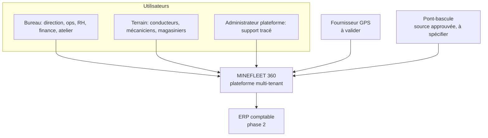
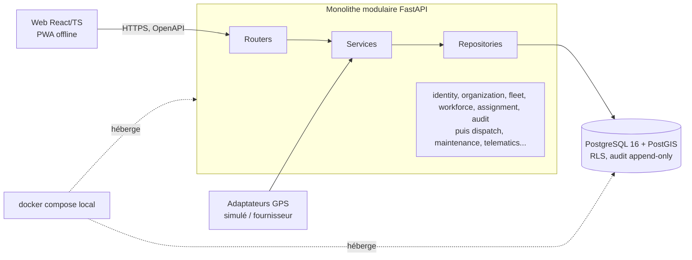

# Architecture — vue d'ensemble

> Statut : **Proposé** (phase 0). Ce document est volontairement court ; les décisions détaillées sont dans les ADR. Rien n'est encore implémenté.

## 1. Contexte système (C4 niveau 1)

## 2. Conteneurs (C4 niveau 2)

## 3. Décisions
| ADR | Sujet | Résumé |
|---|---|---|
| [ADR-001](adr/ADR-001-monolithe-modulaire.md) | Monolithe modulaire | Monorepo `backend/ frontend/ infra/ docs/`, couches router-service-repository, import-linter |
| [ADR-002](adr/ADR-002-multi-tenancy.md) | Multi-tenancy | Base/schéma partagés, `tenant_id`, FK composites, RLS via `app.current_tenant_id()` (`NULLIF`, 0 ligne sans contexte), tenant plateforme réservé, connexion par code d'espace + e-mail, rôle DB sans BYPASSRLS |
| [ADR-003](adr/ADR-003-authentification-sessions.md) | Authentification | JWT court + refresh rotatif en cookie httpOnly, argon2id, MFA ultérieure |
| [ADR-004](adr/ADR-004-stack-et-outillage.md) | Stack | Python 3.12 en Docker, FastAPI, SQLAlchemy 2, PostgreSQL 16/PostGIS, React/Vite, OpenAPI -> client TS |
| [ADR-005](adr/ADR-005-audit-et-evenements.md) | Audit | `audit_event` unique, append-only, partitionné par mois, même transaction ; chaînage de hash reporté (scellement asynchrone) ; outbox plus tard |
| [INTEGRATION_GPS_OFFLINE](INTEGRATION_GPS_OFFLINE.md) | GPS et offline | Port/adaptateur, ingestion idempotente, PWA avec file locale et idempotency keys (lot 4 pour la partie offline, D-14) |

## 4. Invariants transverses
- Toute lecture/écriture métier est tenant-scopée et autorisée (rôle + portée site) ; accès inter-tenant -> 404.
- UTC en base, fuseau d'affichage par site ; GNF entier ; UUID v4 (`gen_random_uuid()`).
- GPS n'est jamais une preuve de tonnage (H10).
- Toute mutation est auditée dans sa transaction.
- Contrat API = OpenAPI généré ; migrations Alembic uniquement.

## 5. Hors périmètre / non réalisé
Aucun code, test, déploiement ni provisionnement. Les décisions techniques D-01..D-24 sont tranchées et les défauts provisoires C-01..C-17 attendent le client ou le juriste : voir [`DECISIONS_A_ARBITRER.md`](DECISIONS_A_ARBITRER.md), qui prime en cas de divergence. Plan de livraison : [`PLAN_LOT1.md`](PLAN_LOT1.md) (tranches 1a, 1b, 1c).
