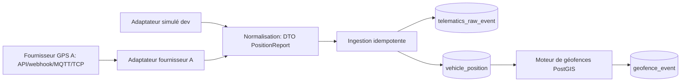
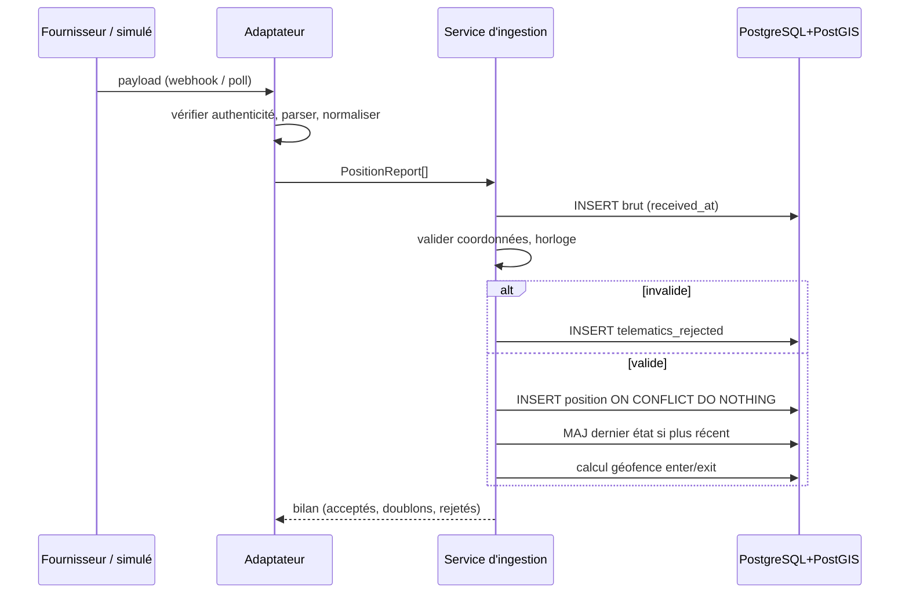
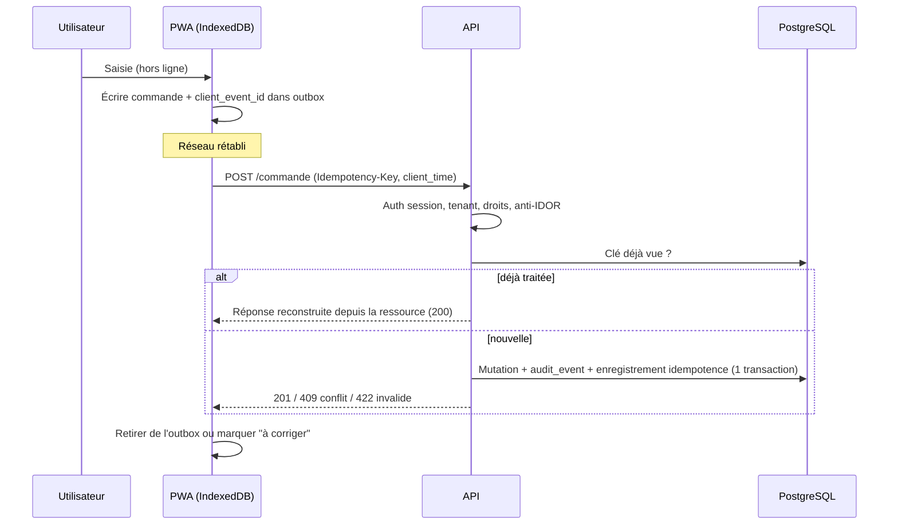
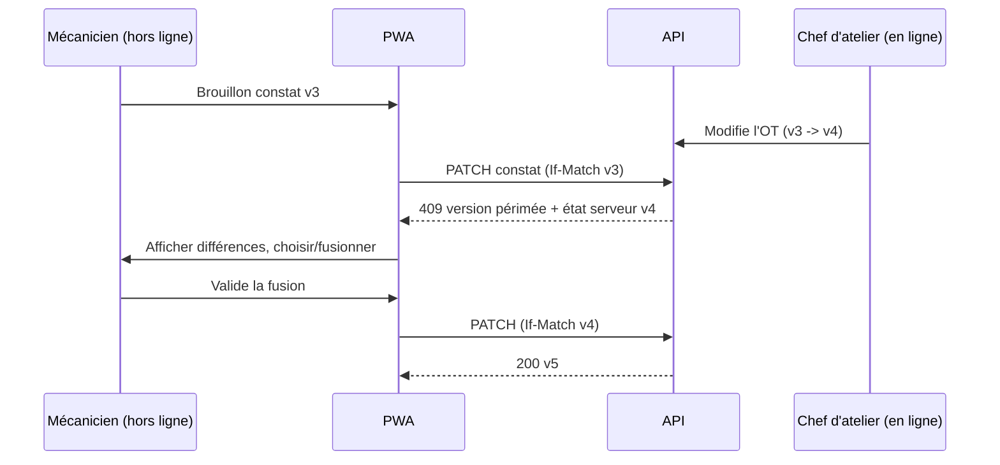

# Intégration GPS et mode hors ligne

> Statut : **Proposé** (cadrage). Aucun fournisseur GPS n'est choisi ; aucune performance, fréquence d'envoi ou précision n'est supposée : tout paramètre chiffré ci-dessous est un **paramètre configurable à fixer après essai terrain**.
> Références : `docs/00_SOCLE_CADRAGE.md` (H4, H9, H10), ADR-001, ADR-002, ADR-005, `docs/DECISIONS_A_ARBITRER.md` (D-01, D-14, D-16, D-19, C-12, C-14).
> **Périmètre de livraison** : la partie A (GPS) relève du **lot 5** (adaptateur simulé d'abord, fournisseur à valider : C-14) ; la partie B (hors ligne, `Idempotency-Key`, `idempotency_record`) relève du **lot 4** (D-14). **Rien de ce document n'est livré au lot 1** : il n'y a ni écran conducteur (C-12), ni idempotence générique, ni compteurs, ni GPS au lot 1 ; les doublons y sont empêchés par les contraintes d'unicité et d'exclusion. Les statuts cités (missions, affectations, relevés) suivent les codes anglais `UPPER_SNAKE_CASE` (D-01) du dictionnaire.

## 0. Principes non négociables
- **GPS ≠ preuve de tonnage (H10)** : la position, la vitesse et les événements GPS ne produisent jamais un tonnage « mesuré ». Le tonnage vient d'un pont-bascule ou d'une source approuvée ; le GPS sert au suivi, aux temps de cycle et au rapprochement.
- **Données de démonstration fictives (H9)** : l'adaptateur simulé génère des trajectoires synthétiques ; aucune trace réelle de salarié.
- **Vie privée** : base légale, information des salariés, finalités, limitation d'accès et rétention à valider avec un conseil juridique en Guinée avant production. Pas de suivi hors temps de travail.
- Toutes les données sont tenant-scopées (ADR-002) ; un appareil appartient à un seul tenant.

## 1. Partie A — Ingestion GPS

### 1.1 Architecture port / adaptateur

Port (module futur `telematics`, non créé au lot 1 en dehors du simulé) :
```python
class GpsProviderPort(Protocol):
    def parse(self, payload: bytes, headers: Mapping[str, str]) -> list[PositionReport]: ...
    def verify_authenticity(self, payload: bytes, headers: Mapping[str, str]) -> bool: ...
```
`PositionReport` normalisé : `device_id`, `seq` (si fourni), `device_time` (UTC), `lat`, `lon`, `speed?`, `heading?`, `accuracy?`, `ignition?`, `raw_ref`.
- Un adaptateur par fournisseur ; les formats propriétaires ne sortent jamais de l'adaptateur.
- **Adaptateur simulé** : génère des positions synthétiques le long d'itinéraires fictifs, avec options d'injection de défauts (doublons, retard, désordre, décalage d'horloge, coordonnées invalides, silence réseau) pour tester chaque scénario ci-dessous.
- Association appareil -> véhicule via table `gps_device` (tenant, `device_id` fournisseur, véhicule, période de validité) : un appareil réaffecté ne réécrit pas l'historique.
- Authentification de la source : secret par appareil/fournisseur, stocké hors dépôt, rotation possible ; payload non authentifié rejeté et compté.

### 1.2 Ingestion idempotente
- **Clé d'idempotence** : `(tenant_id, device_id, device_time, seq)` ; si le fournisseur ne fournit pas `seq`, utiliser `(tenant_id, device_id, device_time)` + hachage du contenu normalisé pour distinguer deux mesures différentes au même instant (à valider avec le fournisseur).
- Contrainte `UNIQUE` en base + `INSERT ... ON CONFLICT DO NOTHING` ; le doublon est compté (métrique) mais ne produit ni erreur ni événement.
- Traitement par lot : réponse partielle (acceptés / doublons / rejetés avec motif) pour que l'émetteur ne rejoue que le nécessaire.

### 1.3 Scénarios dégradés

| Scénario | Détection | Traitement | Résultat |
|---|---|---|---|
| Doublon (même clé) | Contrainte unique | Ignoré, compteur | Aucun effet |
| Événement en retard | `received_at - device_time` > seuil de retard | Stocké, flag `late`; recalcul des états/géofences concernés, pas d'alerte « temps réel » | Historique correct |
| Hors ordre | `device_time` < dernière position connue du même appareil | Inséré à sa place chronologique ; le « dernier état » n'est mis à jour que si `device_time` est le plus récent | Dernière position cohérente |
| Décalage d'horloge appareil | Écart `device_time` vs `received_at` hors tolérance configurable | Flag `clock_skew_suspect`; conserver les deux horodatages ; ne pas écraser `device_time` ; correction par offset appareil estimé seulement si validée | Traçable, non destructif |
| Horodatage futur | `device_time > received_at + tolérance` | Rejet vers quarantaine avec motif | Pas de pollution |
| Coordonnées invalides | lat hors [-90,90], lon hors [-180,180], NaN, (0,0) suspect, précision absente/excessive selon règle configurable | Rejet vers quarantaine (`telematics_rejected`), compteur, brut conservé | Aucune géofence calculée dessus |
| Saut de position improbable | Vitesse implicite entre deux points au-delà d'un seuil configurable | Flag `suspect_jump`, exclu des calculs de distance, conservé | Qualité des données |
| Perte de réseau (appareil) | Les trackers mettent en mémoire et renvoient en rafale | Traiter comme « en retard »; le silence d'un appareil au-delà d'un seuil produit un état `no_signal` (pas une position inventée) | Pas d'interpolation silencieuse |
| Perte de réseau (serveur) | Webhook en échec | Réessais côté fournisseur ou rattrapage par polling à partir du dernier curseur | Rattrapage idempotent |

### 1.4 Géofences PostGIS
- Stockage `geofence` (tenant, site, nom, type : site, chargement, déchargement, atelier, zone interdite ; `geometry(Polygon, 4326)` ; période de validité) avec index GiST. Calcul métrique via `geography` ou projection locale appropriée (à choisir après validation du système de coordonnées du site).
- Contrôle de validité à la création : `ST_IsValid`, surface non nulle, coordonnées dans le pays/site attendu.
- Entrée/sortie : `geofence_event(vehicle, geofence, type enter|exit, device_time, position_ref)` généré par comparaison avec l'état précédent ; **hystérésis/temps de présence minimal configurable** pour éviter le va-et-vient dû à l'imprécision GPS.
- Les événements d'entrée/sortie alimentent la rotation (temps de cycle) en tant que **signal**, jamais comme tonnage ; un chargement n'est « mesuré » que rapproché d'un ticket de pesée.
- Le recalcul après données tardives doit être idempotent (suppression/regénération des événements de la fenêtre concernée, tracé).

### 1.5 Stockage brut vs normalisé, rétention
| Couche | Contenu | Usage | Rétention |
|---|---|---|---|
| Brut (`telematics_raw_event`) | Payload fournisseur tel que reçu, `received_at`, source | Rejeu, enquête, preuve d'ingestion | Courte, à fixer (légal + besoin) |
| Normalisé (`vehicle_position`) | Position validée, horodatages device/réception, flags qualité | Cartes, géofences, rotations | Moyenne, à fixer ; partitionnement temporel |
| Agrégats (trajets, temps de cycle) | Dérivés | Reporting | Plus longue, données minimisées |
Les durées sont **à définir** avec le client et un conseil juridique local ; purge automatisée, tracée dans l'audit. Accès aux positions individuelles restreint par rôle/site et audité ; privilégier des vues agrégées pour la direction.

### 1.6 Séquence d'ingestion


## 2. Partie B — Mode hors ligne (PWA / mobile)

### 2.0 État d'implémentation

La première tranche du socle PWA est livrée par la PR #158 : manifeste installable, cache du shell et des ressources statiques,
indicateur de connectivité et avertissement explicite en cas de coupure. Le Service Worker exclut volontairement
`/api/` et toutes les mutations. Tant que l'application reste ouverte, les écrans déjà chargés restent visibles ;
un rechargement hors ligne ne restaure pas une session expirée et aucune écriture métier n'est encore mise en file.

La deuxième tranche introduit le socle d'idempotence serveur : migration `0039`, clé cloisonnée par tenant et
utilisateur, empreinte SHA-256 du contenu sans stockage du corps, réservation concurrente et référence de ressource
pour reconstruire le rejeu. La clé est finalisée dans la transaction de la mutation métier ; une même clé avec un
contenu différent est refusée. La durée de rétention est configurable entre une heure et trente jours (sept jours
par défaut) et doit être validée pendant le pilote en Guinée.

Cette fondation n'est pas encore branchée à une route métier et ne constitue donc pas une promesse de saisie hors
ligne. L'outbox IndexedDB, son cloisonnement local par tenant/utilisateur, la purge à la déconnexion et le premier
parcours append-only restent à livrer avant d'activer la synchronisation terrain.

### 2.1 Principes
- Priorité terrain : réseau faible/intermittent. Le client enregistre localement puis synchronise ; l'état affiché distingue clairement **« enregistré localement »** et **« synchronisé »**.
- Stockage : **IndexedDB** (file d'attente `outbox` + cache de référentiels) derrière une couche d'accès unique ; Service Worker pour les ressources statiques. Données locales minimales, **sans secret** ; effacées à la déconnexion ; chiffrement local à évaluer (limites des navigateurs).
- Chaque commande locale reçoit un `client_event_id` (UUID généré côté client) servant d'**idempotency key** (en-tête `Idempotency-Key`) ; le serveur mémorise l'**état** (`idempotency_record` créée au **lot 4**, D-14 : tenant, utilisateur, clé, hash de requête, état `IN_PROGRESS`/`COMPLETED`, type et identifiant de la ressource créée, expiration) et, pour un rejeu, reconstruit la réponse par lecture de la ressource sans réexécuter : aucun corps de réponse n'est stocké (données personnelles). Même clé avec contenu différent -> 422 avec code stable. Les créations de données maîtres restent interdites hors ligne.
- Horodatage : le client envoie `client_time` (informatif) ; le serveur enregistre `received_at` et conserve les deux ; l'heure légale de l'enregistrement est celle du serveur sauf entité où l'heure d'événement terrain est métier (ex. heure de panne), alors `occurred_at` client est conservé avec tolérance de décalage et flag si écart suspect.
- Authentification : file rejouée avec la session courante ; si la session a expiré, reconnexion avant rejeu (ADR-003). L'acteur est celui de la session, jamais un identifiant fourni par le payload.
- Rejeu ordonné par file (FIFO par entité) avec reprise exponentielle ; erreurs définitives (validation, droits) placées en « à corriger » visible par l'utilisateur, jamais supprimées silencieusement.

### 2.2 Ce qui est autorisé hors ligne ou non

| Action | Hors ligne | Justification |
|---|---|---|
| Consulter ses missions/affectations du jour, checklist (cache) | Oui (lecture) | Cache synchronisé à l'avance |
| Remplir une checklist de prise de poste | Oui | Création idempotente, lien véhicule/conducteur |
| Signaler une panne / anomalie (+ photo différée) | Oui | Urgence terrain ; photo envoyée à la reconnexion |
| Marquer l'événement de mission (départ, arrivée, début chargement) | Oui, avec `occurred_at` | Valeur métier de l'heure terrain |
| Saisie d'un tonnage | **Non comme mesure** : seulement note libre « déclaré » ; la mesure vient du pont-bascule (H10) | Pas de preuve GPS/déclaratif |
| Création/modification de véhicule, conducteur, permis | Non | Données maîtres, risque de conflit |
| Affectation conducteur-véhicule | Non | Contrôle d'éligibilité côté serveur |
| Attribution de rôles, actions d'administration | Non | Sécurité |
| Émission de carburant (valeurs, stock) | Non au lot concerné (à décider) | Contrôle de stock |
| Clôture/validation d'un ordre de travail par le chef d'atelier | Non | Validation hiérarchique |
| Constat du mécanicien (temps passé, notes) | Oui, en brouillon synchronisable | Atelier à connectivité faible |

### 2.3 Résolution de conflits par type d'entité

| Entité | Stratégie | Détail |
|---|---|---|
| Checklist / signalement (événements immuables) | Append-only, pas de conflit | Idempotency key ; doublon ignoré |
| Événement de mission (horodaté) | Journal d'événements ; transitions validées par machine d'états serveur | Transition invalide (ex. mission `CANCELLED` entre-temps) -> rejet « à corriger » avec motif, événement conservé comme non appliqué |
| Statut de mission (`PLANNED`, `ASSIGNED`, `EN_ROUTE_EMPTY`, `LOADING`, `EN_ROUTE_LOADED`, `UNLOADING`, `COMPLETED`, `CANCELLED`, `SUSPENDED`) | Serveur gagnant (dispatcher) | Le client reçoit l'état courant et la raison |
| Brouillon de constat mécanicien | Dernier écrit gagnant par champ, avec version (`row_version`, ETag faible `W/"<row_version>"`, `If-Match`, `409` si obsolète : D-19) ; conflit détecté -> fusion proposée à l'utilisateur | Pas d'écrasement silencieux |
| Données maîtres (véhicule, conducteur) | Non modifiables hors ligne | Pas de conflit possible |
| Ordre de travail | Optimistic concurrency (version) ; changements de statut serveur-gagnant | Rejet explicite en cas de version périmée |

### 2.4 Séquence de synchronisation


### 2.5 Séquence de conflit


## 3. Tests à prévoir (non exécutés)
- Simulateur : chaque scénario du tableau 1.3 avec assertion sur le résultat (doublon sans effet, tardif recalculé, invalide en quarantaine).
- Idempotence (lot 4) : même requête rejouée N fois -> un seul effet ; même clé + corps différent -> 422.
- Isolation tenant : appareil/clé d'un tenant A ne peut écrire pour B ; geofence de B invisible à A.
- Offline (Playwright, mode réseau coupé) : saisie hors ligne, reprise, rejeu après expiration de session, conflit 409.
- Aucun test n'a été écrit ni exécuté à ce stade.

## 4. Points à valider
- Fournisseur(s) GPS : protocole (webhook/API/MQTT), format, fréquence réelle, présence de `seq`, couverture réseau sur sites, coût. **Aucun fournisseur n'est retenu ni testé.**
- Seuils (retard, tolérance d'horloge, sauts, hystérésis) : à calibrer après essai terrain.
- Rétention brut/normalisé/agrégé, base légale, information et consentement des salariés (conseil juridique Guinée).
- Système de coordonnées et qualité des polygones de site (relevé).
- Intégration pont-bascule (format, ticket, horodatage) : spécification séparée, hors ce document.
- Capacités navigateur sur appareils terrain réels (IndexedDB, Service Worker, stockage persistant).
- Émission de carburant et autres actions hors ligne : arbitrage métier.
