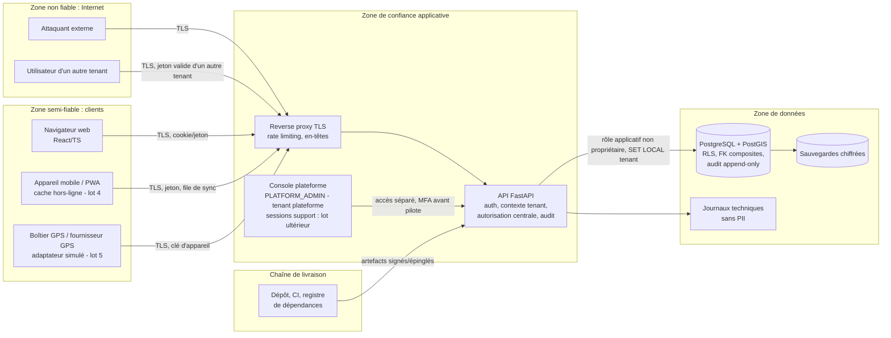

# Modèle de menaces et contrôles — MINEFLEET 360

> Statut : **cadrage (phase 0), révisé après revue croisée** le 2026-10-25. Aucun code n'existe : tous les contrôles ci-dessous sont **prévus**, aucun n'est implémenté ni testé. Les tests listés sont des **tests à écrire** ; rien n'a été exécuté.
> Préséance : `DECISIONS_A_ARBITRER.md` > `MODELE_PHYSIQUE_LOT1.md` > `MATRICE_RBAC.md` > ce document. Décisions appliquées ici : **D-05** (codes HTTP), **D-06/D-07** (connexion, tenant plateforme), **D-08** (RLS), **D-09** (YAML), **D-10** (RBAC), **D-13/D-14/D-16** (hors lot 1), **D-15** (minimisation), **D-17** (audit), **D-18** (référentiels), **D-21** (tranches), **D-22/D-23** (outillage, fuseaux).
> Références : `CLAUDE.md`, `PRODUCT_VISION.md`, `ROADMAP.md`, `00_SOCLE_CADRAGE.md` (H1-H10, rôles, entités).
> Distinction : **[Fait]** (documents du dépôt, décisions tranchées) · **[Proposé]** (conception) · **[À valider]** (client, juriste guinéen, fournisseur GPS).
> Les durées, seuils et algorithmes cités sont des **propositions de départ**, pas des exigences sourcées.

---

## 1. Périmètre et méthode
- Système : SaaS multi-tenant, multi-site, de flotte et transport minier ; monolithe modulaire FastAPI + React/TS ; PostgreSQL 16 + PostGIS ; pas de Redis ni de stockage objet au Lot 1 (H8).
- **Lot 1** (D-21) : modules `organization`, `identity`, `fleet`, `workforce`, `assignment`, `audit`, livrés en trois tranches : **1a** socle (dépôt, compose, CI locale, tenant/site, auth, rôles, audit, RLS) ; **1b** véhicules, conducteurs, permis, habilitations ; **1c** affectations, UI minimale, E2E.
- **Retiré du lot 1 (« lot ultérieur », LU)** — D-13, D-14, D-16 : exports ; accès support plateforme ; liaison compte↔conducteur et écran conducteur ; dérogation d'éligibilité ; chaînage de hash en ligne (remplacé par un **scellement asynchrone** ultérieur, lot 1.x) ; idempotence `Idempotency-Key` (lot 4) ; relevés de compteurs ; documents réglementaires véhicule. **Les menaces correspondantes restent au registre** ; leurs contrôles sont rattachés au lot cible.
- Méthode : **STRIDE** (S usurpation, T falsification, R répudiation, I divulgation d'information, D déni de service, E élévation de privilèges).
- Gravité (qualitative, sans chiffrage inventé) : **Critique** = compromission inter-tenant, de la plateforme ou de l'intégrité de l'audit ; **Haute** = fuite ou altération significative dans un tenant, ou contournement d'un contrôle majeur ; **Moyenne** = impact limité ou exploitation difficile ; **Faible** = gêne.
- Colonne **Lot** : `1a`, `1b`, `1c` (tranche où le contrôle est livré et testé) ; `LU` = lot ultérieur, avec lot cible si connu (offline : lot 4, D-14/C-12 ; GPS et pont-bascule : lot 5, C-14 ; planificateur : lot 2+, D-12) ; `Ops` = contrôle d'exploitation hors code, à mettre en place avant toute mise en production. Les anciennes étiquettes « L2/L3 » du cadrage sont remplacées par `LU`.

## 2. Actifs
| ID | Actif | Pourquoi il compte |
|----|-------|--------------------|
| A-01 | Données métier d'un tenant (véhicules, affectations, plus tard missions, tonnages, coûts) | Confidentialité commerciale ; fuite vers un concurrent. |
| A-02 | Dossiers du personnel (conducteurs : matricule, nom, téléphone, permis, habilitations) | Données personnelles ; obligations légales [À valider]. Pas de date de naissance ni d'aptitude médicale au lot 1 (D-15). |
| A-03 | Positions GPS et événements de géolocalisation des salariés (LU, lot 5) | Donnée personnelle sensible (suivi) ; risque juridique et de sécurité physique. |
| A-04 | Journal d'audit (`audit_event`) | Preuve de traçabilité ; sa falsification annule la confiance. |
| A-05 | Comptes, mots de passe (empreintes), sessions, jetons, secrets MFA | Prise de contrôle de comptes. |
| A-06 | Frontières de tenant (isolation) | Fondement du modèle commercial (H1-H3). |
| A-07 | Secrets de plateforme (clés de signature, accès base, clés d'appareils) | Compromission globale. |
| A-08 | Sauvegardes | Copie complète de tous les tenants. |
| A-09 | Chaîne de livraison (dépôt, CI, dépendances, images) | Injection de code malveillant. |
| A-10 | Disponibilité du service (dispatch en temps réel) | Arrêt d'exploitation minière. |
| A-11 | Intégrité des données de charge/tonnage (futur) | GPS ≠ preuve de tonnage (H10) ; fraude. |

## 3. Acteurs de menace
| ID | Acteur | Capacités typiques |
|----|--------|--------------------|
| X-01 | **Interne malveillant ou curieux** (salarié d'un tenant : dispatcher, admin de tenant, RH) | Compte légitime ; connaît l'application ; tente de voir/modifier au-delà de son rôle ou de son site. |
| X-02 | **Interne éditeur** (PLATFORM_ADMIN, exploitation, développeur) | Accès infrastructure, base, sauvegardes. Au lot 1, aucun accès applicatif aux données métier ni session de support : le risque restant est l'accès direct à la base. |
| X-03 | **Sous-traitant** (transporteur partenaire, prestataire de maintenance, fournisseur GPS) | Accès légitime restreint (LU) ; données du donneur d'ordre à protéger ; appareils/API tierces. |
| X-04 | **Tenant concurrent** | Compte légitime dans **un autre** tenant ; cible l'IDOR, l'énumération, les canaux auxiliaires (temps de réponse, messages d'erreur). |
| X-05 | **Attaquant externe** | Internet : bourrage d'identifiants, injection, scan, vol de session, supply chain. |
| X-06 | **Appareil perdu ou volé** (téléphone/tablette de conducteur, poste partagé en cabine ou en atelier) | Accès physique à un appareil déverrouillé ou non, avec cache hors-ligne et jetons (LU, lot 4). |

## 4. Frontières de confiance

Frontières à contrôler : (F1) Internet → edge ; (F2) client → API (**toute donnée client est non fiable**, y compris `tenant_id`, `driver_id`, horodatages d'appareil) ; (F3) API → base (le tenant courant est imposé par l'API et par la RLS) ; (F4) plateforme → tenant (au lot 1 : aucun chemin applicatif vers les données métier) ; (F5) appareil mobile → cache local (LU) ; (F6) CI → production.

---

## 5. Menaces numérotées

Colonnes : **STRIDE** · **Gravité** · **Contrôle** (catalogue §6) · **Lot** · **Vérification** (tests ST-xx du §8, ou contrôle Ops). Les codes HTTP de vérification suivent D-05 (voir §8.0).

### 5.1 Isolation inter-tenant, IDOR, références
| ID | STRIDE | Menace | Gravité | Contrôle | Lot | Vérification |
|----|--------|--------|---------|----------|-----|--------------|
| T-01 | I | **IDOR en lecture** : un utilisateur du tenant B appelle `GET /vehicles/{uuid}` (ou driver, assignment, site, user, audit event) avec l'identifiant d'un objet du tenant A (obtenu par fuite, journal, URL partagée). | Critique | C-01, C-02, C-03, C-05 | 1a (site, user, audit) / 1b / 1c | ST-12, ST-20, ST-30, ST-41, ST-51, ST-70 (404 identique à un identifiant inexistant) ; ST-03 (RLS). |
| T-02 | T | **IDOR en écriture** : `PATCH`/action (`deactivate`, `revoke`, `end`) sur un objet d'un autre tenant. | Critique | C-01, C-02, C-03, C-05 | 1a / 1b / 1c | ST-13, ST-20, ST-26, ST-31, ST-41, ST-51 (404 + base inchangée). |
| T-03 | T/I | **Référence inter-tenant par clé étrangère** : créer une affectation, un véhicule ou une habilitation qui référence `driver_id`, `vehicle_id`, `category_id`, `site_id` d'un autre tenant ; fuite par jointure ou corruption. | Critique | C-04, C-02, C-06 | 1a / 1b / 1c | ST-04 (introspection avec liste d'exceptions DBT-41), ST-22, ST-32, ST-50 (422 `REFERENCE_NOT_FOUND`) et insertion SQL directe refusée en base. |
| T-04 | I | **Fuite par liste, recherche, tri, comptage, pagination, agrégation** : `total`, facettes, `?site_id=`, `?q=` incluant d'autres tenants ou sites. La fuite par **export** est reportée avec les exports (LU, aucune route au lot 1). | Critique | C-02, C-03, C-31 | 1a / 1b / 1c ; exports LU | ST-14, ST-21, ST-34 ; ST-01 (aucune route d'export) ; LU : ST-35, ST-44, ST-57, ST-75. |
| T-05 | T | **Injection de `tenant_id` / champs privilégiés** dans le corps, la requête ou un en-tête (mass assignment) pour écrire dans un autre tenant ou changer `created_by`, `is_admin`. | Critique | C-01, C-06 | 1a / 1b / 1c | ST-10, ST-15, ST-25, ST-33, ST-58 (422). |
| T-06 | I/E | **Fuite de contexte tenant via le pool de connexions** (RLS pilotée par une variable de session non réinitialisée) ; rôle base propriétaire/superuser contournant la RLS ; requête sans contexte tenant retournant tout ou levant une erreur. | Critique | C-03 | 1a | ST-03 (alternance, concurrence, contexte absent = 0 ligne sans erreur), ST-05. |
| T-07 | I/E | **Contournement du cloisonnement par site** (rôle `SITE` lit/écrit un autre site du même tenant : URL directe, filtre, recherche, FK). | Haute | C-07, C-02 | 1a / 1b / 1c | ST-02 (généré), ST-36, ST-49, ST-50. |
| T-42 | I | **Sous-traitant ou tenant lié** accédant aux données du donneur d'ordre ou d'un autre sous-traitant (portail, comptes externes). | Haute | C-37, C-07 | LU | À définir à l'ouverture du lot concerné : tests de matrice contractuelle ; modèle d'accès distinct des rôles internes. |
| T-43 | I | **Canaux auxiliaires inter-tenant** : différence 403/404 exploitable, délai de réponse, message d'erreur, énumération de code d'espace ou d'e-mail à la connexion. | Moyenne | C-05, C-40 | 1a | ST-09, ST-60 (comparaison code, corps, en-têtes). La règle D-05 évalue le `403` avant la recherche de la ressource : aucune fuite d'existence. |
| T-49 | D | **Sondage massif d'UUID étrangers** saturant le journal d'audit ou les logs (404 cross-tenant audités un à un). | Moyenne | C-17, C-31 | 1a | ST-73c (les 404 cross-tenant ne créent pas d'audit tenant mais un log de sécurité plafonné), ST-08. |

### 5.2 Authentification, sessions, comptes
| ID | STRIDE | Menace | Gravité | Contrôle | Lot | Vérification |
|----|--------|--------|---------|----------|-----|--------------|
| T-13 | S | **Vol de session/jeton** : XSS, stockage en `localStorage`, jeton dans l'URL, journal ou cache ; rejeu d'un jeton volé. | Haute | C-10, C-15, C-38 | 1a | ST-62a/b, ST-63, ST-64, ST-80 (cookie HttpOnly/Secure/SameSite ou jeton en mémoire, CSP, réutilisation de refresh détectée). |
| T-14 | S | **CSRF** si authentification par cookie. | Haute | C-10 | 1a (conditionnel au choix cookie/jeton, §10.2) | ST-66. |
| T-15 | S | **Force brute et bourrage d'identifiants** sur `/auth/login`, réinitialisation (et MFA après le lot 1). | Haute | C-11, C-12, C-31, C-39 | 1a | ST-60, ST-61. |
| T-16 | I | **Énumération de comptes ou d'espaces** (login, reset, invitation) : code d'espace inconnu, e-mail inconnu et mot de passe faux doivent être indiscernables (D-06). | Moyenne | C-12, C-40 | 1a | ST-60, ST-65. |
| T-17 | S/E | **Abus des jetons de réinitialisation/invitation** (réutilisables, longs, devinables, non expirés, journalisés). | Haute | C-13, C-33 | 1a | ST-65. |
| T-11 | E | **Droits périmés** : rôle retiré, compte désactivé, tenant suspendu mais jeton encore valable. | Haute | C-10, C-07 | 1a | ST-63, ST-67, ST-68, ST-68b. |
| T-44 | E | **Jeton falsifié** (`alg: none`, claim `tenant_id`/`roles` modifié, mauvais audience, clé faible). | Critique | C-10, C-28 | 1a | ST-64. |
| T-50 | E | **Confusion avec le tenant plateforme** : création d'un tenant client portant le code réservé `mf-platform`, ou rôle `PLATFORM_ADMIN` attribué dans un tenant client. | Critique | C-08, C-03 | 1a | ST-22b, ST-89 ; FK `(role_code, scope_type)` et `(tenant_id, tenant_kind)` (ST-05). |

### 5.3 Autorisation et escalade
| ID | STRIDE | Menace | Gravité | Contrôle | Lot | Vérification |
|----|--------|--------|---------|----------|-----|--------------|
| T-08 | E | **Escalade verticale** : `TENANT_ADMIN` s'attribue des rôles, crée un `PLATFORM_ADMIN`, retire le dernier admin. (L'ancienne variante « auto-liaison à une fiche conducteur pour lire des données RH » disparaît : la liaison est LU et `user_account_id` n'est pas écrivable.) | Critique | C-08, C-07 | 1a ; liaison LU | ST-22, ST-23, ST-24, ST-25, ST-45b ; LU : ST-45. |
| T-09 | I/E | **Escalade horizontale** : un `DRIVER` lit ou modifie les données d'autres conducteurs. Au lot 1, `DRIVER` ne porte aucune permission métier (aucune liaison, aucun écran) ; les routes « moi » sont LU. | Haute | C-07, C-09 | 1b (absence de permission) ; routes « moi » LU (lot 4) | ST-02 (403 pour `DRIVER` sur toute route métier) ; LU : ST-37, ST-42, ST-54. |
| T-10 | E | **Contrôle d'accès uniquement dans l'UI** ou route sans permission déclarée (oubli lors d'un nouvel endpoint). | Haute | C-07 | 1a | ST-01 (inventaire des routes), ST-02 (matrice générée). |
| T-12 | E/I | **Abus interne éditeur** : au lot 1, `PLATFORM_ADMIN` n'a **aucune** permission métier et il n'existe **aucune session de support** (D-16) ; reste l'accès direct à la base par l'exploitation. | Critique | C-35, C-16 ; C-34 (session de support) LU | 1a (absence de chemin) + Ops ; support : avant pilote (C-10) | ST-28a (403 sur toutes les routes métier) ; LU : ST-28b (sessions de support). Ops : comptes nominatifs, MFA, revue périodique. |
| T-45 | E | **Contournement de l'éligibilité** (affecter un conducteur au permis/habilitation expiré). Au lot 1 la vérification est **stricte, sans dérogation** (D-13) ; une dérogation silencieuse ne doit pas apparaître « par défaut ». | Haute (sécurité des personnes) | C-36, C-17 ; dérogation motivée LU | 1c ; dérogation LU | ST-52 (422 pour tous les rôles, y compris `OPS_MANAGER` ; aucun champ ni permission de dérogation) ; LU : test de dérogation. |

### 5.4 Injection et validation
| ID | STRIDE | Menace | Gravité | Contrôle | Lot | Vérification |
|----|--------|--------|---------|----------|-----|--------------|
| T-18 | T/I | **Injection SQL** (tri/filtre dynamiques, `text()` concaténé, recherche libre). | Haute | C-14 | 1a (étendu à chaque tranche) | ST-39 + analyse statique (interdiction de SQL concaténé) en CI locale. |
| T-19 | T | **XSS stocké** (nom de site, notes, libellés), injection dans les journaux (retours à la ligne). L'**injection de formules CSV** n'est pertinente qu'avec les exports (LU). | Haute | C-15, C-33 | 1a ; formules CSV LU | ST-80 (CSP), test d'échappement des champs texte ; LU : neutralisation des cellules `= + - @`. |
| T-20 | I/T | **SSRF, traversée de chemin, fichier malveillant** (futur : webhooks fournisseur GPS, import CSV, scan de permis). | Haute | C-14, C-15 | LU (lots 2, 5) | À écrire à l'ouverture des imports/webhooks : liste blanche d'hôtes, validation de type/taille, stockage hors racine web. |

### 5.5 Audit et traçabilité
| ID | STRIDE | Menace | Gravité | Contrôle | Lot | Vérification |
|----|--------|--------|---------|----------|-----|--------------|
| T-21 | T | **Falsification/suppression du journal d'audit** (via l'API, le compte applicatif, un administrateur base, une restauration). Au lot 1 : droits `INSERT/SELECT` seuls, trigger anti `UPDATE/DELETE/TRUNCATE`, RLS, partitions inaccessibles. **Risque résiduel assumé** : une altération par un compte privilégié de la base n'est pas détectée cryptographiquement avant le scellement asynchrone. | Critique | C-16 (1a) ; C-41 scellement (LU, lot 1.x) | 1a ; scellement LU | ST-71, ST-79 ; LU : ST-72 (détection de falsification et de trou). |
| T-22 | R | **Action sans événement d'audit** (oubli, échec d'écriture silencieux, journal hors transaction). | Haute | C-17 | 1a (étendu à chaque tranche) | ST-73 (un jeu d'événements défini par **opération métier**) ; panne d'audit ⇒ mutation annulée. |
| T-23 | R | **Acteur non attribuable** (compte partagé, en-tête `X-User` falsifiable). La variante « session de support non identifiée » est LU. | Moyenne | C-18 ; `support_session_id` LU | 1a | ST-77 ; LU : ST-28b. |
| T-46 | I | **Données personnelles dupliquées dans l'audit** (valeurs avant/après de téléphone, permis). | Moyenne | C-16, C-33 | 1b | ST-74 (valeurs sentinelles absentes du journal). |

### 5.6 GPS, horloge, rejeu, mobile hors-ligne (LU : lots 4-5, socle prévu en lot 1)
| ID | STRIDE | Menace | Gravité | Contrôle | Lot | Vérification |
|----|--------|--------|---------|----------|-----|--------------|
| T-24 | S/T | **Falsification de positions** : faux appareil, jeton d'un autre tenant, coordonnées invalides ou aberrantes (téléportation). | Haute | C-19, C-21 | LU (lot 5) | ST-90, ST-93. |
| T-25 | T | **Rejeu** d'événements GPS (doublons, ancien lot rejoué) faussant temps de rotation ou géofences. | Moyenne | C-20 | LU (lots 4-5) | ST-91. |
| T-26 | T | **Horloge d'appareil fausse ou manipulée** (décalage, date future) : fausse chronologie, contournement de plage horaire de suivi. | Moyenne | C-21 | LU (lots 4-5) | ST-92. |
| T-27 | T | **Usage du GPS comme preuve de tonnage** (H10) ; falsification de charge. | Haute | C-22 | LU (lot 5) | ST-94 (aucun chemin d'écriture d'un tonnage mesuré depuis `telematics`). |
| T-28 | I | **Appareil mobile perdu/volé** : lecture du cache hors-ligne, jeton de rafraîchissement encore valide, file de sync rejouée par un tiers. | Haute | C-23, C-10 | LU (lot 4) | ST-97. |
| T-29 | T | **Actions hors-ligne falsifiées ou en conflit** (horodatages choisis par le client, doublons, écrasement). | Moyenne | C-23, C-20, C-21 | LU (lot 4) | ST-98. |

### 5.7 Données personnelles, géolocalisation, rétention
| ID | STRIDE | Menace | Gravité | Contrôle | Lot | Vérification |
|----|--------|--------|---------|----------|-----|--------------|
| T-30 | I | **Sur-exposition de données personnelles** par l'API (champs inutiles, journaux, réponses d'erreur, filtres permettant l'inférence). Au lot 1 : téléphone et n° de permis masqués **totalement** pour les non-`HR`, rien d'autre n'est collecté (D-15). | Haute | C-09, C-24 | 1b | ST-40, ST-43, ST-46, ST-48. |
| T-31 | I | **Surveillance excessive ou accès abusif aux positions** : suivi hors service, historique nominatif consultable par tout dispatcher, usage disciplinaire non prévu. | Haute (risque juridique et social) | C-25, C-24 | LU (lot 5) | ST-95 + revue juridique (§7). |
| T-32 | I | **Conservation excessive** de positions, dossiers RH, journaux (aucune purge ; données d'anciens salariés). Au lot 1 : colonnes `anonymized_at` prévues, **aucune purge en développement** (C-09), durées à fixer par le juriste. | Moyenne/Haute | C-26 | 1b (modèle) ; jobs de purge LU | ST-96 (LU). |
| T-33 | R | **Droits d'accès/rectification/effacement inexécutables** (données dispersées, audit non pseudonymisable). | Moyenne | C-27 | LU (export du dossier et journal d'accès : hors lot 1, D-16) | ST-76 (LU) ; procédure Ops testée sur données fictives. |
| T-47 | I | **Données de démonstration réelles** ou positions réelles de salariés utilisées en démo. | Haute | C-29 | 1a | ST-84 (seed refusé en production ; revue des jeux de données ; H9). |

### 5.8 Secrets, configuration, sauvegardes, exploitation
| ID | STRIDE | Menace | Gravité | Contrôle | Lot | Vérification |
|----|--------|--------|---------|----------|-----|--------------|
| T-34 | I | **Secrets dans le dépôt/images/logs** (mots de passe base, clé de signature, `.env`). | Haute | C-28, C-33 | 1a | ST-81 (scan de secrets en CI locale et pré-commit), revue de l'historique avant premier push. |
| T-35 | E/I | **Configuration non sûre par défaut** : debug actif, CORS `*`, documentation d'API publique en production, comptes de seed, secrets par défaut. | Haute | C-29 | 1a | ST-80, ST-81, ST-84 (l'application refuse de démarrer en mode production avec une configuration dangereuse). |
| T-36 | I/T | **Sauvegardes** non chiffrées, accessibles trop largement, jamais restaurées en test, contenant des données censées être supprimées, restauration mélangeant des tenants. | Haute | C-30 | Ops (avant production) | ST-86 (exercice de restauration documenté ; suite d'isolation rejouée sur la base restaurée). |
| T-44b | E | **Opération destructive ou accès direct à la base de production** (migration irréversible, requête manuelle). | Haute | C-35 | Ops + 1a | Contrôle de processus : approbation explicite (CLAUDE.md), migrations Alembic revues, comptes nominatifs ; ST-83 en CI locale. |
| T-48 | T/I | **Transport non protégé** (TLS absent ou faible, pas de HSTS, trafic GPS en clair). | Haute | C-38 | 1a / Ops | ST-80 (en-têtes) ; vérification de configuration TLS en préproduction. |

### 5.9 Déni de service, dépendances, journalisation
| ID | STRIDE | Menace | Gravité | Contrôle | Lot | Vérification |
|----|--------|--------|---------|----------|-----|--------------|
| T-37 | D | **DoS applicatif** : listes sans limite, requêtes coûteuses, corps volumineux. (Exports massifs : LU ; ingestion GPS en rafale : LU.) | Moyenne/Haute | C-31 | 1a | ST-07, ST-08, ST-85. |
| T-38 | D | **Locataire bruyant** : un tenant épuise les ressources des autres. Sans Redis (H8), la limitation du lot 1 est **par processus** : elle ne garantit pas l'équité entre processus multiples (limite documentée, QA-32). | Moyenne | C-31 | 1a | ST-08 (garantie testée : par processus). |
| T-39 | T | **Supply chain** : dépendance vulnérable ou malveillante, image de base non épinglée, workflow CI avec droits excessifs, paquet typosquatté. | Haute | C-32 | 1a | ST-82 (audit de dépendances, lockfiles, revue de toute nouvelle dépendance, D-22). |
| T-40 | I | **Journaux techniques avec PII/secrets/jetons** (corps de requête, en-têtes `Authorization`, n° de permis, téléphone). | Moyenne/Haute | C-33 | 1a / 1b | ST-48, ST-74 (valeurs sentinelles absentes de tous les logs de la suite de tests). |
| T-41 | T | **Conditions de concurrence** : deux affectations simultanées du même véhicule/conducteur ; double soumission ; mise à jour sur `row_version` obsolète. L'idempotence par clé est LU (lot 4, D-14) : au lot 1 les doublons sont arrêtés par unicité et exclusion. | Moyenne | C-36, C-42 | 1a (`If-Match`) / 1c | ST-53, ST-56, ST-87. |

---

## 6. Catalogue des contrôles
Colonne **Lot** : tranche de livraison ou LU.

| ID | Lot | Contrôle prévu | Détail / exigence |
|----|-----|----------------|-------------------|
| C-01 | 1a | **Contexte tenant issu de la session** | `tenant_id` extrait du jeton validé, exposé par une dépendance FastAPI unique ; jamais lu depuis le corps, l'URL ou un en-tête. |
| C-02 | 1a | **Accès aux données par dépôts tenant-scoped** | Les routes n'utilisent pas de session SQLAlchemy brute ; tout accès passe par des dépôts imposant `tenant_id` (et le filtre de site). Test d'architecture/lint interdisant les requêtes sur tables métier hors dépôts. |
| C-03 | 1a | **RLS PostgreSQL en défense en profondeur (H1, D-08)** | RLS activée **et forcée** sur toute table métier **et sur chaque partition** créée (DB-25) ; rôle applicatif `mf_app` non propriétaire, sans `BYPASSRLS` ni superuser ; politique `tenant_id = app.current_tenant_id()` avec `app.current_tenant_id()` = `NULLIF(current_setting('app.tenant_id', true), '')::uuid` ⇒ **0 ligne et jamais d'erreur** sans contexte, y compris sur connexion de pool réutilisée ; `SET LOCAL` (`set_config(..., true)`) à chaque transaction ; `mf_owner` visé par aucune politique (fail-closed) ; seul le provisioning de tenant, auditée, fixe un autre contexte. Tables globales (`role`, `role_allowed_scope`, `license_category_ref`) : `SELECT` seul. |
| C-04 | 1a | **UUID et FK composites (H2, H3, D-20)** | Aucun identifiant séquentiel exposé ; UUID v4 (`gen_random_uuid()`) ; FK `(tenant_id, id)` entre tables métier, hors exceptions listées (colonnes d'acteur : `granted_by`, `revoked_by`, `approved_by`, `verified_by`, `recorded_by`, `actor_user_id` ; `created_by`/`updated_by` sans FK). |
| C-05 | 1a | **Réponse uniforme hors portée (D-05)** | Table de décision ordonnée (`MATRICE_RBAC.md` §1.1.6) : 401 → 403 (aucune affectation portant la permission, avant toute recherche de ressource) → 404 identique (inexistante, autre tenant, hors site, règle d'objet) → 422 → 409 → 429. Corps et en-têtes identiques à « UUID inexistant ». |
| C-06 | 1a | **Schémas stricts** | Pydantic `extra="forbid"` (champ inconnu ou `tenant_id` ⇒ **422**), DTO d'entrée/sortie séparés, champs privilégiés non écrivables. |
| C-07 | 1a | **Moteur d'autorisation central, deny-by-default** | Permission déclarée par route (`x-permission`), évaluée côté serveur selon `authz_matrix.yaml` (`MATRICE_RBAC.md` §7) : rôle, portée (union des affectations), règle d'objet. Matrice YAML comme source des tests. |
| C-08 | 1a | **Garde-fous anti-escalade** | Règles de `MATRICE_RBAC.md` §4.2 : pas d'auto-modification (422 `SELF_ROLE_CHANGE_FORBIDDEN`), `PLATFORM_ADMIN` non attribuable (422 `ROLE_NOT_ASSIGNABLE`, FK `role_allowed_scope` + `tenant_kind`), dernier admin protégé (409 `LAST_TENANT_ADMIN`), audit à criticité élevée sur rôles sensibles. |
| C-09 | 1b | **Sérialisation par permission / masquage de champs (D-15)** | Téléphone et n° de permis : **clé absente** de la réponse pour tout rôle autre que `HR` ; pas de masquage partiel ; filtre/tri/recherche sur un champ masqué ⇒ 422 `FIELD_NOT_ALLOWED` ; jamais masqué côté UI seulement. |
| C-10 | 1a | **Sessions et jetons** | Jeton d'accès court, jeton de rafraîchissement rotatif avec détection de réutilisation et période de grâce paramétrée (ADR-003), révocation vérifiée en base via `auth_session.revoked_at` (pas de « version de jeton », DB-33), cookies `HttpOnly; Secure; SameSite` ou jeton en mémoire, CSP stricte, protection CSRF si cookie. Durées [Proposé : accès 10-15 min]. Adresse IP et agent utilisateur portés par `auth_session`. |
| C-11 | 1a (MFA : après lot 1) | **Mots de passe et MFA** | Empreintes Argon2id [Proposé], longueur minimale, refus des mots de passe courants (liste locale). MFA TOTP pour `PLATFORM_ADMIN`, `TENANT_ADMIN`, `HR`, `FINANCE` : livré **après** le lot 1, avant pilote (C-03 des décisions). |
| C-12 | 1a | **Anti-bourrage / force brute** | Limitation par IP et par triplet (code d'espace, e-mail, IP), délais progressifs, verrouillage temporaire (`locked_until`), réponses et délais uniformes, y compris pour des identifiants inexistants ; alerte sur échecs répétés. |
| C-13 | 1a | **Jetons de reset/invitation** | Table `account_token` : usage unique, courte durée, 256 bits aléatoires, stockés hachés (SHA-256), invalidés au changement de mot de passe, jamais journalisés. |
| C-14 | 1a | **Anti-injection SQL/entrées** | Requêtes paramétrées, liste blanche de colonnes de tri/filtre (hors champ → 422 `SORT_FIELD_INVALID`), validation Pydantic, interdiction du SQL concaténé (lint/CI). |
| C-15 | 1a | **Sortie sûre** | Échappement par défaut (React), CSP ; neutralisation des formules CSV et validation de type/taille des fichiers : avec les exports et imports (LU). |
| C-16 | 1a | **Journal d'audit append-only (D-17)** | Table `audit_event` unique, **partitionnée par mois dès la migration 0001**, `mf_app` = `INSERT`/`SELECT` seuls, trigger anti `UPDATE/DELETE/TRUNCATE` (`MF001`), RLS, aucun droit sur les partitions ; pas de valeurs sensibles en clair (`changed_fields` = noms seulement) ; **pas de chaînage en ligne** ; colonnes `prev_hash`/`row_hash` nullables réservées. |
| C-17 | 1a | **Audit transactionnel et politique de refus** | Événement écrit dans la même transaction que l'action ; échec = annulation. **Politique** : toute mutation réussie est auditée ; **tout `403` est audité** (`outcome = DENIED`) ; les `404` « autre tenant » ne sont **pas** audités dans le tenant mais comptés par métrique et journalisés (log de sécurité plafonné) ; « exactement N événements » s'entend **par opération métier identifiée** (les flux d'authentification en produisent plusieurs). |
| C-18 | 1a | **Identité d'acteur** | Comptes nominatifs, pas de compte partagé, `request_id`, IP et agent (UTC, H4). `support_session_id` : colonne réservée, utilisée avec les sessions de support (LU). |
| C-19 | LU (lot 5) | **Authentification des appareils GPS** | Secret/clé par appareil lié à un tenant et un véhicule, TLS, signature ou HMAC des lots ; rotation ; l'appareil ne peut écrire que pour son véhicule. |
| C-20 | LU (lot 4) | **Idempotence et anti-rejeu** | `Idempotency-Key` / `idempotency_record`, `event_id` unique par appareil, numéro de séquence, fenêtre acceptée, déduplication (D-14). Au lot 1 : contraintes d'unicité et d'exclusion seulement. |
| C-21 | LU (lots 4-5) | **Double horodatage et tolérance d'horloge** | `device_time` et `server_received_at` stockés (UTC) ; dérive au-delà d'un seuil configurable → événement marqué/quarantaine ; l'heure d'appareil n'est jamais utilisée pour l'audit ni les droits. **Horloge injectable** dans le code dès le lot 1 (D-12). |
| C-22 | LU (lot 5) | **Pas de tonnage déduit du GPS (H10)** | Donnée de charge portant un `source_type` obligatoire ; seules les sources « pont-bascule/approuvée » peuvent produire une charge mesurée. |
| C-23 | LU (lot 4) | **Mobile / hors-ligne** | Cache minimal (aucun champ RH sensible), expiration (TTL), chiffrement quand la plateforme le permet [limites à documenter], verrouillage appareil exigé, effacement à la déconnexion et à la révocation, jeton lié à l'appareil, actions de la file revalidées côté serveur. |
| C-24 | 1b | **Minimisation (D-15)** | Finalités documentées par donnée ; **pas de date de naissance, d'adresse, de pièce d'identité, d'aptitude médicale ni de motif maladie au lot 1** (motifs d'indisponibilité : `LEAVE`, `TRAINING`, `OTHER`) ; ajout = migration conditionnée à l'avis du juriste. |
| C-25 | LU (lot 5) | **Encadrement de la géolocalisation des salariés** | Suivi uniquement pendant les horaires de service, temps réel limité au site, historique nominatif consultable sur motif et tracé, agrégation par défaut, information préalable des salariés (§7). |
| C-26 | 1b (modèle) / LU (jobs) | **Rétention et purge** | Durées par catégorie (§9), colonnes d'anonymisation prévues ; aucune purge en développement ; jobs de purge/anonymisation testés plus tard ; suspension possible en cas de procédure. |
| C-27 | LU | **Droits des personnes** | Export du dossier d'un salarié (hors lot 1), journal d'accès à ses données, procédure d'effacement/anonymisation (l'audit est pseudonymisé plutôt que supprimé) [modalités à valider]. |
| C-28 | 1a | **Gestion des secrets** | Aucun secret dans le dépôt ; variables d'environnement ou gestionnaire de secrets ; secrets distincts par environnement ; rotation ; scan de secrets (pré-commit + CI locale). |
| C-29 | 1a | **Configuration sûre par défaut** | Refus de démarrer en production avec debug, secret par défaut ou seed ; CORS en liste blanche ; documentation d'API restreinte ; seed = script d'exploitation refusant `ENV=production`, exécuté avec le rôle applicatif ; données de démo fictives uniquement (H9). |
| C-30 | Ops | **Sauvegardes** | Chiffrées, accès restreint et journalisé, copie hors site, restauration testée périodiquement, durée alignée avec la politique d'effacement. |
| C-31 | 1a | **Limitation de débit et de charge** | Limites par IP, compte, tenant et route ; mécanisme du lot 1 **par processus** (pas de Redis, H8), limite documentée ; pagination bornée (`limit` > maximum ⇒ 422) ; plafond de taille de corps ; délais d'expiration SQL. Exports bornés/asynchrones : LU. |
| C-32 | 1a | **Sécurité de la chaîne de livraison** | Lockfiles, audit de dépendances (Python et JS), mises à jour surveillées, SBOM, images épinglées, permissions CI minimales, revue de toute nouvelle dépendance (D-22). La CI distante est écrite mais non exécutée (D-24, C-17). |
| C-33 | 1a | **Journalisation sans PII** | Logs structurés avec `request_id`, filtres de rédaction (en-têtes d'autorisation, champs sensibles), liste noire de champs, accès aux logs restreint, rétention limitée. |
| C-34 | LU (avant pilote) | **Accès support plateforme** | Sessions justifiées, approuvées par le tenant, limitées en durée, lecture seule par défaut, visibles du tenant (`MATRICE_RBAC.md` §4.1). Hors lot 1 (D-16, C-10). |
| C-35 | Ops | **Contrôles d'exploitation** | Aucun accès direct à la base de production hors procédure ; comptes nominatifs + MFA ; migrations Alembic revues ; pas de migration destructive ni de déploiement sans approbation explicite. |
| C-36 | 1c (dérogation LU) | **Intégrité des affectations** | Contrainte d'exclusion `gist` sur `[valid_from, valid_to)` hors `CANCELLED` (véhicule et conducteur), `CHECK (valid_to > valid_from)`, vérification serveur d'éligibilité **sans dérogation**, même site obligatoire, pas d'antidatage au-delà d'une tolérance (D-04, D-13), refus des changements d'état tant qu'une affectation est ouverte (D-11, 409). Dérogation motivée, auditée et notifiée : lot ultérieur. |
| C-37 | LU | **Isolation des tiers** | Comptes externes séparés, accès contractualisé et limité par objet. |
| C-38 | 1a / Ops | **Transport** | TLS 1.2+ partout, HSTS, certificats gérés. |
| C-39 | 1a (alertes : LU) | **Détection** | Événements structurés pour échecs d'authentification massifs, refus répétés, tentatives d'accès inter-tenant, attributions de rôles sensibles. Alerte/notification automatisée : LU. |
| C-40 | 1a | **Anti-énumération (D-06)** | Code d'espace inconnu, e-mail inconnu, mot de passe faux, compte désactivé, tenant suspendu ⇒ **un seul** `401` `INVALID_CREDENTIALS`, mêmes corps/en-têtes, hachage factice pour un compte inconnu ; reset identique pour e-mail connu ou inconnu ; résolution du tenant par code exact (`app.login_tenant_code`) sans `BYPASSRLS` ; tenant plateforme réservé (`mf-platform`, code refusé à la création d'un tenant client). |
| C-41 | LU (lot 1.x) | **Scellement asynchrone de l'audit** | Tâche hors chemin d'écriture hachant des lots ordonnés par séquence (table `audit_seal`), ancrage externe périodique [À arbitrer : coût/hébergement] ; vérification d'intégrité (`audit.integrity.verify`). Remplace le chaînage en ligne (D-16, DB-20). |
| C-42 | 1a | **Concurrence optimiste (D-19)** | `row_version` géré par trigger ; `If-Match`/ETag obligatoire sur toute mise à jour : absent ⇒ 422 `IF_MATCH_REQUIRED`, obsolète ⇒ 409 `ROW_VERSION_STALE`. |

---

## 7. Conformité — points à valider avec un juriste guinéen
> **Aucune référence d'article ou de numéro de loi n'est citée ici** : je ne peux pas les vérifier. Tout ce qui suit est **[À confirmer]** par un conseil juridique local avant toute mise en production (CLAUDE.md : « Validate Guinea-specific compliance requirements with local legal counsel »).

1. **Cadre applicable** : existence, statut et contenu de la loi guinéenne sur la protection des données à caractère personnel ; existence et pouvoirs de l'autorité de contrôle ; textes sur les communications électroniques/cybersécurité pouvant s'appliquer. [À confirmer]
2. **Formalités préalables** : déclaration ou autorisation préalable de traitement (notamment pour la géolocalisation et les données RH) ; registre des traitements. [À confirmer]
3. **Rôles juridiques** : le tenant (exploitant minier/transporteur) est-il responsable de traitement et l'éditeur sous-traitant ? Contrat de sous-traitance, clauses de sécurité, notification des violations de données (délais, destinataires). [À confirmer]
4. **Bases légales et consentement** : base du traitement des dossiers conducteurs et de la géolocalisation (exécution du contrat de travail, obligation légale, intérêt légitime, consentement) ; validité d'un consentement donné par un salarié dans un rapport de subordination. [À confirmer]
5. **Surveillance des salariés** : licéité et proportionnalité du suivi GPS des véhicules/conducteurs ; limitation aux heures de service ; interdiction ou encadrement du suivi en dehors du temps de travail ; usage à des fins disciplinaires ; consultation des représentants du personnel ; règlement intérieur ; durée de conservation des traces. [À confirmer]
6. **Information des personnes** : contenu et forme de l'information préalable (finalités, destinataires, durées, droits) ; affichage sur site et dans l'application ; langue (français, éventuellement langues locales). [À confirmer]
7. **Droits des personnes** : accès, rectification, opposition, effacement, limitation ; délais de réponse ; modalités de preuve d'identité ; conciliation avec l'obligation de conserver l'audit. [À confirmer]
8. **Durées de conservation** : durée légale/recommandée pour dossiers RH, permis, positions GPS, journaux d'accès, journaux d'audit. Les valeurs du §9 sont des **hypothèses de travail** (C-09 des décisions : aucune purge en développement). [À confirmer]
9. **Transfert hors de Guinée** : selon l'hébergement retenu (cloud étranger, région, prestataires de support, sauvegardes hors territoire) : conditions, autorisations, garanties, localisation obligatoire éventuelle pour certaines données ; implication pour les sauvegardes et l'accès support depuis l'étranger. [À confirmer ; dépend de la décision d'hébergement C-01, développement local uniquement]
10. **Données sensibles** : santé (aptitude médicale), biométrie, situation judiciaire, syndicale : **non collectées au lot 1** (D-15) ; régime spécial éventuel avant tout ajout. [À confirmer]
11. **Secrets d'affaires et données du secteur minier** : obligations de confidentialité contractuelles ou sectorielles, accès des autorités, réquisitions et procédure de réponse. [À confirmer]
12. **Obligations d'hygiène, sécurité et santé au travail** liées aux habilitations et au permis de conduire (conservation, preuves). [À confirmer]
13. **Mobile et appareils personnels** : usage d'appareils personnels (BYOD) par les conducteurs, effacement à distance, vie privée de l'appareil. [À confirmer]
14. **Catégories de permis guinéens** et exigences pour engins hors route (C-07) : valeurs du lot 1 fictives, marquées « à valider localement ». [À confirmer]

## 8. Plan de tests de sécurité — Lot 1

> **Aucun de ces tests n'existe ni n'a été exécuté.** Cibles : pytest (API et base), intégration avec PostgreSQL/PostGIS réel en service Docker (D-22) pour RLS, contraintes, droits ; Playwright/Vitest pour la partie web ; scan de secrets et audit de dépendances en CI **locale** d'abord (D-24).
> Les chemins d'endpoints sont **attendus** (préfixe `/api/v1` omis) et seront ajustés au contrat OpenAPI définitif et à `authz_matrix.yaml`. Les révocations sont des actions `POST .../revoke` (pas de `DELETE`, D-19).
> **Tests générés** : ST-01, ST-02, ST-06 et les cas d'isolation et de masquage marqués « généré » sont produits depuis `authz_matrix.yaml` (`MATRICE_RBAC.md` §7.2) ; leur oracle ne provient jamais du code applicatif.

### 8.0 Convention d'oracle (D-05) et tranches (D-21)
- **Un cas = une réponse attendue unique.** Les alternatives « 404/403 », « 422/ignoré », « 409/403 » de la version précédente sont supprimées. Une ligne qui énumère plusieurs cas (a), (b)… attribue **un** code à chaque cas.
- Codes : `401` non authentifié (cause non révélée) ; `403` aucune affectation active portant la permission (évalué **avant** la recherche de la ressource) ; `404` ressource inexistante, d'un autre tenant, hors portée de site, ou règle d'objet non satisfaite (corps et en-têtes identiques) ; `422` format invalide, champ inconnu, référence introuvable (`REFERENCE_NOT_FOUND`) ou règle métier violée (`code` stable) ; `409` conflit d'état, unicité, chevauchement, `row_version` obsolète ; `429` limitation. Les `403` sont audités ; les `404` « autre tenant » sont journalisés comme événements de sécurité (pas d'audit tenant).
- Les noms de codes d'erreur (`DRIVER_LICENSE_EXPIRED`, `SELF_ROLE_CHANGE_FORBIDDEN`…) sont des **propositions** à entériner dans le catalogue d'erreurs (champs `code`, `message_fr`, `details`, `request_id`).
- **Tranche** : `1a`, `1b`, `1c` ou `LU`. Un test `LU` est conservé pour mémoire et **n'est pas écrit** au lot 1.

| Tranche | Tests |
|---------|-------|
| **1a** | ST-01..09, ST-10..16(partie tenant), ST-20..27, ST-28a, ST-29, ST-29b, ST-39 (routes 1a), ST-60..69, ST-68b, ST-70, ST-71, ST-73, ST-74 (partie auth), ST-77, ST-79, ST-80..85, ST-87, ST-89 ; ST-86 : Ops, avant production |
| **1b** | ST-16 (catégories), ST-30..34, ST-36, ST-38, ST-39 (routes 1b), ST-40, ST-41, ST-43, ST-45b, ST-46..49, ST-74 (champs personnels) |
| **1c** | ST-50..53, ST-56, ST-58, ST-59, ST-88 |
| **LU** | ST-28b, ST-35, ST-37, ST-42, ST-44, ST-45, ST-54, ST-55, ST-57, ST-72, ST-75, ST-76, ST-90..98 |

### 8.1 Fixtures communes
- Deux tenants **A** et **B** (données fictives, H9), chacun avec deux sites (`A1`, `A2`, `B1`, `B2`) ; le tenant plateforme `mf-platform` (D-07) avec un compte `PLATFORM_ADMIN`.
- **Fuseaux (D-23)** : les sites ne reposent pas tous sur `Africa/Conakry` (UTC+0, qui masque les bugs) ; au moins un site à décalage fixe non nul (UTC+1) et un à changement d'heure ; **horloge injectable** dans tous les tests de date.
- Un utilisateur par rôle du socle (14) et par profil d'affectation utile (`TENANT`, `SITE` sur `A1`), dans A ; au moins un `TENANT_ADMIN`, un `HR`, un `DISPATCHER` (site) dans B. Pour `DISPATCHER` et les rôles 🔶, le profil `TENANT` est présent pour vérifier le refus.
- Objets dans A et B : véhicules, catégories (copie par tenant, D-18), conducteurs (avec valeurs **sentinelles** reconnaissables pour téléphone et n° de permis — seules colonnes sensibles du lot 1), permis, habilitations, affectations, événements d'audit.
- Utilitaire « réponse équivalente » : compare code, corps (hors `request_id`) et en-têtes entre l'accès à un objet d'un autre tenant et l'accès à un UUID inexistant.

### 8.2 Tests transverses
| ID | Tranche | Test | Oracle (unique par cas) | Menaces |
|----|---------|------|-------------------------|---------|
| ST-01 | 1a | Inventaire des routes : (a) route sans permission et hors `public_routes` ; (b) route dont la permission est `tranche: later` (export, support, `link-account`, `override`, `integrity`) ; (c) route de la liste blanche publique (`/auth/login`, `/auth/refresh`, reset, activation, santé). | (a) échec du build ; (b) échec du build ; (c) accepté. Généré. | T-10, T-04 |
| ST-02 | 1a (étendu 1b, 1c) | **Matrice générée** : pour chaque permission livrée × route × rôle × profil d'affectation (`TENANT`, `SITE` sur le site de la ressource, `SITE` sur un autre site). | Oracle calculé par la table §1.1.6 : rôle ou portée ne portant pas la permission (dont 🔶 avec `TENANT`) → **403** ; `SITE` autre site, route objet → **404** ; collection → 200 filtrée ; sinon code de succès de la route. Un code par cas. | T-07, T-10 |
| ST-03 | 1a | **RLS** (SQL direct avec `mf_app`) : (a) contexte A, `SELECT/UPDATE/DELETE` sur chaque table métier ; (b) contexte absent, y compris **sur connexion de pool réutilisée après une transaction qui avait fixé le contexte** ; (c) alternance A/B sur une même connexion ; (d) requêtes concurrentes de tenants différents ; (e) attributs du rôle `mf_app` ; (f) accès direct à une partition d'audit ; (g) lecture de `tenant` avec `app.login_tenant_code` valide, partiel, joker. | (a) lignes de A seulement ; (b) **0 ligne, aucune erreur** (D-08) ; (c) aucune fuite entre transactions ; (d) aucune fuite ; (e) ni propriétaire ni `BYPASSRLS` ; (f) refusé (SQLSTATE `42501`) ; (g) une seule ligne pour le code exact, 0 ligne sinon. | T-01, T-06 |
| ST-04 | 1a | Introspection : toute FK entre tables tenant-scopées inclut `tenant_id`, hors **liste d'exceptions explicite** (`granted_by`, `revoked_by`, `approved_by`, `verified_by`, `recorded_by`, `actor_user_id` ; `created_by`/`updated_by` sans FK) ; insertion SQL d'une FK vers l'autre tenant. | Aucune FK simple hors liste ; insertion refusée (SQLSTATE `23503`). | T-03 |
| ST-05 | 1a (étendu à chaque migration) | Introspection : (a) toute table non listée a `tenant_id NOT NULL`, RLS activée **et forcée**, PK `uuid` ; (b) **liste blanche des tables globales** : `role`, `role_allowed_scope`, `license_category_ref`, `alembic_version`, `spatial_ref_sys`, plus `tenant` (racine) et les partitions d'audit ; (c) tables globales : écriture par `mf_app` ; (d) partitions créées avec RLS forcée. | (a) conforme ; (b) la liste blanche est exacte (toute table globale absente de la liste fait échouer) ; (c) `INSERT`/`UPDATE`/`DELETE` refusés (SQLSTATE `42501`) ; (d) conforme. | T-06, T-01, T-50 |
| ST-06 | 1a | Contrat OpenAPI : (a) identifiants entiers exposés ; (b) paramètre `tenant_id` dans une requête ; (c) route sans `x-permission` égal à la clé YAML. | (a) aucun ; (b) aucun ; (c) aucune (sinon échec du build). Généré. | T-01, T-05 |
| ST-07 | 1a | Pagination d'une liste : (a) `limit` > maximum ; (b) `limit=0` ou négatif ; (c) `offset` au-delà du total. | (a) 422 `PAGE_LIMIT_INVALID` ; (b) 422 `PAGE_LIMIT_INVALID` ; (c) 200 liste vide. Maximum et défaut fixés au contrat OpenAPI. | T-37 |
| ST-08 | 1a | Limitation de débit **par processus** (H8, QA-32) : (a) rafale sur une route par un tenant ; (b) requête d'un autre tenant pendant la rafale (même processus). | (a) 429 avec `Retry-After` ; (b) 200. Garantie testée : par processus uniquement. | T-37, T-38, T-49 |
| ST-09 | 1a | Format d'erreur : (a) 404, 403, 422, 500 ; (b) objet d'un autre tenant vs UUID inexistant. | (a) corps normalisé `{code, message_fr, details, request_id}`, sans trace, chemin ni SQL ; (b) réponses équivalentes (code, corps, en-têtes). | T-43 |
| ST-87 | 1a (étendu à chaque route de mise à jour) | Concurrence optimiste, paramétré sur toutes les routes `PATCH`/action : (a) `If-Match` absent ; (b) `row_version` obsolète ; (c) `If-Match` correct. | (a) 422 `IF_MATCH_REQUIRED` ; (b) 409 `ROW_VERSION_STALE` ; (c) 200 et ETag incrémenté. | T-41 |

### 8.3 Authentification (`/auth/*`)
| ID | Tranche | Endpoint | Scénario | Oracle (unique par cas) | Menaces |
|----|---------|----------|----------|-------------------------|---------|
| ST-60 | 1a | `POST /auth/login` | (a) code d'espace inconnu ; (b) e-mail inconnu ; (c) mot de passe faux ; (d) compte `DISABLED` ; (e) compte `INVITED` ; (f) tenant `SUSPENDED` ; (g) tentative n°N+1 sur un même triplet, que le compte existe ou non. | (a)-(f) **401 `INVALID_CREDENTIALS`**, corps et en-têtes identiques (comparaison) ; (g) 429 + `Retry-After` ; événement de sécurité sans révéler l'existence du compte. Temps de réponse comparés en test de tendance non bloquant. | T-15, T-16, T-43 |
| ST-61 | 1a | `POST /auth/login` | (a) rafale depuis une IP ; (b) rafale ciblant un compte depuis plusieurs IP. | (a) 429 ; (b) 429. | T-15 |
| ST-62a | 1a | `POST /auth/refresh` | Rejeu **unique** du refresh précédent dans la période de grâce (même identifiant de requête). | 200 une seule fois ; la session reste valide. | T-13 |
| ST-62b | 1a | `POST /auth/refresh` | (a) deuxième rejeu dans la grâce ; (b) rejeu hors grâce. | (a) 401 et famille de jetons révoquée ; (b) 401 et famille révoquée ; événement de sécurité. | T-13 |
| ST-63 | 1a | `POST /auth/logout`, `POST /sessions/{id}/revoke` | Utiliser le jeton d'accès après déconnexion/révocation. | 401. | T-11, T-13 |
| ST-64 | 1a | Toute route protégée | (a) `alg: none` ; (b) signature altérée ; (c) `tenant_id`/`roles` modifiés ; (d) expiré ; (e) mauvais `aud`/`iss`. | 401 pour chaque cas. | T-44 |
| ST-65 | 1a | `POST /auth/password/reset-request`, `/reset-confirm` | (a) e-mail inconnu vs connu ; (b) jeton réutilisé ; (c) jeton expiré ; (d) jeton d'un autre compte ; (e) présence du jeton dans les logs. | (a) 202 identique ; (b)(c)(d) 422 `TOKEN_INVALID` identique ; (e) aucune occurrence. | T-16, T-17 |
| ST-66 | 1a (si cookies, §10.2) | Routes d'écriture | (a) requête mutante sans jeton CSRF ; (b) depuis une origine non autorisée ; (c) attributs de cookie. | (a) 403 `CSRF_FAILED` ; (b) 403 `CSRF_FAILED` ; (c) `HttpOnly`, `Secure`, `SameSite` présents. | T-14 |
| ST-67 | 1a | Toute route | Retirer un rôle à un utilisateur ayant une session active, puis rappeler. | 403 dès la requête suivante. | T-11 |
| ST-68 | 1a | Toute route | Désactiver le compte (`POST /users/{id}/deactivate`), rappeler avec ses jetons. | 401 ; sessions révoquées. | T-11 |
| ST-68b | 1a | Toute route | Suspendre le tenant (`organization.tenant.suspend`), rappeler avec le jeton d'un utilisateur du tenant. | 401, corps identique à ST-68. | T-11 |
| ST-69 | 1a | `GET /auth/me` | Appel par un utilisateur authentifié. | 200, profil/tenant/rôles/portées de l'appelant uniquement, aucun secret. | T-30 |
| ST-89 | 1a | `POST /tenants`, `POST /auth/login` | (a) création d'un tenant client avec le code réservé `mf-platform` ; (b) connexion d'un `PLATFORM_ADMIN` avec le code d'un tenant client ; (c) connexion d'un compte de tenant client avec le code `mf-platform`. | (a) 422 `TENANT_CODE_RESERVED` ; (b) 401 `INVALID_CREDENTIALS` ; (c) 401 `INVALID_CREDENTIALS`. | T-50, T-16 |

### 8.4 `organization` (tenants, sites)
| ID | Tranche | Endpoint | Scénario | Oracle (unique par cas) | Menaces |
|----|---------|----------|----------|-------------------------|---------|
| ST-10 | 1a | `GET /tenant` | (a) appel par chaque rôle de A ; (b) `?tenant_id=B`. | (a) 200, données de A uniquement ; (b) 422 (paramètre inconnu). | T-01, T-05 |
| ST-11 | 1a | `POST /tenants`, `PATCH /tenant`, `POST /tenants/{id}/suspend` | (a) `TENANT_ADMIN` sur création de tenant ; (b) rôle non administrateur sur `PATCH /tenant` ; (c) `PLATFORM_ADMIN` sur `PATCH /tenant` ; (d) `PLATFORM_ADMIN` sur création. | (a) 403 ; (b) 403 ; (c) 403 ; (d) 201. | T-08, T-12 |
| ST-12 | 1a | `GET /sites/{id}` | Site de B appelé par un utilisateur de A (permission détenue). | 404, équivalent à un UUID inexistant. | T-01 |
| ST-13 | 1a | `PATCH /sites/{id}`, `POST /sites/{id}/deactivate` | Site de B, en écriture. | 404 ; base inchangée (relecture directe). | T-02 |
| ST-14 | 1a | `GET /sites` | (a) `TENANT_ADMIN` de A ; (b) utilisateur `SITE` A1. | (a) 200, sites de A, `total` cohérent ; (b) 200, A1 seulement. | T-04, T-07 |
| ST-15 | 1a | `POST /sites` | Corps avec `tenant_id: B`. | 422. | T-05 |
| ST-16 | 1a (création de tenant) / 1b (catégories) | `POST /tenants` puis `GET /vehicle-categories` | Création d'un tenant par `PLATFORM_ADMIN` : (a) catégories de véhicule et de permis copiées dans le nouveau tenant (D-18) ; (b) modification d'une catégorie de A. | (a) 201, catégories du référentiel présentes, `tenant_id` = nouveau tenant ; (b) aucune modification chez B ni dans le référentiel global. | T-03 |

### 8.5 `identity` (comptes, rôles)
| ID | Tranche | Endpoint | Scénario | Oracle (unique par cas) | Menaces |
|----|---------|----------|----------|-------------------------|---------|
| ST-20 | 1a | `GET/PATCH /users/{id}`, `POST /users/{id}/deactivate`, `/reset-credentials` | Utilisateur de B ciblé par `TENANT_ADMIN` de A, pour chacune des quatre actions. | 404 pour chacune ; base inchangée. | T-01, T-02 |
| ST-21 | 1a | `GET /users` | Recherche, tri, filtre, pagination, comptage par `TENANT_ADMIN` de A. | 200 ; aucun utilisateur de B ; `total` de A. | T-04 |
| ST-22 | 1a | `POST /users/{id}/role-assignments` | (a) `site_id` d'un site de B ; (b) rôle `PLATFORM_ADMIN` ; (c) rôle inexistant. | (a) 422 `REFERENCE_NOT_FOUND` ; (b) 422 `ROLE_NOT_ASSIGNABLE` + événement de sécurité ; (c) 422 `REFERENCE_NOT_FOUND`. | T-03, T-08, T-50 |
| ST-23 | 1a | `POST /users/{id}/role-assignments`, `POST /role-assignments/{id}/revoke` | (a) `TENANT_ADMIN` s'attribue un rôle ; (b) retire son propre rôle. | (a) 422 `SELF_ROLE_CHANGE_FORBIDDEN` ; (b) 422 `SELF_ROLE_CHANGE_FORBIDDEN` ; événement de sécurité. | T-08 |
| ST-24 | 1a | `POST /users/{id}/deactivate`, `POST /role-assignments/{id}/revoke` | (a) deux `TENANT_ADMIN` : l'un désactive l'autre ; (b) il ne reste qu'un `TENANT_ADMIN` actif : un autre compte tente de le désactiver (via un second administrateur éphémère) puis de révoquer son rôle. | (a) 200 ; (b) 409 `LAST_TENANT_ADMIN` pour chaque tentative. | T-08 |
| ST-25 | 1a | `POST/PATCH /users` | Corps avec `is_platform_admin`, `tenant_id`, `roles`. | 422 pour chaque champ. | T-05, T-08 |
| ST-26 | 1a | `POST /role-assignments/{id}/revoke` | Affectation d'un utilisateur de B. | 404 ; base inchangée. | T-02 |
| ST-27 | 1a | Toutes routes `/users*`, `/role-assignments*` | (a) chacun des rôles ne portant pas la permission (dont `DIRECTION`, `OPS`, `HSE`…) ; (b) `HR` et `AUDITOR` en lecture de `/users` ; (c) rôle `DRIVER`. | (a) 403 ; (b) 200 avec e-mail, téléphone et IP **absents** ; (c) 403. Généré depuis ST-02. | T-10, T-30 |
| ST-28a | 1a | Routes métier (`/vehicles`, `/drivers`, `/vehicle-assignments`, `/audit-events`, `/users`) | `PLATFORM_ADMIN` du tenant plateforme appelle chaque route, objet de A fourni. | 403 pour chaque route ; événement `DENIED` audité. Aucune session de support n'existe. | T-12 |
| ST-29 | 1a | `GET /roles` | Catalogue vu par `TENANT_ADMIN`. | 200 ; `PLATFORM_ADMIN` absent de la liste attribuable ; les rôles sont ceux du catalogue global (D-18). | T-08 |
| ST-29b | 1a | `POST /sessions/{id}/revoke` | (a) révoquer la session d'un autre utilisateur du tenant sans `identity.session.revoke_any` ; (b) session d'un utilisateur de B avec la permission. | (a) 403 ; (b) 404. | T-02, T-11 |

### 8.6 `fleet` (véhicules, catégories)
| ID | Tranche | Endpoint | Scénario | Oracle (unique par cas) | Menaces |
|----|---------|----------|----------|-------------------------|---------|
| ST-30 | 1b | `GET /vehicles/{id}` | Véhicule de B appelé depuis A par un rôle autorisé en lecture. | 404, équivalent à inexistant. | T-01 |
| ST-31 | 1b | `PATCH /vehicles/{id}`, `POST /vehicles/{id}/deactivate`, `/status` | Véhicule de B. | 404 ; base inchangée. | T-02 |
| ST-32 | 1b | `POST /vehicles`, `PATCH /vehicles/{id}` | (a) `category_id` d'un autre tenant ; (b) `site_id` d'un autre tenant ; (c) insertion SQL équivalente. | (a) 422 `REFERENCE_NOT_FOUND` ; (b) 422 `REFERENCE_NOT_FOUND` ; (c) SQLSTATE `23503` ; aucune ligne créée. | T-03 |
| ST-33 | 1b | `POST /vehicles` | Corps avec `tenant_id: B` ; corps avec `id` imposé. | 422 pour chacun. | T-05 |
| ST-34 | 1b | `GET /vehicles` | Filtre par `category_id` de B, par `site_id` de B, recherche libre, tri, pagination. | 200 ; liste vide pour un filtre étranger (identique à un UUID inexistant) ; `total` = comptage de A. | T-04 |
| ST-35 | LU | `GET /vehicles/export` | Export (périmètre, formules CSV, audit). | Non écrit au lot 1 : aucune route (ST-01). | T-04, T-19 |
| ST-36 | 1b | `GET/PATCH /vehicles/...` | `DISPATCHER` : (a) site A1 sur un véhicule de A2 ; (b) liste ; (c) mise à jour de statut sur A2 ; (d) affectation `TENANT` de `DISPATCHER` sur la liste. | (a) 404 ; (b) 200, A1 seulement ; (c) 404 ; (d) 403. | T-07 |
| ST-37 | LU (lot 4) | `GET /vehicles/{id}` | `DRIVER` : véhicule affecté vs non affecté. | Non écrit au lot 1 (aucune permission `DRIVER`, couverte par ST-02 : 403). | T-09, T-30 |
| ST-38 | 1b | `/vehicle-categories` | (a) lecture d'une catégorie de B ; (b) écriture sur une catégorie de B ; (c) écriture par un rôle sans `manage`. | (a) 404 ; (b) 404 ; (c) 403. | T-01, T-02 |
| ST-39 | 1a (étendu 1b, 1c) | Paramètres de tri/filtre de **toutes** les listes | (a) colonne de tri inconnue ; (b) charge d'injection SQL (`;--`, `' OR 1=1`) dans `q`. | (a) 422 `SORT_FIELD_INVALID` ; (b) 200 sans ligne supplémentaire ; jamais 500. | T-18 |

### 8.7 `workforce` (conducteurs, permis, habilitations)
| ID | Tranche | Endpoint | Scénario | Oracle (unique par cas) | Menaces |
|----|---------|----------|----------|-------------------------|---------|
| ST-40 | 1b | `GET /drivers`, `GET /drivers/{id}` | (a) `HR` ; (b) rôles autorisés non-`HR` (`DIRECTION`, `OPS`, `DISP` site, `WSC`, `FUEL`, `HSE`, `AUDITOR`) ; (c) `TENANT_ADMIN` ; (d) `DRIVER`. Généré depuis `field_policies`. | (a) 200 avec `phone` ; (b) 200 **sans** clés `phone`, n° de permis et motif de suspension, valeurs sentinelles absentes du corps ; (c) 403 (D-10) ; (d) 403. | T-30 |
| ST-41 | 1b | `GET/PATCH /drivers/{id}`, `/drivers/{id}/licenses[/{lid}]`, `/drivers/{id}/qualifications[/{qid}]` | (a) conducteur de B ; (b) **identifiants imbriqués incohérents** (conducteur de A avec permis de B) ; (c) idem en écriture. | (a) 404 ; (b) 404 ; (c) 404 ; base inchangée. | T-01, T-02, T-03 |
| ST-42 | LU (lot 4) | `GET /drivers/me` | Routes « moi » du conducteur. | Non écrit au lot 1 (aucune route). | T-09 |
| ST-43 | 1b | `GET /drivers?phone=…`, `?q=`, `?sort=phone` | Appel par un rôle non-`HR`. | (a) filtre `phone` : 422 `FIELD_NOT_ALLOWED` ; (b) tri `phone` : 422 `FIELD_NOT_ALLOWED` ; (c) `q` avec la valeur du téléphone : 200 sans résultat (le champ masqué n'est pas cherché). | T-30 |
| ST-44 | LU | `GET /drivers/export` | Export du dossier conducteur. | Non écrit au lot 1 (aucune route). | T-04, T-30 |
| ST-45 | LU (lot 4) | `POST /drivers/{id}/link-account` | Liaison compte↔conducteur. | Non écrit au lot 1 (aucune route). | T-08, T-09 |
| ST-45b | 1b | `POST/PATCH /drivers` | Corps contenant `user_account_id`. | 422 (champ non écrivable). | T-08 |
| ST-46 | 1b | `POST/PATCH /drivers/{id}/licenses` | (a) rôle non-`HR` ; (b) `HR`, puis recherche de la valeur sentinelle du n° de permis dans les logs et l'audit. | (a) 403 ; (b) 201, sentinelle **absente** des logs et de l'audit (seul `changed_fields` contient le nom du champ). | T-30, T-46 |
| ST-47 | 1b | `/drivers/{id}/qualifications` | (a) création par `HR` ; (b) par `HSE` ; (c) par un autre rôle ; (d) catégorie d'engin d'un autre tenant. | (a) 201 + audit présent ; (b) **403** (HSE lecture seule, D-10) ; (c) 403 ; (d) 422 `REFERENCE_NOT_FOUND`. | T-03, T-10 |
| ST-48 | 1b (étendu 1c) | Suite complète, valeurs sentinelles | Recherche des sentinelles et des jetons dans tous les logs applicatifs capturés. | 0 occurrence. | T-30, T-40 |
| ST-49 | 1b | `GET /drivers[/{id}]` | `DISPATCHER` de A1 : (a) conducteur rattaché à A2 ; (b) liste. | (a) 404 ; (b) 200, A1 seulement. | T-07 |

### 8.8 `assignment` (affectations)
| ID | Tranche | Endpoint | Scénario | Oracle (unique par cas) | Menaces |
|----|---------|----------|----------|-------------------------|---------|
| ST-50 | 1c | `POST /vehicle-assignments` | (a) `driver_id` de B ; (b) `vehicle_id` de B ; (c) véhicule d'un site hors portée de l'acteur ; (d) véhicule et conducteur de sites différents du même tenant ; (e) SQL direct inter-tenant. | (a) 422 `REFERENCE_NOT_FOUND` ; (b) 422 `REFERENCE_NOT_FOUND` ; (c) 422 `REFERENCE_NOT_FOUND` ; (d) 422 `ASSIGNMENT_SITE_MISMATCH` ; (e) SQLSTATE `23503`. Aucune ligne créée. | T-03, T-07 |
| ST-51 | 1c | `GET/PATCH /vehicle-assignments/{id}`, `POST .../end` | Affectation de B. | 404 pour chaque action ; base inchangée. | T-01, T-02 |
| ST-52 | 1c | `POST /vehicle-assignments` | **Éligibilité stricte, sans dérogation** : (a) permis expiré, par `OPS_MANAGER` ; (b) habilitation retirée ; (c) permis expiré, par `DISPATCHER` (site) ; (d) corps contenant `override`/`justification` ; (e) permission `override_eligibility` dans le YAML. | (a) 422 `DRIVER_LICENSE_EXPIRED` ; (b) 422 `DRIVER_QUALIFICATION_MISSING` ; (c) 422 `DRIVER_LICENSE_EXPIRED` ; (d) 422 (champ inconnu) ; (e) absente (échec du build, ST-01). | T-45 |
| ST-53 | 1c | `POST /vehicle-assignments` | Deux requêtes **réellement concurrentes** (transactions distinctes, PostgreSQL réel) : (a) même véhicule, intervalles chevauchants ; (b) même conducteur. | (a) exactement un 201 et un 409 `VEHICLE_ASSIGNMENT_OVERLAP` ; (b) exactement un 201 et un 409 `DRIVER_ASSIGNMENT_OVERLAP`. | T-41 |
| ST-54 | LU (lot 4) | `GET /vehicle-assignments` | `DRIVER` : affectations propres. | Non écrit au lot 1 (403 par ST-02). | T-09 |
| ST-55 | LU | `GET /vehicle-assignments` | `FINANCE` : identité pseudonymisée. | Non écrit au lot 1 (`FINANCE` : lecture ⏭, 403 par ST-02). | T-30 |
| ST-56 | 1c | `PATCH/POST .../end` | (a) modifier une affectation clôturée ; (b) fin avant début ; (c) début antidaté au-delà de la tolérance ; (d) horodatages avec décalage (site UTC+1) ; (e) permis expirant à la limite de minuit local, **horloge injectée**. | (a) 409 `ASSIGNMENT_TERMINAL` ; (b) 422 `ASSIGNMENT_DATES_INVALID` ; (c) 422 `ASSIGNMENT_BACKDATED` ; (d) 201, stockage en UTC (valeur relue) ; (e) code fixé par RM-021 (à aligner avec `REGLES_METIER.md`). | T-41 |
| ST-57 | LU | `GET /vehicle-assignments/export` | Export. | Non écrit au lot 1 (aucune route). | T-04 |
| ST-58 | 1c | `POST/PATCH /vehicle-assignments` | Corps avec `tenant_id`, `created_by`, `status` forcé. | 422 pour chacun. | T-05 |
| ST-59 | 1c | `POST /vehicle-assignments` | `DISPATCHER` : (a) affectation de rôle `TENANT` ; (b) affectation `SITE` sur le site du véhicule ; (c) affectation `SITE` d'un autre site. | (a) 403 ; (b) 201 ; (c) 422 `REFERENCE_NOT_FOUND` (D-10). | T-07 |
| ST-88 | 1c | `PATCH /vehicles/{id}/status`, `PATCH /drivers/{id}` | Cycle de vie (D-11) : (a) véhicule avec affectation `ACTIVE` vers `IN_MAINTENANCE` ; (b) véhicule sans affectation vers `IN_MAINTENANCE` ; (c) conducteur avec affectation `PLANNED` vers `SUSPENDED` ; (d) conducteur sans affectation vers `SUSPENDED`. | (a) 409 `VEHICLE_HAS_OPEN_ASSIGNMENTS` avec liste des affectations ; (b) 200 ; (c) 409 `DRIVER_HAS_OPEN_ASSIGNMENTS` ; (d) 200. | T-41 |

### 8.9 `audit` (journal)
Politique : « exactement N événements » s'entend **par opération métier identifiée** ; les flux d'authentification ont leur propre contrat.

| ID | Tranche | Endpoint | Scénario | Oracle (unique par cas) | Menaces |
|----|---------|----------|----------|-------------------------|---------|
| ST-70 | 1a | `GET /audit-events`, `GET /audit-events/{id}` | (a) événement de B ; (b) filtre `actor_id` de B ; (c) `DIRECTION`, `OPS`, `HR`, `HSE` ; (d) `PLATFORM_ADMIN` ; (e) `TENANT_ADMIN` et `AUDITOR` de A. | (a) 404 ; (b) 200 liste vide ; (c) 403 ; (d) 403 ; (e) 200, événements de A. | T-01, T-04 |
| ST-71 | 1a | Écriture sur `/audit-events*` ; SQL | (a) `PUT`/`PATCH`/`DELETE` sur `/audit-events/{id}` ; (b) `POST /audit-events` ; (c) `UPDATE`, `DELETE`, `TRUNCATE` par `mf_app` ; (d) `UPDATE` par `mf_owner`. | (a) 405 ; (b) 405 ; (c) SQLSTATE `42501` ; (d) exception `MF001` (trigger). | T-21 |
| ST-72 | LU (lot 1.x) | `GET /audit-events/verify` | Intégrité cryptographique (scellement asynchrone). | Non écrit au lot 1 (aucune route, pas de chaînage en ligne). | T-21 |
| ST-73 | 1a (étendu à chaque tranche) | Routes d'écriture (liste générée) | (a) mutation réussie ; (b) mutation refusée (403) ; (c) lecture d'un objet d'un autre tenant ; (d) panne simulée de l'écriture d'audit ; (e) tentative de connexion. | (a) exactement 1 événement `SUCCESS` par opération métier (acteur, tenant, `request_id`, UTC, `action`, `entity_type`) ; (b) 1 événement `DENIED` ; (c) 404 et **0 événement d'audit tenant**, 1 log de sécurité ; (d) mutation annulée, 500, base inchangée ; (e) événements du contrat d'authentification, 1 par tentative. | T-22, T-49 |
| ST-74 | 1a (auth) / 1b (champs personnels) | Contenu des événements | Valeurs sentinelles (téléphone, n° de permis), mots de passe, jetons. | 0 occurrence ; seulement les noms de champs modifiés. | T-46, T-40 |
| ST-75 | LU | `GET /audit-events/export` | Export du journal. | Non écrit au lot 1 (aucune route). | T-04 |
| ST-76 | LU | `GET /me/data-access-log` | Journal d'accès du titulaire. | Non écrit au lot 1 (aucune route). | T-33 |
| ST-77 | 1a | Routes d'écriture | (a) en-tête `X-User` falsifié ; (b) corps avec `actor_id`. | (a) 200/201 nominal, acteur de l'événement = identité du jeton ; (b) 422. | T-23 |
| ST-79 | 1a | Migration 0001 | Partitions mensuelles d'`audit_event` : insertion d'un événement dans le mois courant. | L'événement va dans la partition du mois ; `audit_event_default` contient 0 ligne. | T-21 |

### 8.10 Configuration, secrets, dépendances (CI locale d'abord, D-24)
| ID | Tranche | Contrôle | Oracle (unique par cas) | Menaces |
|----|---------|----------|-------------------------|---------|
| ST-80 | 1a | Test de configuration/HTTP : en-têtes (HSTS, CSP, `X-Content-Type-Options`), CORS en liste blanche (pas `*`), documentation d'API non publique en mode production, cookies sécurisés. | Chaque en-tête présent et conforme ; CORS `*` absent ; documentation d'API : 404 en production. | T-13, T-19, T-35, T-48 |
| ST-81 | 1a | Scan de secrets (pré-commit + CI locale) sur dépôt et historique ; démarrage en mode production avec secret par défaut, debug actif ou clé vide. | 0 secret détecté ; l'application refuse de démarrer (code de sortie ≠ 0). | T-34, T-35 |
| ST-82 | 1a | Audit de dépendances Python et JS, lockfiles présents (D-22). | Échec sur vulnérabilité de gravité haute non acceptée. | T-39 |
| ST-83 | 1a | Migrations Alembic montée/descente sur base vierge ; ST-05 après migration. | Migrations réversibles ou stratégie documentée ; RLS présente. | T-44b |
| ST-84 | 1a | Script de seed avec `ENV=production`, et avec le rôle applicatif. | Refus (code de sortie ≠ 0) en production ; données de démonstration exclusivement fictives (H9) ; exécution avec `mf_app`, non `mf_owner`. | T-35, T-47 |
| ST-85 | 1a | (a) corps volumineux ; (b) JSON profondément imbriqué ; (c) requête SQL lente. | (a) 413 ; (b) 422 ; (c) 503 `SERVICE_TIMEOUT` (délai d'expiration SQL). Codes 413/503 hors table D-05, à entériner. | T-37 |
| ST-86 | Ops (avant production) | **Exercice de restauration** (procédure, non pytest) : restauration d'une sauvegarde dans un environnement isolé, puis ST-03/ST-05. | Restauration réussie, isolation intacte, temps mesuré réellement. | T-36 |

### 8.11 Tests GPS / mobile (LU : lots 4-5, à préparer)
| ID | Tranche | Scénario | Oracle (unique par cas) | Menaces |
|----|---------|----------|-------------------------|---------|
| ST-90 | LU (lot 5) | Ingestion avec clé d'appareil du tenant A pour un véhicule de B, ou appareil révoqué. | 401 (clé révoquée) ; 404 (véhicule de B) ; aucune donnée écrite. | T-24 |
| ST-91 | LU (lots 4-5) | Rejeu du même `event_id`/lot. | Idempotent : aucun doublon. | T-25 |
| ST-92 | LU (lots 4-5) | `device_time` dans le futur ou très ancien. | Événement marqué/quarantaine ; `server_received_at` conservé ; heure d'appareil non utilisée pour droits/audit. | T-26 |
| ST-93 | LU (lot 5) | Coordonnées invalides (latitude > 90, NaN), vitesse impossible. | 422. | T-24 |
| ST-94 | LU (lot 5) | Recherche de tout chemin d'écriture de tonnage mesuré depuis `telematics`. | Inexistant ; `source_type` obligatoire. | T-27 |
| ST-95 | LU (lot 5) | Lecture de positions : `DRIVER` d'un autre ; `DISPATCHER` hors site ou hors horaires ; historique nominatif sans motif. | 404 ; 404 ; 422 `PURPOSE_REQUIRED` ; accès autorisé = événement d'audit. | T-31 |
| ST-96 | LU | Job de purge/anonymisation sur données factices datées. | Données hors durée supprimées/anonymisées, autres intactes ; l'audit reste vérifiable. | T-32 |
| ST-97 | LU (lot 4) | Playwright : stockage local après usage ; déconnexion ; session révoquée côté serveur puis synchronisation. | Aucun champ RH sensible en cache ; stockage vidé ; synchronisation refusée (401). | T-28 |
| ST-98 | LU (lot 4) | File hors-ligne : action avec horodatage client, doublon, droits retirés entre-temps, conflit. | Horodatage serveur ajouté ; doublon ignoré ; droits revérifiés (403) ; conflit signalé (409). | T-29 |
| ST-28b | LU (avant pilote) | Sessions de support : (a) demande non approuvée ; (b) approbation par un `TENANT_ADMIN` d'un autre tenant ; (c) auto-approbation ; (d) session approuvée en lecture ; (e) écriture ; (f) après expiration ; (g) données RH. | (a)(b)(c)(e)(f)(g) 403 ; (d) 200 ; chaque requête auditée avec `support_session_id` et visible du `TENANT_ADMIN`. | T-12, T-23 |

---

## 9. Rétention et exploitation (hypothèses de travail)
> Valeurs **[Proposé, à valider juridiquement]** — non issues d'un texte vérifié. **Aucune purge n'est implémentée en développement** (C-09 des décisions).

| Catégorie | Durée proposée de départ | Remarque |
|-----------|--------------------------|----------|
| Positions GPS détaillées nominatives (LU, lot 5) | Courte (ordre de quelques semaines à quelques mois), configurable par tenant | Au-delà : agrégation/anonymisation. |
| Positions agrégées (rotations, kilométrage) | Durée de besoin métier | Sans identité si possible. |
| Dossier conducteur actif | Durée de la relation de travail | Masquage immédiat à la sortie des effectifs. |
| Dossier conducteur sorti (permis, habilitations) | Durée légale à confirmer | Accès restreint à `HR` ; colonne `anonymized_at` prévue. |
| Journal d'audit | Longue (conformité) | Partitions mensuelles ; pseudonymisation plutôt que suppression ; l'intégrité cryptographique viendra avec le scellement asynchrone. |
| Adresses IP et sessions (`auth_session`, `audit_event.ip_address`) | À fixer | Donnée personnelle ; rétention à définir par le juriste. |
| Journaux techniques | Courte | Sans PII (C-33). |
| Sauvegardes | Durée finie documentée | Les données effacées disparaissent des sauvegardes à échéance ; documenter le délai. |

Contrôles d'exploitation avant toute mise en production (**Ops**) : accès de production nominatifs avec MFA ; revue périodique des comptes `PLATFORM_ADMIN` ; plan de réponse aux incidents (notification du tenant, délai à valider §7) ; exercice de restauration documenté ; rotation des secrets ; procédure tracée de reprise en cas de perte du dernier `TENANT_ADMIN` ; pas de déploiement, de migration destructive ni de service payant sans approbation explicite (CLAUDE.md).

## 10. Points ouverts
Tranchés et retirés : source de vérité YAML (D-09), chaînage de hash en ligne (reporté, D-16), accès support (hors lot 1, D-16), aucune donnée de santé (D-15).
1. **Hébergement** (pays, fournisseur) — C-01 : conditionne transfert hors Guinée, accès support, sauvegardes (§7.9). Développement local uniquement.
2. **Cookie vs jeton en mémoire** pour la session web : détermine CSRF/XSS (T-13, T-14) ; ST-66 est conditionnel. Rappel QA-27 : `Secure` exige HTTPS, y compris pour les E2E locaux.
3. **Scellement asynchrone de l'audit** : ancrage externe immuable (coût/hébergement) ; date du lot 1.x.
4. **MFA** (C-03) : TOTP pour `PLATFORM_ADMIN`, `TENANT_ADMIN`, `HR`, `FINANCE`, après le lot 1 et avant pilote.
5. **Accès support** (C-10) : approbation tenant obligatoire vs bris de glace à deux administrateurs ; durée maximale.
6. **Double validation** pour l'attribution de `TENANT_ADMIN`/`HR` et mécanisme de notification (alertes reportées).
7. **Durées de rétention** (en particulier positions GPS nominatives et IP) après avis juridique (C-09).
8. **Politique de géolocalisation** : plages horaires de suivi, qui voit le temps réel, usage disciplinaire autorisé ou non (C-08).
9. **Stockage hors-ligne mobile** : champs admis en cache, verrouillage d'appareil, BYOD ou appareils fournis (lot 4).
10. **Catalogue d'erreurs** : entériner les codes proposés (`REFERENCE_NOT_FOUND`, `INVALID_CREDENTIALS`, `SELF_ROLE_CHANGE_FORBIDDEN`, `ROLE_NOT_ASSIGNABLE`, `LAST_TENANT_ADMIN`, `FIELD_NOT_ALLOWED`, `IF_MATCH_REQUIRED`, `ROW_VERSION_STALE`, `PAGE_LIMIT_INVALID`, `SORT_FIELD_INVALID`, `TOKEN_INVALID`, `CSRF_FAILED`, `SERVICE_TIMEOUT`…) avec le modèle physique §7 (SQLSTATE → API).
