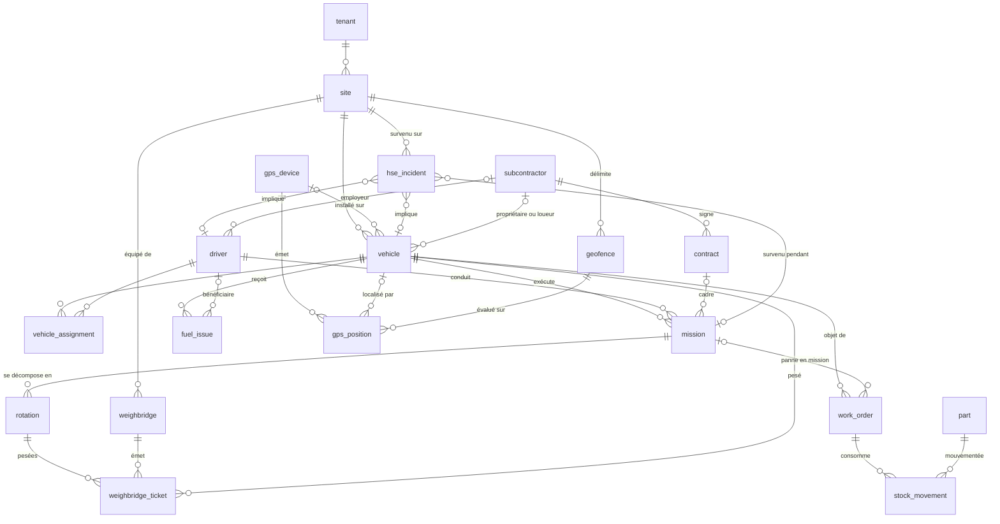
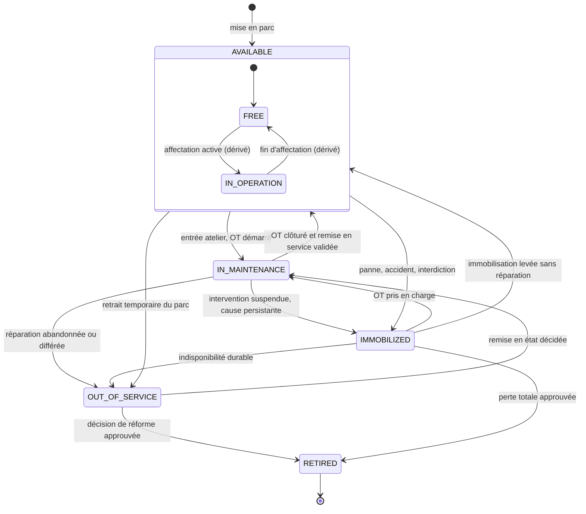
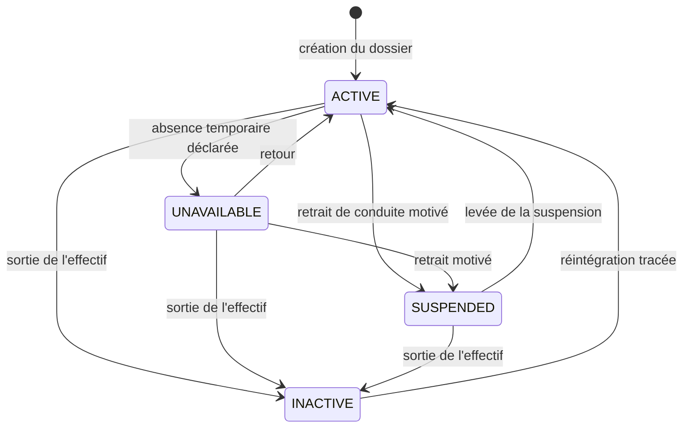
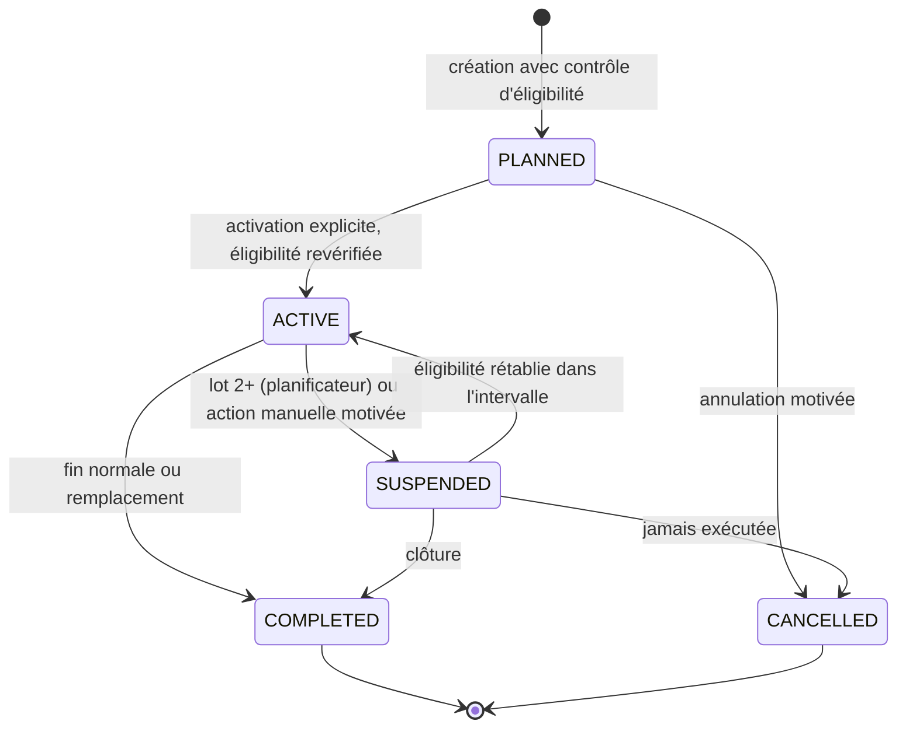
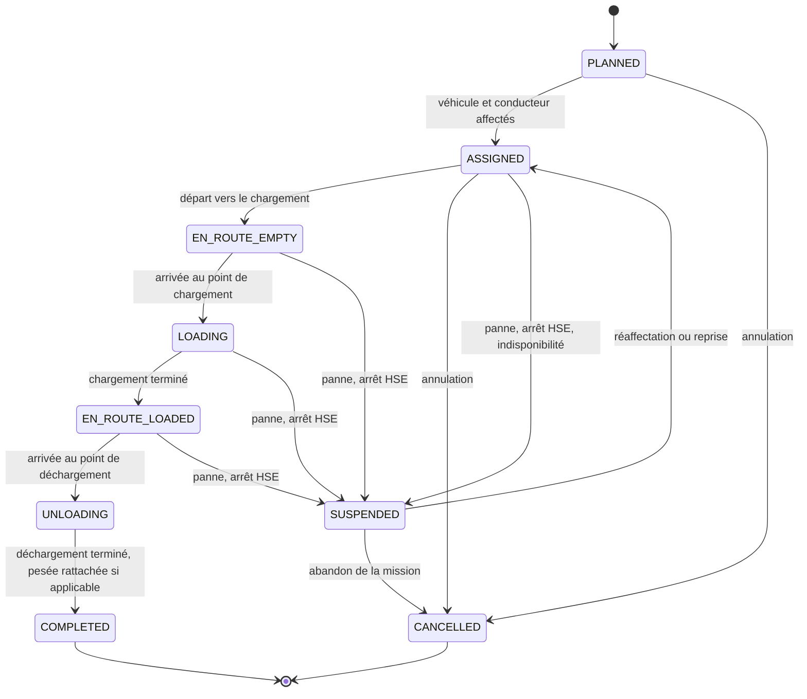
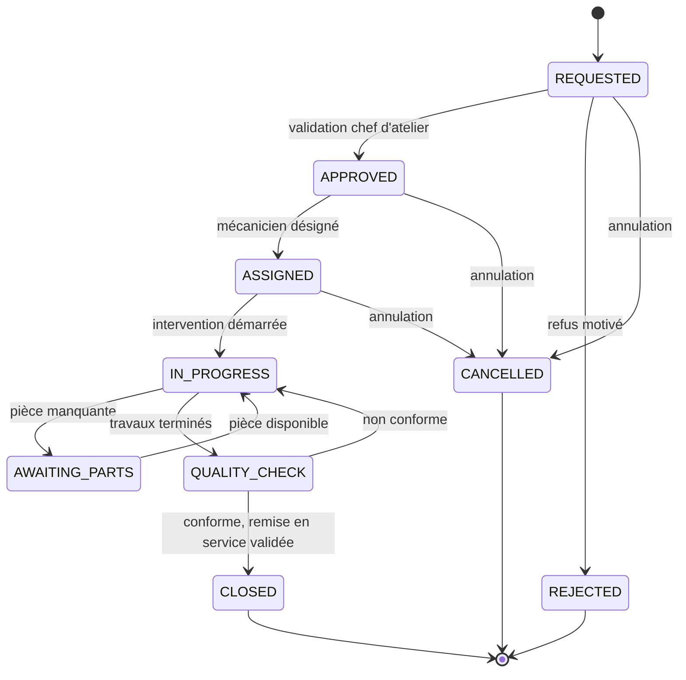

# Modèle conceptuel — MINEFLEET 360

> Statut : **provisoire** (phase 0, cadrage), mis à jour après la revue croisée. Conforme à `docs/00_SOCLE_CADRAGE.md` (H1-H10) et à `docs/DECISIONS_A_ARBITRER.md` (D-01..D-24, qui prime en cas de divergence). Aucune donnée réelle, aucun chiffre d'exploitation : tous les exemples sont fictifs.
> Détail des colonnes et glossaire code → libellé FR : `docs/DICTIONNAIRE_DONNEES.md`. Invariants métier : `docs/REGLES_METIER.md`. Schéma physique : `docs/MODELE_PHYSIQUE_LOT1.md`.

## 0. Légende de fiabilité

| Marque | Sens |
|--------|------|
| **Fait vérifié** | Imposé par `CLAUDE.md`, par le socle de cadrage ou par une décision D-xx (ce n'est pas une vérification terrain). |
| **Hypothèse** | Pratique courante supposée du secteur minier / transport, non confirmée par le client. |
| **À valider** | Dépend du client, du fournisseur (GPS, pont-bascule) ou d'un juriste guinéen. |

## 1. Conventions transverses (toutes les entités métier)

- **Fait vérifié** (H1, H3, H4, D-07, D-20) : toute table tenant-scopée porte `tenant_id uuid NOT NULL` **sans exception** (les comptes et événements de plateforme appartiennent au tenant plateforme réservé, `kind = 'PLATFORM'`) ; identifiants UUID v4 (`gen_random_uuid()`) ; clés étrangères composites `(tenant_id, id)` ; horodatages `timestamptz` en UTC, fuseau d'affichage porté par le site.
- **Fait vérifié** (D-01) : toutes les valeurs d'énumération et de statut sont en anglais `UPPER_SNAKE_CASE` ; les libellés français vivent dans l'interface. Glossaire unique : dictionnaire de données §0.
- Colonnes communes non répétées : `created_at`, `updated_at`, `created_by`, `updated_by`, `row_version` (concurrence optimiste gérée par trigger, `If-Match`/ETag — D-19).
- Pas de suppression physique des entités métier et pas de colonne `archived_at` : l'état terminal est le **statut** (ou `is_active` pour un référentiel). `audit_event` et `vehicle_status_history` sont en ajout seul.
- Tables globales (sans `tenant_id`, lecture seule, D-18) : `role`, `role_allowed_scope`, `license_category_ref`. `tenant` est sa propre racine. Le catalogue des permissions n'est pas en base (D-18a) : il vit dans `authz_matrix.yaml`.
- Catégories de véhicule : **copie par tenant** ; catégories de permis requises : table de jonction (D-18).

## 2. Schéma détaillé — Lot 1

```mermaid
erDiagram
    tenant ||--o{ site : "possède"
    tenant ||--o{ user_account : "emploie"
    tenant ||--o{ vehicle_category : "configure"
    tenant ||--o{ vehicle : "possède"
    tenant ||--o{ driver : "emploie"
    site ||--o{ vehicle : "héberge"
    site ||--o{ driver : "site de rattachement"
    site |o--o{ user_role_assignment : "portée SITE"
    site ||--o{ vehicle_assignment : "site d'exploitation"
    user_account ||--o{ user_role_assignment : "reçoit"
    user_account ||--o{ account_token : "invitation ou réinitialisation"
    user_account ||--o{ auth_session : "sessions"
    role ||--o{ user_role_assignment : "définit"
    role ||--o{ role_allowed_scope : "portées admises"
    user_account |o--o| driver : "compte optionnel (H6), liaison hors lot 1"
    vehicle_category ||--o{ vehicle : "classe"
    vehicle_category ||--o{ vehicle_category_license_category : "exige"
    license_category_ref ||--o{ vehicle_category_license_category : "catégorie de permis"
    vehicle_category |o--o{ driver_qualification : "habilitation portant sur"
    license_category_ref ||--o{ driver_license : "catégorie"
    driver ||--o{ driver_license : "détient"
    driver ||--o{ driver_qualification : "détient"
    driver ||--o{ vehicle_assignment : "est affecté"
    vehicle ||--o{ vehicle_assignment : "est affecté à"
    vehicle ||--o{ vehicle_status_history : "historique de statut"
    tenant ||--o{ audit_event : "trace"
    user_account |o--o{ audit_event : "acteur"

    tenant {
        uuid tenant_id PK
        text code UK "code d'espace de travail (connexion)"
        text kind "CUSTOMER PLATFORM"
        text legal_name
        text status "ACTIVE SUSPENDED ARCHIVED"
        text default_timezone "Africa/Conakry"
    }
    site {
        uuid site_id PK
        uuid tenant_id FK
        text code UK "unique par tenant"
        text name
        text site_type "MINE QUARRY WORKSHOP DEPOT PORT OFFICE"
        text timezone
        geography location "PostGIS point optionnel"
        text status "ACTIVE INACTIVE"
    }
    user_account {
        uuid user_account_id PK
        uuid tenant_id FK "NOT NULL, tenant plateforme inclus"
        citext email UK "unique par tenant"
        text password_hash
        text status "INVITED ACTIVE DISABLED"
        boolean mfa_enabled
        timestamptz last_login_at
    }
    account_token {
        uuid account_token_id PK
        uuid tenant_id FK
        uuid user_account_id FK
        text purpose "INVITATION PASSWORD_RESET"
        bytea token_hash
        timestamptz expires_at
    }
    auth_session {
        uuid auth_session_id PK
        uuid tenant_id FK
        uuid user_account_id FK
        bytea refresh_hash_current
        timestamptz expires_at
        timestamptz revoked_at
    }
    role {
        text role_code PK "TENANT_ADMIN DISPATCHER etc"
        text label_fr
        boolean is_optional "AUDITOR"
    }
    role_allowed_scope {
        text role_code FK
        text scope_type "PLATFORM TENANT SITE"
    }
    user_role_assignment {
        uuid user_role_assignment_id PK
        uuid tenant_id FK
        text tenant_kind "contrôle portée PLATFORM"
        uuid user_account_id FK
        text role_code FK
        text scope_type "PLATFORM TENANT SITE"
        uuid site_id FK "requis si SITE"
        timestamptz valid_from
        timestamptz valid_to
        timestamptz revoked_at
    }
    vehicle_category {
        uuid vehicle_category_id PK
        uuid tenant_id FK
        text code UK "unique par tenant, copie par tenant"
        text label_fr
        text family
        boolean requires_driver
        boolean requires_internal_authorization
        boolean has_odometer
        boolean has_hour_meter
        boolean is_system
    }
    vehicle_category_license_category {
        uuid tenant_id FK
        uuid vehicle_category_id FK
        text license_category_code FK
    }
    license_category_ref {
        text code PK "à valider localement"
        text label_fr
    }
    vehicle {
        uuid vehicle_id PK
        uuid tenant_id FK
        uuid site_id FK
        uuid vehicle_category_id FK
        text fleet_number UK "unique à vie par tenant"
        text registration_number "nullable"
        text serial_number "nullable"
        text status "AVAILABLE IN_MAINTENANCE IMMOBILIZED OUT_OF_SERVICE RETIRED"
        integer rated_payload_kg "capacité nominale, pas une mesure"
    }
    vehicle_status_history {
        uuid vehicle_status_history_id PK
        uuid tenant_id FK
        uuid vehicle_id FK
        text from_status
        text to_status
        timestamptz changed_at
    }
    driver {
        uuid driver_id PK
        uuid tenant_id FK
        uuid site_id FK "site de rattachement"
        uuid user_account_id FK "nullable unique"
        text employee_number UK "unique par tenant"
        text last_name
        text first_name
        text employment_type "EMPLOYEE TEMP_AGENCY SUBCONTRACTOR"
        text status "ACTIVE UNAVAILABLE SUSPENDED INACTIVE"
    }
    driver_license {
        uuid driver_license_id PK
        uuid tenant_id FK
        uuid driver_id FK
        text license_number
        text category_code FK "à valider localement"
        date issue_date
        date expiry_date
        text status "VALID SUSPENDED WITHDRAWN"
    }
    driver_qualification {
        uuid driver_qualification_id PK
        uuid tenant_id FK
        uuid driver_id FK
        uuid vehicle_category_id FK
        text qualification_type "DRIVING_AUTHORIZATION SAFETY_TRAINING OTHER"
        date valid_from
        date valid_to
        text status "VALID SUSPENDED REVOKED"
    }
    vehicle_assignment {
        uuid vehicle_assignment_id PK
        uuid tenant_id FK
        uuid site_id FK
        uuid vehicle_id FK
        uuid driver_id FK
        timestamptz valid_from
        timestamptz valid_to "exclusif, NULL si ouverte"
        text shift_code "informatif"
        text status "PLANNED ACTIVE SUSPENDED COMPLETED CANCELLED"
        jsonb eligibility_snapshot
    }
    audit_event {
        uuid audit_event_id PK "avec occurred_at, partition mensuelle"
        uuid tenant_id FK "NOT NULL"
        timestamptz occurred_at
        uuid actor_user_id FK
        text actor_kind "USER SYSTEM PLATFORM_SUPPORT DEVICE_SYNC ANONYMOUS"
        text action
        text entity_type
        uuid entity_id
        text outcome "SUCCESS DENIED FAILURE"
        jsonb before_data
        jsonb after_data
    }
```

Notes de lecture :
- **Hors lot 1** (D-14, D-16) : `vehicle_meter_reading` (livrée avec la première story de compteur ; aucune colonne de compteur sur `vehicle`), `idempotency_record` (lot 4, offline), `vehicle_document`, `support_access_session`, `audit_seal`, `person`.
- Les relations vers `tenant` de chaque table métier (H3) ne sont pas toutes dessinées pour la lisibilité.
- **Risque de modélisation** : `driver` désigne dans le socle une « personne ». Les mécaniciens et magasiniers (lot 3 et au-delà) nécessiteront peut-être `person`. Décision : `driver` conservé au lot 1 (C-05) ; migration non destructive plus tard (`driver.person_id`).
- Le tenant plateforme est un `tenant` de type `PLATFORM` (un seul) qui porte le compte `PLATFORM_ADMIN` ; il est exclu des listes de tenants clients.

## 3. Vue cible simplifiée — modules futurs (hors lot 1)

Pas de colonnes : uniquement les liens. **Indicatif**, à affiner à chaque lot.

Points de conception à retenir pour ne pas se tromper plus tard :
- **Fait vérifié** (H10) : `gps_position` n'alimente jamais le tonnage ; seul `weighbridge_ticket` (ou source approuvée) produit un tonnage **mesuré**. Le tonnage **estimé** (capacité nominale × rotations) reste étiqueté comme tel.
- **Hypothèse** : une `rotation` est un cycle chargement → transport → déchargement ; une `mission` regroupe une ou plusieurs rotations pour un même couple origine/destination et matériau.
- **Hypothèse** : le lien `gps_device` ↔ `vehicle` sera borné dans le temps (historique d'installation), via une table de liaison.
- **À valider** : propriété et facturation des engins/conducteurs sous-traitants.

## 4. Machines à états

Principe général (**hypothèse**, bonne pratique) : chaque changement de statut est une transition explicite, refusée si non listée, avec motif, acteur, horodatage UTC et un `audit_event`. Les statuts sont des codes stables **en anglais `UPPER_SNAKE_CASE`** (D-01) ; libellés FR dans le glossaire du dictionnaire et dans l'interface.

### 4.1 Statut du véhicule / engin (D-02)

Le statut **stocké** porte la disponibilité technique/administrative (5 valeurs). « En exploitation » est une information **dérivée** (affectation `ACTIVE`, plus tard mission en cours), affichée comme sous-état de `AVAILABLE` (« Libre » / « En exploitation »), jamais écrite : cela évite la double source de vérité avec `vehicle_assignment`. Chaque changement est historisé dans `vehicle_status_history` par trigger.

| Statut | Libellé FR | Signification | Affectable ? |
|--------|-----------|---------------|--------------|
| `AVAILABLE` | Disponible | Apte à être exploité. Sous-état dérivé : libre / en exploitation | Oui |
| `IN_MAINTENANCE` | En maintenance | Pris en charge à l'atelier (OT en cours) | Non |
| `IMMOBILIZED` | Immobilisé | Interdit/incapable de rouler, cause identifiée, décision ou OT pas encore démarré | Non |
| `OUT_OF_SERVICE` | Hors service | Indisponible durablement, sans intervention planifiée à court terme | Non |
| `RETIRED` | Réformé | Sorti définitivement du parc (**état terminal**, C-13) | Non |

Règles associées (détail dans `REGLES_METIER.md`) :
- **D-11** : passer en `IN_MAINTENANCE`, `IMMOBILIZED`, `OUT_OF_SERVICE` ou `RETIRED` est **refusé (`409`)** tant qu'une affectation `PLANNED`/`ACTIVE` existe ; la réponse liste les affectations à clôturer. Il n'y a pas de suspension automatique (RM-017, RM-038).
- `RETIRED` est **terminal** : pas de réactivation au lot 1 (défaut C-13) ; un numéro de parc n'est jamais réutilisé.
- **À valider** : statut d'entrée « en réception » avant `AVAILABLE`. Proposition par défaut : non ; la mise en parc crée `AVAILABLE` si les prérequis sont saisis, sinon `OUT_OF_SERVICE` avec motif `RECEPTION_IN_PROGRESS`.
- Lot 1 : changements de statut **manuels** (rôles en RBAC : `WORKSHOP_CHIEF`, `OPS_MANAGER`). Dès le lot Maintenance, `IN_MAINTENANCE`/`AVAILABLE` sont pilotés par l'ordre de travail.

### 4.2 Statut du conducteur (D-03)

Le statut décrit la **situation administrative**, pas l'aptitude. La validité du permis et de l'habilitation est **dérivée des dates** et calculée à la lecture ; elle n'est jamais dupliquée dans le statut.

| Statut | Libellé FR | Signification | Affectable ? |
|--------|-----------|---------------|--------------|
| `ACTIVE` | Actif | En poste | Oui, sous réserve des permis et habilitations |
| `UNAVAILABLE` | Indisponible | Absence temporaire connue, motif `LEAVE` / `TRAINING` / `OTHER` (aucun motif de santé, D-15) | Non pendant la période |
| `SUSPENDED` | Suspendu | Retrait temporaire de conduite (disciplinaire, décision HSE) | Non |
| `INACTIVE` | Inactif | Sorti de l'effectif | Non |

- Un dossier `ACTIVE` sans permis ni habilitation valides **n'est pas affectable** : éligibilité évaluée à la volée (RM-030).
- **D-11** : passer un conducteur en non-`ACTIVE` est **refusé (`409`)** tant qu'une affectation `PLANNED`/`ACTIVE` existe (RM-020, RM-039).
- `SUSPENDED` n'expose pas son motif à tous les rôles : visible de `HR` et `HSE` (lecture) seulement ; `TENANT_ADMIN` ne lit pas les données personnelles du conducteur (D-10, D-15).
- **À valider** : durée légale des suspensions et rôle de l'inspection du travail (juriste guinéen).
- Congé et absences détaillés (soldes, justificatifs) : lot RH ultérieur ; en lot 1, seuls `UNAVAILABLE` + période sont saisis.

### 4.3 Statut de l'affectation conducteur ↔ véhicule (D-04)

L'affectation est un intervalle de validité `[valid_from, valid_to)` (borne haute exclusive, `valid_to` NULL = ouverte). Au lot 1, **véhicule, conducteur et affectation partagent le même site** (D-13) et l'antidatage est interdit.

| Statut | Libellé FR | Signification | Occupe le créneau (anti-chevauchement) ? |
|--------|-----------|---------------|------------------------------------------|
| `PLANNED` | Planifiée | Créée, début dans le futur | Oui |
| `ACTIVE` | Active | En cours, éligibilité vérifiée | Oui |
| `SUSPENDED` | Suspendue | Temporairement non exécutable ; la transition **automatique** vers cet état est reportée au planificateur (lot 2+, D-12) | Oui |
| `COMPLETED` | Terminée | Clôturée (fin normale) ; `valid_to` = fin réelle | Oui (jusqu'à `valid_to` tronqué) |
| `CANCELLED` | Annulée | Jamais exécutée | Non |

L'exclusion de chevauchement porte sur toute affectation `status <> 'CANCELLED'` (côté véhicule et côté conducteur).

- Les affectations `COMPLETED`/`CANCELLED` ne sont ni modifiées ni supprimées (trigger).
- **D-12** : au lot 1, la perte d'éligibilité en cours d'affectation est visible comme **drapeau dérivé « non conforme »** avec motif, calculé à la lecture ; aucune transition n'est écrite par un job.
- **D-13** : aucune dérogation d'éligibilité ni d'antidatage au lot 1.
- **À valider** : qui peut faire passer `SUSPENDED` → `ACTIVE` ; l'activation d'une affectation `PLANNED` à l'heure de début au lot 1 est une action explicite (voir `REGLES_METIER.md` RM-031).

### 4.4 Statut de la mission (indicatif, lot Dispatch)

Corrections proposées à la séquence demandée : `EN_ROUTE` est ambigu (à vide vers le chargement, ou chargé vers le déchargement ?), on distingue les deux. On ajoute `SUSPENDED` (panne, météo, arrêt HSE, voie coupée). La position de la pesée dépend de l'implantation du site (**à valider**). Codes en anglais (D-01) ; ils seront figés à la conception du lot Dispatch.

| Code | Libellé FR |
|------|-----------|
| `PLANNED`, `ASSIGNED` | Planifiée, Affectée |
| `EN_ROUTE_EMPTY`, `LOADING`, `EN_ROUTE_LOADED`, `UNLOADING` | En route à vide, En chargement, En route chargé, En déchargement |
| `COMPLETED`, `CANCELLED`, `SUSPENDED` | Terminée, Annulée, Suspendue |

- Les transitions d'avancement sont issues d'événements (appli mobile, dispatcher, éventuellement géorepérage). **Fait vérifié** (CLAUDE.md) : un franchissement de géorepérage n'est qu'un indice horodaté et imprécis ; il ne prouve ni un chargement ni un tonnage.
- Une mission `COMPLETED` n'est pas modifiable ; correction par événement correctif tracé.
- Événements hors ligne tardifs : traités par `recorded_at`, dédupliqués par identifiant client (lot 4), jamais en écrasant une transition plus récente déjà acceptée.

### 4.5 Statut de l'ordre de travail (indicatif, lot Maintenance)

Séquence de la skill workshop-maintenance, complétée par les cas d'attente de pièces, de rejet et d'annulation. Codes figés à la conception du lot Maintenance.

| Code | Libellé FR |
|------|-----------|
| `REQUESTED`, `APPROVED`, `ASSIGNED` | Demandé, Approuvé, Assigné |
| `IN_PROGRESS`, `AWAITING_PARTS`, `QUALITY_CHECK` | En cours, En attente de pièces, Contrôle qualité |
| `CLOSED`, `REJECTED`, `CANCELLED` | Clôturé, Rejeté, Annulé |

- Le passage `QUALITY_CHECK` → `CLOSED` est le seul qui libère le véhicule vers `AVAILABLE` (approbation de remise en service obligatoire).
- Protection contre la double consommation de pièces (mouvement de stock unique par ligne d'OT) ; durée d'immobilisation calculée depuis `vehicle_status_history`.

## 5. Vérifications de cohérence avec le socle et les décisions

| Point | Prise en compte |
|-------|-----------------|
| H1, H3, D-07 | `tenant_id NOT NULL` partout, FK composites ; tenant plateforme réservé ; exceptions listées en §1 |
| H4, D-23 | `timestamptz` UTC ; fuseau au niveau `tenant` puis `site` ; tests multi-fuseaux |
| H6, D-16 | `driver.user_account_id` nullable, unique ; liaison et écran conducteur hors lot 1 |
| H7 | `user_role_assignment.scope_type` + `site_id` conditionnel ; portées admises par `role_allowed_scope` |
| H10 | Aucun champ GPS dans les entités de tonnage ; `rated_payload_kg` explicitement nominal |
| D-01..D-04 | Statuts en anglais ; véhicule 5 valeurs, conducteur 4, affectation 5 |
| D-14, D-16 | `idempotency_record`, `vehicle_meter_reading` hors lot 1 |
| D-18, D-18a | `role` global, permissions dans `authz_matrix.yaml` (pas en base) ; catégories par tenant + jonction permis |
| D-21 | Entités par tranche : 1a (tenant, site, identité, audit), 1b (flotte, personnel), 1c (affectation) |
| Codes de rôles (socle §3) | Repris tels quels dans `role.role_code` ; `AUDITOR` retenu, optionnel (D-10) |
