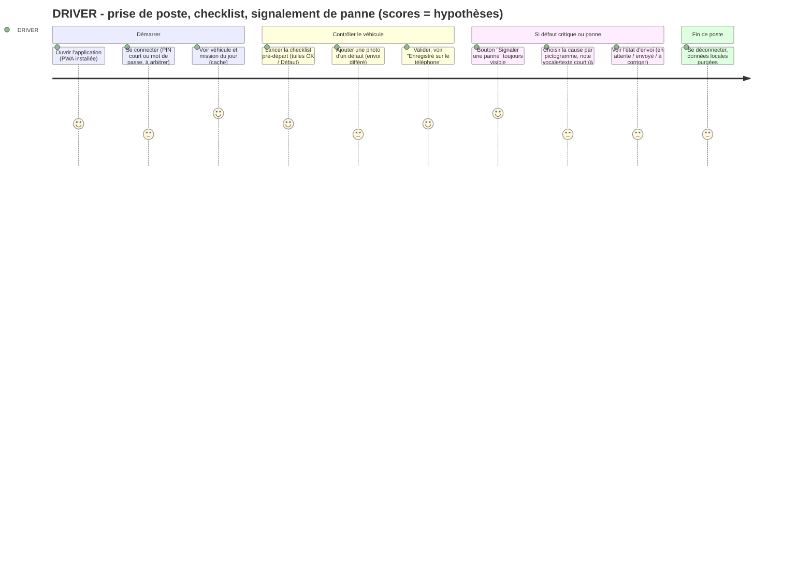
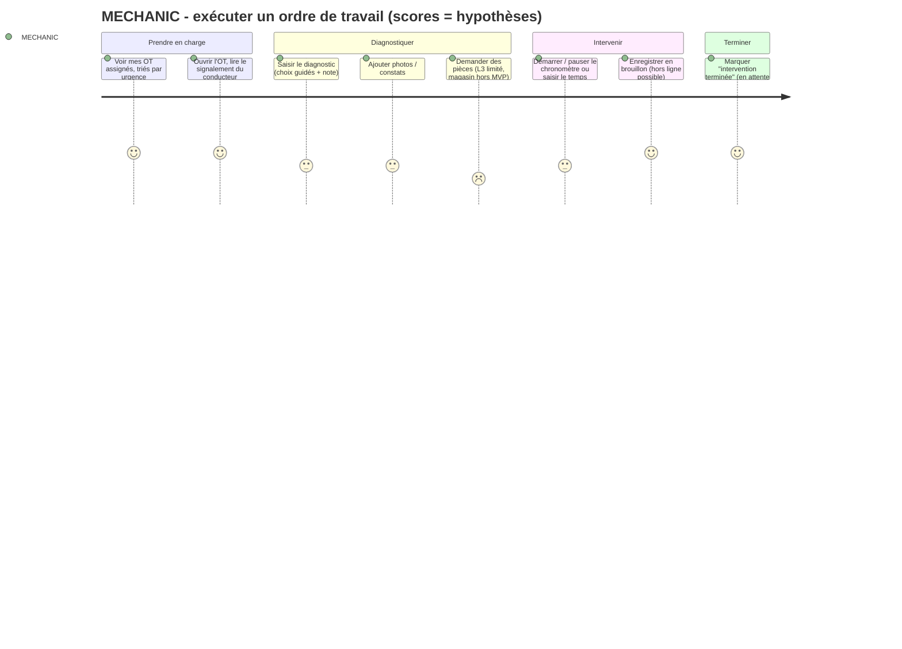
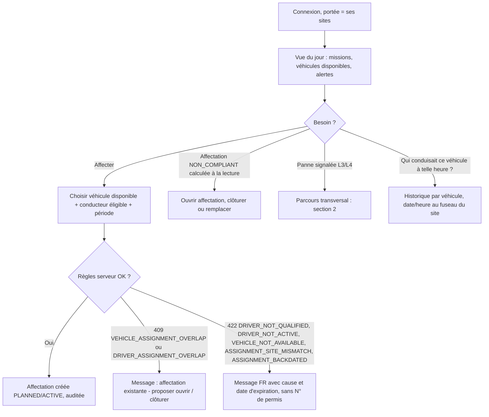
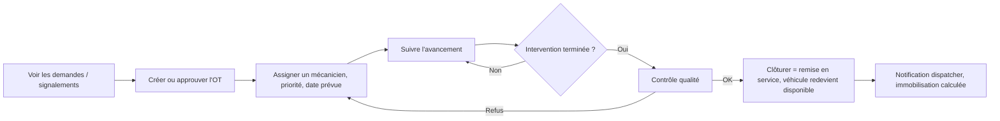
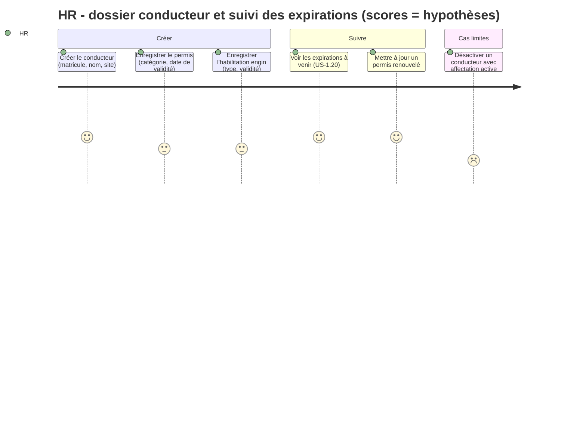
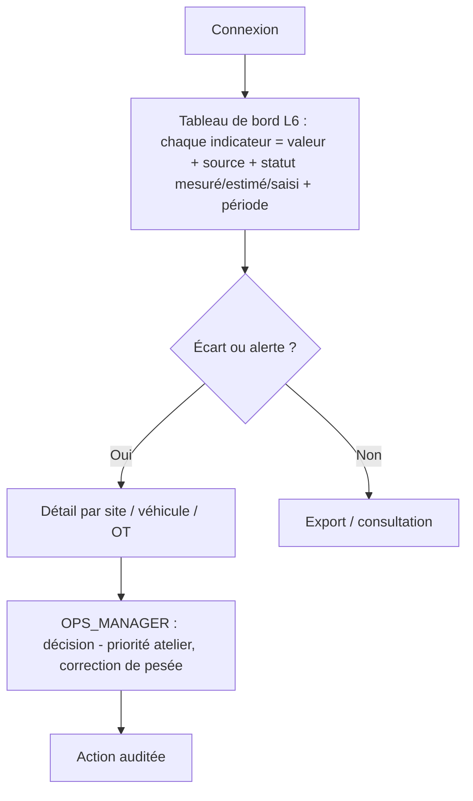
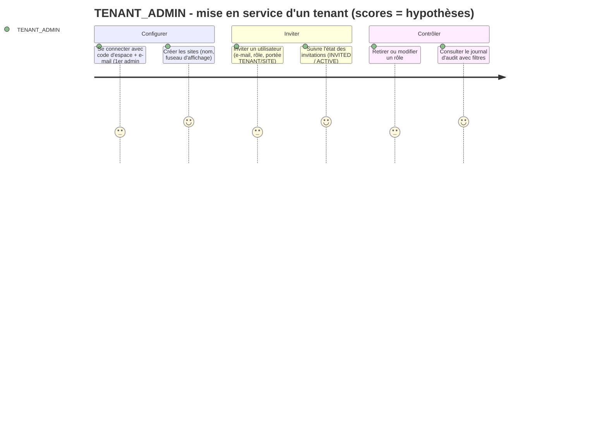
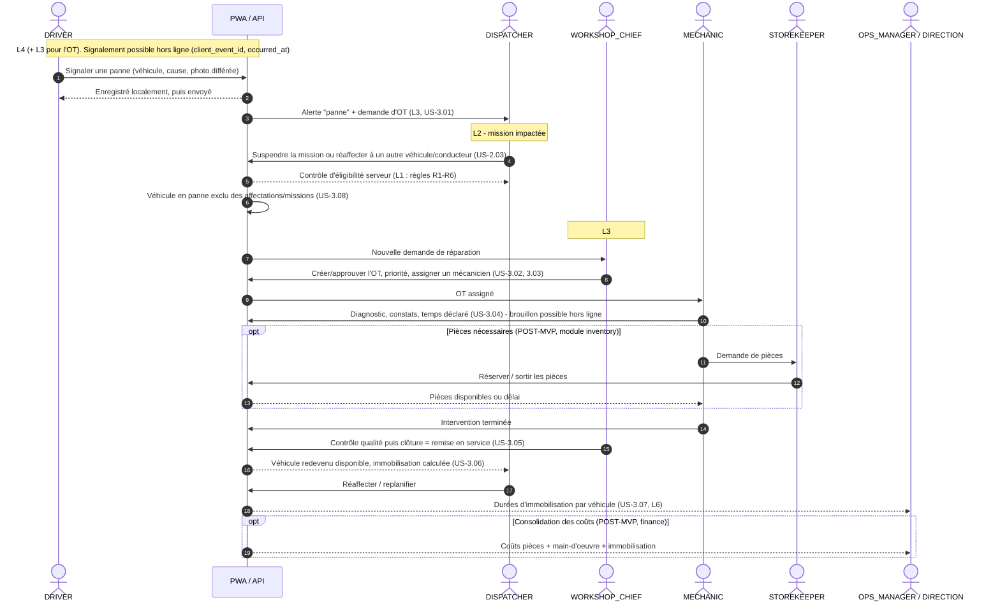
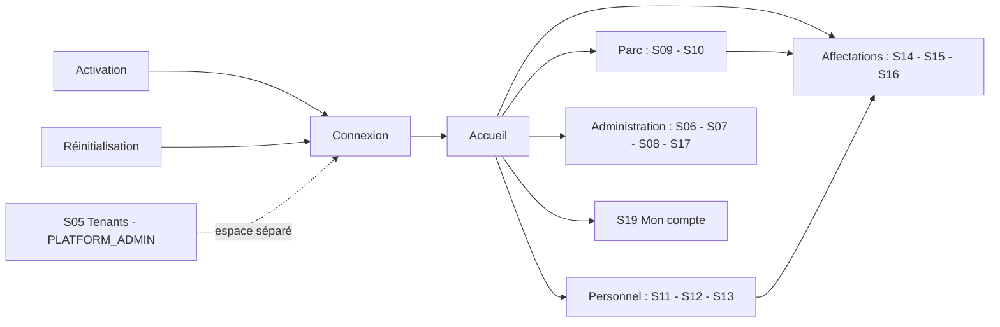

# Parcours utilisateurs et inventaire des écrans — MINEFLEET 360

> Statut : **brouillon de cadrage (phase 0), révisé après la revue croisée** (QA, DB). Aucun code, aucune maquette, aucun test utilisateur n'existe. **Rien dans ce document n'a été testé ni validé auprès de vrais utilisateurs.**
> Préséance : `docs/DECISIONS_A_ARBITRER.md` (D-01..D-24, défauts provisoires C-01..C-17) > `MODELE_PHYSIQUE_LOT1.md` > `MATRICE_RBAC.md` > `REGLES_METIER.md` > `USER_STORIES.md` > ce document. Statuts affichés = libellés français des codes anglais (D-01) ; codes d'erreur et table 401/403/404/409/422 : `USER_STORIES.md` CT-1 et §0.4.
> Références : `docs/00_SOCLE_CADRAGE.md` (codes de rôles, H1-H10), `docs/PRD_MVP.md` (lots L1 à L6), `docs/USER_STORIES.md` (US-1.xx, US-2.xx...), `docs/INTEGRATION_GPS_OFFLINE.md` (mode hors ligne), `docs/MATRICE_RBAC.md` et `docs/REGLES_METIER.md` (rédigés en parallèle ; non repris ligne à ligne ici, voir section 7).
> Distinction appliquée : **Fait** (écrit dans un document du dépôt), **Hypothèse** (notée `[HYP]`, réversible, non validée terrain), **À valider** (notée `[VAL]`).
> Toutes les données d'exemple sont fictives (H9). Aucun chiffre de performance, de gain ou d'adoption n'est affirmé.

## 0. Hypothèses générales, impacts et critères

### 0.1 Hypothèses de travail
| # | Hypothèse | Statut |
|---|-----------|--------|
| U1 | Les descriptions de terrain (appareil, gants, poussière, soleil, quarts) sont **déduites du contexte minier** et de `PRD_MVP.md` (R7, P4), pas observées. Elles doivent être confirmées par des visites de site et des ateliers. | `[VAL]` |
| U2 | Le niveau de littératie numérique varie fortement ; on conçoit pour le **plus bas niveau plausible** côté terrain (conducteur, mécanicien) et pour un usage expert côté dispatcher. Aucune donnée n'existe sur le taux d'alphabétisation en français ou le taux d'équipement smartphone. | `[VAL]` |
| U3 | Le lot 1 ne livre **pas** d'écran terrain ni d'écran conducteur (US-1.29 : « interface web minimale » ; PRD A10 ; D-16, C-12 : écran conducteur et authentification terrain reportés au lot 4). Les parcours `DRIVER`, `MECHANIC`, `WORKSHOP_CHIEF` décrits ici concernent les lots 2 à 4 et servent à **ne pas contredire** ces lots dans les choix du lot 1 (navigation, design system, états). | Fait (D-16) + `[HYP]` |
| U4 | Application cible : web responsive pour desktop/tablette/mobile au lot 1, puis **PWA** (installable, hors ligne) pour le terrain au lot 4 (A9 PRD). Pas d'application native. | Fait (PRD) |
| U5 | Langue : français uniquement au MVP ; textes externalisés pour permettre d'autres langues ensuite (Q13). Les langues locales (soussou, pular, malinké) ne sont pas supposées ; le recours à des **pictogrammes et au vocabulaire simple** réduit la dépendance à la lecture. | `[VAL]` |
| U6 | Les conducteurs n'ont pas tous un compte ni un smartphone (H6, A5, A10). Le téléphone peut être **partagé** (R7, US-4.08). | Fait + `[VAL]` |
| U7 | Le rôle `MECHANIC` et `WORKSHOP_CHIEF` n'ont qu'une lecture minimale au lot 1 (US §0.2) ; le `STOREKEEPER` n'a aucune fonction au MVP (PRD §5.2) alors qu'il apparaît dans le processus transversal de la vision. | Fait |

### 0.2 Modules impactés (conception UX uniquement, aucune modification de code)
`identity` (connexion, invitation, rôles), `organization` (sites, fuseau), `fleet`, `workforce`, `assignment`, `audit` pour le lot 1 ; `dispatch` (L2, L4), `maintenance` (L3), `telematics` (L5), `reporting` (L6) pour les parcours futurs.

### 0.3 Implications sécurité / tenant pour l'interface
- **L'interface n'est jamais l'autorité** : masquer un bouton n'est pas une protection (US-1.29 A1). Chaque écran doit fonctionner correctement quand l'API répond 403/404.
- `tenant_id` jamais saisi ni affiché comme paramètre modifiable ; il vient de la session (CT-1). Aucune URL ne contient un identifiant séquentiel (UUID, CT-7).
- Table unique des codes (D-05, `USER_STORIES.md` CT-1) : une ressource d'un autre tenant ou hors portée de site affiche « introuvable » (404), pas « accès refusé », pour ne pas révéler son existence. Un 403 n'apparaît que lorsque l'utilisateur ne possède aucune attribution portant la permission (endpoint de collection ou ressource visible). Un 422 porte un code métier stable que l'écran traduit en message français ; un 409 est un conflit d'état (chevauchement, unicité, version obsolète, blocage par ressources ouvertes avec liste).
- Données personnelles (D-15) : téléphone et numéro de permis visibles par `HR` seul ; **masquage total** pour tous les autres rôles, y compris `TENANT_ADMIN` (le champ est absent, pas grisé). La journalisation des lectures est la question ouverte Q19. Pas de photo, date de naissance, adresse ni aptitude médicale au lot 1.
- Données locales hors ligne : sans secret, purgées à la déconnexion (US-4.08). Un téléphone partagé ne doit pas exposer les données du conducteur précédent.
- Le GPS n'est jamais présenté comme preuve de tonnage (H10) : tout chiffre affiche sa source et son statut (mesuré / estimé / saisi, US-6.05).

### 0.4 Critères d'acceptation de ce document
1. Chaque persona demandé (DRIVER, MECHANIC, DISPATCHER, WORKSHOP_CHIEF, HR, DIRECTION, OPS_MANAGER, TENANT_ADMIN) a : contexte, objectifs, parcours, écrans, lot, irritants/garde-fous.
2. Le parcours transversal est décrit en séquence multi-acteurs avec les lots.
3. Les écrans du Lot 1 sont inventoriés avec contenu, actions, états (vide, chargement, erreur, 403, hors ligne), navigation, accessibilité, formats FR.
4. Toute valeur non vérifiée est marquée `[HYP]` ou `[VAL]`.
5. Aucune affirmation de test ou de résultat utilisateur.

### 0.5 Lots de livraison (rappel du PRD)
| Lot | Contenu | Module |
|-----|---------|--------|
| L1 | Fondations : tenant, sites, utilisateurs/rôles, véhicules, conducteurs, permis/habilitations, affectations, audit, UI minimale | `organization`, `identity`, `fleet`, `workforce`, `assignment`, `audit` |
| L2 | Missions et rotations, pesée saisie avec source | `dispatch` |
| L3 | Ordres de travail et état véhicule | `maintenance` |
| L4 | Checklist mobile hors ligne (PWA), signalement de panne | `dispatch` / `maintenance` |
| L5 | GPS via adaptateur simulé, géofences | `telematics` |
| L6 | Dashboard opérationnel | `reporting` |

---

## 1. Parcours par persona

Convention des diagrammes : `journey` Mermaid, score 1 (pénible) à 5 (fluide) = **estimation de conception, non mesurée** ; sert à repérer les points de friction à valider en atelier.

### 1.1 Conducteur — `DRIVER`

**Contexte terrain `[HYP][VAL]`**
- Appareil : smartphone Android d'entrée de gamme, personnel ou **partagé**, ou aucun appareil (conducteur sans compte, H6). Écran souvent rayé, batterie limitée.
- Connectivité : intermittente ou absente sur piste et en fosse ; bonne éventuellement au parking/base vie. Conception « hors ligne d'abord » (PRD O5).
- Conditions : gants, mains sales ou mouillées, poussière sur l'écran, soleil direct (reflets), cabine qui vibre, saisie debout près du camion. Peu de temps (rotations, départ en file).
- Quart : prise de poste le matin/soir, souvent de nuit (faible luminosité, éblouissement : prévoir un thème sombre à fort contraste).
- Littératie numérique : à valider ; on suppose lecture lente possible et préférence pour pictogrammes, grands boutons, choix par tuiles plutôt que saisie de texte.

**Objectifs** : savoir quel véhicule et quelle mission aujourd'hui ; faire la checklist sans être bloqué ; signaler une panne vite, même sans réseau ; ne pas être tenu responsable d'une saisie perdue.

**Lots** : L1 aucun écran ni accès (C-12, D-16) ; L2 « ma mission du jour » (US-2.07) ; L4 checklist + signalement hors ligne (US-4.01 à 4.03, 4.08) ; L3 réception de l'OT liée au signalement (US-3.01).

**Parcours principal (prise de poste, checklist, panne)**

**Écrans impliqués** (futurs, hors L1) : D1 Accueil conducteur (véhicule + mission + état de synchro), D2 Checklist pré-départ, D3 Signalement de panne, D4 Mes envois (file hors ligne), D5 Connexion simplifiée. Mission du jour (L2).

**Irritants et garde-fous**
| Irritant / risque | Garde-fou de conception |
|---|---|
| Pas de réseau au moment de signaler | Saisie locale immédiate ; message « Enregistré sur le téléphone, sera envoyé » ; `client_event_id` pour éviter les doublons (INTEGRATION §2.1). Jamais de blocage. |
| Gants / doigts sales | Cibles tactiles >= 48 px, de préférence 56 px+ ; espacement large ; pas de glisser-déposer obligatoire ; pas de double-tap. |
| Soleil / nuit | Contraste >= 7:1 sur les actions principales `[HYP]`, thème clair et sombre, jamais d'information par la seule couleur. |
| Téléphone partagé | Déconnexion visible, verrouillage à l'inactivité, purge locale à la déconnexion (US-4.08). |
| Session expirée avec saisies en attente | Reconnexion demandée avant rejeu, saisies conservées (ADR-003) ; message clair, aucune perte. |
| Erreur de validation à la synchro | Élément placé en « À corriger » avec motif en français, jamais supprimé silencieusement (INTEGRATION §2.1). |
| Refus d'autorisation (403) | Phrase simple : « Vous n'avez pas le droit de faire cela. Parlez à votre dispatcher. » ; pas de code technique. |
| Heure | Les heures d'événements terrain (heure de panne) sont celles saisies/captées sur le téléphone ; écart d'horloge signalé côté serveur, pas reproché au conducteur. |
| Tonnage | Le conducteur ne saisit pas de tonnage « mesuré » ; au mieux une note « déclaré » (INTEGRATION §2.2, H10). |
| Vie privée | Information claire sur ce qui est collecté ; aucun suivi GPS de la personne, seulement du véhicule, base légale à valider (V1). |

### 1.2 Mécanicien — `MECHANIC`

**Contexte terrain `[HYP][VAL]`** : atelier ou intervention sur site ; tablette ou smartphone robuste partagé, ou terminal d'atelier fixe ; mains grasses/gantées ; bruit, huile, éclats ; connectivité faible à moyenne ; travail par ordre de travail, par quart ; littératie numérique à valider, probablement plus à l'aise avec vocabulaire technique et photos qu'avec la saisie de texte long.

**Objectifs** : voir les OT qui lui sont assignés ; consigner diagnostic, constats, temps passé, pièces utilisées (pièces : post-MVP) ; ne pas perdre un brouillon si le réseau tombe.

**Lots** : L3 (US-3.04) ; brouillon hors ligne en L4+ (INTEGRATION §2.2 : constat en brouillon synchronisable). Lot 1 : lecture minimale seulement.

**Écrans** (futurs) : M1 Mes OT, M2 Détail OT (diagnostic, constats, temps), M3 Brouillons en attente.

**Irritants et garde-fous**
| Irritant / risque | Garde-fou |
|---|---|
| Conflit : le chef d'atelier modifie l'OT pendant que le mécanicien est hors ligne | 409 « version périmée » : écran de comparaison et de fusion, jamais d'écrasement silencieux (INTEGRATION §2.5). |
| Clôture de l'OT | Le mécanicien ne clôture pas : la validation est hiérarchique (WORKSHOP_CHIEF), action indisponible hors ligne et 403 sinon. |
| Pièces non disponibles au MVP | Champ « pièce demandée » en texte libre explicitement étiqueté « non géré par le stock » ; ne pas simuler un stock. `[VAL]` |
| Saisie longue au clavier | Listes de causes fréquentes, dictée vocale du système (non garantie), photos. |
| Temps passé | Saisie déclarative, étiquetée « déclaré » ; pas de calcul de coût de main-d'oeuvre sans taux validé. |

### 1.3 Dispatcher — `DISPATCHER`

**Contexte `[HYP][VAL]`** : poste fixe en salle de régulation ou bureau de site ; écran(s) de bureau, clavier, souris ; bonne connectivité en général (mais coupures possibles : les lots 1 à 3 et 6 tolèrent le réseau dégradé) ; travaille en temps réel, par quart (24/7 possible) ; radio/téléphone en parallèle ; **forte pression** quand une panne survient ; utilisateur expert, répétitif (profil « power user ») ; littératie numérique bonne à moyenne.

**Objectifs** : savoir qui conduit quoi, où, avec quelle mission ; affecter vite sans erreur ; réagir à une panne (suspendre/réaffecter) ; voir les non-conformités (permis expiré) avant qu'elles bloquent ; ne jamais être surpris par un refus tardif.

**Lots** : L1 tranche 1c, affectations (US-1.22 à 1.25) ; L2 missions (US-2.01 à 2.04) ; L3 vue d'immobilisation (US-3.06) ; L4 état de la checklist avant départ (US-4.06) ; L5 dernière position (US-5.03) ; L6 dashboard dispatcher (US-6.02).

**Écrans** : L1 : liste/détail affectations, création, clôture, historique, véhicules, conducteurs (lecture partielle) ; L2+ : planning de missions, détail mission, carte/dernière position (L5), dashboard (L6).

**Irritants et garde-fous**
| Irritant / risque | Garde-fou |
|---|---|
| Refus de l'affectation après avoir tout saisi | Afficher **avant soumission** l'éligibilité (conducteur et véhicule non éligibles grisés avec cause), le serveur restant l'autorité ; les 409/422 reviennent avec les champs conservés (US-1.29 A2). |
| Double soumission / réseau lent | Bouton désactivé pendant l'envoi avec indicateur ; pas d'idempotence applicative au lot 1 (D-14) : la seconde soumission reçoit 409 `VEHICLE_ASSIGNMENT_OVERLAP` et une seule affectation existe (US-1.22 A13). |
| Deux dispatchers sur le même véhicule | 409 explicite et rafraîchissement proposé ; pas de « dernier gagnant » silencieux (CT-4). |
| Fuseau | Dates saisies et affichées à l'heure du site (Africa/Conakry par défaut), jamais en UTC brut ; le serveur fait foi pour « maintenant ». |
| Début dans le passé | Pas d'antidatage au lot 1 : début ≥ maintenant − tolérance configurable ; sinon 422 `ASSIGNMENT_BACKDATED` avec message clair, sans motif ni dérogation possible (D-13). |
| Alerte permanente (fatigue d'alertes) | Alertes hiérarchisées, sources et âge visibles ; pas de clignotement. `[VAL]` |
| Position GPS vieille | Toujours afficher l'ancienneté (« il y a 12 min ») et `no_signal`, jamais une position inventée (INTEGRATION §1.3). |

### 1.4 Chef d'atelier — `WORKSHOP_CHIEF`

**Contexte `[HYP][VAL]`** : bureau d'atelier, ordinateur ou tablette ; connectivité moyenne ; attention partagée entre l'écran et l'atelier ; niveau numérique moyen ; décide de la priorité, de l'affectation des mécaniciens, de la remise en service (responsabilité sécurité).

**Objectifs** : voir la file des demandes de réparation ; créer/approuver l'OT, assigner un mécanicien, suivre l'avancement ; contrôler la qualité et remettre en service ; communiquer la date prévue de retour au dispatcher.

**Lots** : L3 (US-3.01 à 3.03, 3.05) ; dépendances L4 (signalements) ; pièces et coûts post-MVP.

**Écrans** (futurs) : W1 File des demandes, W2 Détail OT (statuts : demandé, approuvé, assigné, en cours, contrôle qualité, clôturé), W3 Charge des mécaniciens, W4 Remise en service.

**Irritants et garde-fous**
| Irritant / risque | Garde-fou |
|---|---|
| Remise en service par erreur | Confirmation explicite avec récapitulatif (véhicule, constats, contrôleur) ; action tracée ; seul `WORKSHOP_CHIEF` (403 sinon) ; indisponible hors ligne. |
| Version périmée | 409 + comparaison. |
| Statut du véhicule divergent de l'OT | Le statut du véhicule (`IN_MAINTENANCE`, etc.) est piloté par l'OT (PRD §6 L3) : l'écran explique « véhicule en maintenance à cause de l'OT n° ... », sans bouton contradictoire. |
| Coûts | Au MVP, seulement des durées et temps déclarés ; aucun montant GNF sans source (coûts consolidés : post-MVP). |

### 1.5 RH — `HR`

**Contexte `[HYP][VAL]`** : bureau, PC fixe ; connectivité correcte ; saisie administrative ; dossiers papier à transcrire ; confidentialité forte ; niveau numérique moyen à bon.

**Objectifs** : tenir les dossiers conducteurs, permis (catégorie, validité), habilitations engins ; anticiper les expirations ; activer/désactiver un conducteur.

**Lots** : **L1 tranche 1b** (US-1.16 à 1.21), L6 (US-6.04).

**Écrans (L1)** : liste conducteurs, fiche conducteur, formulaires permis/habilitation, vue « expirations à venir ».

**Irritants et garde-fous**
| Irritant / risque | Garde-fou |
|---|---|
| Numéro de permis et téléphone sensibles | Visibles par `HR` seul ; absents des réponses pour tout autre rôle, y compris `TENANT_ADMIN` (D-15) ; journalisation de la lecture : Q19 ouverte. |
| Doublon de conducteur | Unicité du matricule par tenant : 409 `DUPLICATE_EMPLOYEE_NUMBER`, message clair sans révéler un autre tenant ; même nom/prénom normalisés sur le même site : avertissement non bloquant `POSSIBLE_DUPLICATE`. |
| Changement de statut avec affectation `PLANNED`/`ACTIVE` | Refus 409 `OPEN_ASSIGNMENTS_EXIST` avec la liste des affectations à clôturer, chacune avec un lien (D-11) ; aucun état « fantôme ». |
| Saisie de dates | Format `JJ/MM/AAAA`, aide à la saisie, validation immédiate ; refus d'une date de fin avant le début. |
| Données minimales | Aucun champ date de naissance, adresse, photo, pièce d'identité, aptitude médicale ou motif maladie en L1 (D-15). |
| Périmètre `HR` | Pas d'accès aux véhicules (ni lecture, ni écriture) ni aux affectations en écriture (403 `PERMISSION_DENIED` audité, US-1.13 A7, US-1.22 A12). |

### 1.6 Dirigeants — `DIRECTION` et `OPS_MANAGER`

**Contexte `[HYP][VAL]`** : bureau, laptop ou tablette, parfois téléphone en déplacement ; connectivité variable ; temps court, lecture surtout, besoin de chiffres fiables et de leur source ; niveau numérique moyen à bon ; `OPS_MANAGER` agit aussi (valide dérogations, gère le parc, saisit/corrige les pesées en L2).

**Objectifs**
- `DIRECTION` (lecture seule, tenant ou sites) : disponibilité du parc, activité par site, conformité du personnel (US-6.01, US-2.08).
- `OPS_MANAGER` : piloter les sites, arbitrer les priorités d'immobilisation, créer et clôturer des affectations (sans dérogation ni antidatage au lot 1, D-13), saisir les pesées avec source (US-2.05, 2.06), définir les géofences (US-5.04), suivre les durées d'immobilisation (US-3.07, 6.03).

**Lots** : L1 (lecture + gestion parc/affectations pour `OPS_MANAGER`), L2, L3, L5, L6.

Avant le lot 6, `DIRECTION`/`OPS_MANAGER` voient en L1 des **listes** (véhicules par statut, conducteurs, affectations, expirations) ; pas de faux tableau de bord.

**Irritants et garde-fous**
| Irritant / risque | Garde-fou |
|---|---|
| Chiffre ambigu (tonnage GPS vs mesuré) | Étiquette obligatoire « mesuré (pont-bascule) / estimé / saisi manuellement » ; infobulle de définition ; jamais de tonnage dérivé du GPS (H10). |
| Indicateur sans définition | Interdit (PRD L6) : lien « définition » sur chaque indicateur. |
| Positions individuelles de salariés | Vues agrégées privilégiées pour la direction (INTEGRATION §1.5) ; accès aux positions individuelles restreint et audité. |
| Portée de site | Tableau limité aux sites de l'utilisateur ; sélecteur de site ne listant que ses sites (US-6.07). |
| Éligibilité | Aucune dérogation d'éligibilité ni de site au lot 1 (reportée, D-13) : le refus 422 est expliqué avec ses motifs. |
| Chargement lent / données absentes | Squelettes, âge des données (« mis à jour à 14:32 »), jamais de zéro trompeur quand la donnée est manquante. |

### 1.7 Administrateur de tenant — `TENANT_ADMIN`

**Contexte `[HYP][VAL]`** : bureau, PC fixe ; connectivité correcte ; profil administratif/IT ; configure une fois, retouche rarement ; responsabilité de sécurité (comptes, rôles, audit).

**Objectifs** : créer les sites, inviter les utilisateurs, attribuer des rôles avec portée, désactiver un compte, consulter l'audit ; ne pas se verrouiller (dernier admin) ; ne pas s'auto-escalader.

**Lots** : **L1 tranche 1a** (US-1.03 à 1.10, 1.26, 1.31) ; L4 modèles de checklist (US-4.05) ; L5 traceurs et rétention (US-5.01, 5.05).

**Écrans (L1)** : sites, utilisateurs, invitation, rôles/portées, audit, plus accès aux écrans métier.

**Irritants et garde-fous**
| Irritant / risque | Garde-fou |
|---|---|
| Modifier ses propres rôles ou retirer le dernier admin | S'auto-modifier : 422 `SELF_ROLE_CHANGE_FORBIDDEN` (il faut un autre admin). Retirer/désactiver le dernier admin actif : 409 `LAST_TENANT_ADMIN`, message « Au moins un administrateur actif est requis » (US-1.31, R11). |
| Octroyer un rôle non attribuable ou une portée interdite | Option non proposée + refus serveur : 422 `ROLE_NOT_ASSIGNABLE` (dont `PLATFORM_ADMIN`) ou 422 `SCOPE_NOT_ALLOWED_FOR_ROLE` (ex. `DISPATCHER` en portée `TENANT`). |
| Invitation expirée ou e-mail erroné | Statut visible, renvoi possible, message neutre ; un e-mail déjà utilisé dans le même tenant donne 409 `DUPLICATE_EMAIL` ; le même e-mail dans un autre tenant est accepté sans indice (D-06). |
| Audit volumineux | Filtres (période, utilisateur, action, ressource), pagination stable, aucune donnée sensible dans l'avant/après. |
| Fuseau de site | Champ obligatoire avec valeur par défaut `Africa/Conakry` et libellé de décalage UTC. |

### 1.8 Tableau de synthèse
| Persona | Appareil principal `[HYP]` | Connectivité `[HYP]` | Lots d'usage | Écrans L1 |
|---|---|---|---|---|
| DRIVER | Smartphone bas de gamme, partagé ou aucun | Intermittente | L2, L4 (aucun accès en L1) | Aucun (C-12, D-16) |
| MECHANIC | Tablette / smartphone d'atelier | Faible à moyenne | L3, L4+ | Lecture minimale |
| DISPATCHER | Desktop multi-écran | Bonne, coupures possibles | L1, L2, L3, L4, L5, L6 | Affectations, parc, conducteurs (R*) |
| WORKSHOP_CHIEF | PC / tablette | Moyenne | L3 | Lecture minimale |
| HR | PC fixe | Correcte | L1, L6 | Conducteurs, permis, habilitations |
| DIRECTION | Laptop / téléphone | Variable | L1 (lecture), L2, L6 | Listes en lecture |
| OPS_MANAGER | Laptop / PC | Variable | L1, L2, L3, L5, L6 | Parc, affectations |
| TENANT_ADMIN | PC fixe | Correcte | L1, L4, L5 | Sites, utilisateurs, audit |

---

## 2. Parcours transversal : panne, suspension/réaffectation, OT, diagnostic, pièces, remise en service, coûts

Fait : décrit dans `docs/PRODUCT_VISION.md` ; **couvert partiellement** par le MVP (PRD §4) : les **pièces** (magasinier) et la **consolidation des coûts** sont hors MVP. Les étapes hors MVP sont marquées « post-MVP » et ne doivent pas être simulées dans l'interface (aucun faux stock, aucun faux coût).

**Correspondance étape / lot / écran**
| Étape | Acteur | Lot | Écran (cf. section 3 pour L1) |
|---|---|---|---|
| Signaler la panne | DRIVER | L4 (+L3) | D3 Signalement |
| Suspendre / réaffecter mission | DISPATCHER | L2 (+L1 pour l'éligibilité) | Détail mission, Création d'affectation |
| Exclusion du véhicule des affectations | système | L1 (règle) / L3 (OT) | Message sur écran affectation (422 `VEHICLE_NOT_AVAILABLE`) |
| Créer / approuver OT, assigner | WORKSHOP_CHIEF | L3 | W1, W2 |
| Diagnostic, constats, temps | MECHANIC | L3 (+L4 hors ligne) | M2 |
| Pièces | STOREKEEPER | **post-MVP** | non prévu |
| Contrôle qualité, remise en service | WORKSHOP_CHIEF | L3 | W4 |
| Replanification | DISPATCHER | L2/L3 | Planning |
| Immobilisation / indicateurs | OPS_MANAGER, DIRECTION | L3, L6 | Dashboard |
| Coûts consolidés | FINANCE, OPS_MANAGER | **post-MVP** | non prévu |

**Garde-fous du parcours**
- **Panne hors ligne** : le signalement n'est jamais refusé localement ; l'état « en attente d'envoi » est visible du conducteur ; le dispatcher voit l'**ancienneté** de l'information (« signalé à 06:12 par le conducteur, reçu à 06:47 »). `occurred_at` du terrain et `received_at` serveur sont tous deux conservés.
- **Statut de mission contesté** : statut serveur gagnant (INTEGRATION §2.3) ; si le client hors ligne signale un départ alors que le dispatcher a annulé la mission, l'événement est conservé « non appliqué » avec motif.
- **Cohérence** : passer un véhicule en `IN_MAINTENANCE`/`IMMOBILIZED`/`OUT_OF_SERVICE` alors qu'une affectation `PLANNED`/`ACTIVE` existe est refusé 409 `OPEN_ASSIGNMENTS_EXIST` avec la liste des affectations à clôturer (D-11) ; le dispatcher clôture, puis le statut peut changer. L'articulation exacte avec l'ouverture d'un OT (lot 3) sera précisée avant ce lot. La suspension automatique est reportée au planificateur (D-12).
- **Autorisations** : chaque transition est réservée à un rôle ; tout autre rôle reçoit 403 `PERMISSION_DENIED` audité. Le mécanicien ne remet pas en service ; le dispatcher ne clôture pas un OT.
- **Isolation** : toutes les vues de ce parcours sont tenant-scopées ; l'OT d'un autre tenant est « introuvable ».

---

## 3. Inventaire des écrans du Lot 1 (UI minimaliste)

Périmètre : stories US-1.01 à US-1.32 (`USER_STORIES.md`), tranches 1a/1b/1c (D-21). **Navigation et boutons dérivés des droits** (US-1.29 A1) ; l'API reste l'autorité. Les rôles « R* » voient les champs sensibles masqués. Les matrices détaillées sont dans `MATRICE_RBAC.md` (à croiser ; en cas de divergence, c'est la matrice RBAC arbitrée qui fait foi).

### 3.1 Liste des écrans

| ID | Écran | Rôles principaux (lecture / écriture) | Stories |
|----|-------|----------------------------------------|---------|
| S01 | Connexion (code d'espace + e-mail + mot de passe, D-06) | tous | US-1.08 |
| S02 | Activation de compte (lien d'invitation) | invité | US-1.05 |
| S03 | Mot de passe oublié / réinitialisation | tous | US-1.10 |
| S04 | Accueil (sélection par rôle) | tous | US-1.29 |
| S05 | Tenants (admin plateforme) | PLATFORM_ADMIN | US-1.01, 1.02 (le 1er `PLATFORM_ADMIN` est créé par CLI, US-1.32, sans écran) |
| S06 | Sites : liste et formulaire | lecture : majorité ; écriture : TENANT_ADMIN | US-1.03 |
| S07 | Utilisateurs : liste, invitation, détail | TENANT_ADMIN | US-1.04, 1.07 |
| S08 | Rôles et portées d'un utilisateur | TENANT_ADMIN | US-1.06 |
| S09 | Véhicules : liste et recherche | DISPATCHER, OPS_MANAGER, DIRECTION, HR, HSE, TENANT_ADMIN... | US-1.13 |
| S10 | Véhicule : fiche, création/édition, statut, archivage | OPS_MANAGER, TENANT_ADMIN | US-1.12, 1.14, 1.15 |
| S11 | Conducteurs : liste et recherche | HR (complet, téléphone inclus) ; vue masquée (matricule, nom, site, statut) pour les autres rôles autorisés par `MATRICE_RBAC.md` | US-1.16, 1.17 |
| S12 | Conducteur : fiche, permis, habilitations, changement de statut | HR (écriture et n° de permis) ; lecture masquée pour les autres | US-1.16 à 1.21 |
| S13 | Expirations à venir | HR, HSE, DISPATCHER | US-1.20 |
| S14 | Affectations : liste (en cours, planifiées, non conformes) | DISPATCHER, OPS_MANAGER (lecture : HR, HSE, DIRECTION) | US-1.24, 1.25 |
| S15 | Affectation : création (assistant) | DISPATCHER, OPS_MANAGER | US-1.22 |
| S16 | Affectation : détail, clôture/annulation, historique | DISPATCHER, OPS_MANAGER | US-1.23, 1.24 |
| S17 | Journal d'audit | TENANT_ADMIN, AUDITOR (D-10) | US-1.26 |
| S18 | Pages d'état : 403, 404, 409, 5xx, session expirée, hors ligne | tous | US-1.29 A6, A7 |
| S19 | Mon compte (profil, mot de passe, déconnexion) | tous | US-1.09 |

Aucun écran « Mes affectations » ni écran conducteur en L1 (C-12, D-16 ; Q4 résolue par défaut provisoire). Le chargement de démonstration (US-1.30) est une commande opérateur, pas un écran, `[HYP]`.

### 3.2 Contenu, actions et états par écran

Les états ci-dessous suivent un **gabarit commun** (voir 3.3) ; seules les spécificités sont détaillées.

**S01 Connexion**
- Contenu : **code d'espace de travail** (prérempli si porté par l'URL), e-mail, mot de passe, afficher/masquer, lien « mot de passe oublié » (qui demande aussi code d'espace + e-mail). Le même e-mail peut exister dans plusieurs espaces ; le code d'espace désigne le compte (D-06, Q16 résolue).
- Actions : se connecter. Après `LOGIN_MAX_FAILURES` échecs : 429 `RATE_LIMITED`, message neutre avec délai (valeurs de configuration, Q22 ouverte).
- États : chargement (bouton désactivé + texte « Connexion en cours... ») ; erreur identifiants : 401 `INVALID_CREDENTIALS`, message unique « Espace de travail, e-mail ou mot de passe incorrect » (identique pour code d'espace inconnu, e-mail inconnu, mot de passe faux, compte invité/désactivé et tenant suspendu : aucune énumération d'espaces ni de comptes) ; verrouillage temporaire (429) : message avec délai ; hors ligne : « Pas de connexion. Réessayez quand le réseau revient. » (la connexion requiert le réseau, `[HYP]`).

**S02 Activation** : définir un mot de passe avec règles affichées en clair (`PASSWORD_POLICY`, 422 `PASSWORD_POLICY_VIOLATION`) ; jeton invalide/expiré/déjà utilisé/tenant suspendu (422 `TOKEN_INVALID`) : message unique « Ce lien n'est plus valable. Demandez une nouvelle invitation. » ; succès : redirection vers S01.

**S03 Réinitialisation** : demande par code d'espace + e-mail avec réponse identique que le compte existe ou non ; formulaire de nouveau mot de passe ; jeton expiré géré comme S02.

**S04 Accueil** : tuiles menant aux modules autorisés (pas de tableau de bord en L1) ; compteurs simples facultatifs (véhicules disponibles, expirations proches) chacun avec date de calcul `[HYP]` ; vide : « Rien à signaler » ; erreur partielle : la tuile en échec affiche « Indisponible » sans bloquer les autres.

**S05 Tenants** (PLATFORM_ADMIN) : liste (nom, statut ACTIVE/SUSPENDED, date de création), création (nom, code d'espace, premier admin), suspension/réactivation avec confirmation et motif. Pas d'accès aux données métier du tenant (RBAC §4.1, D-10 ; tout appel métier : 403 `PERMISSION_DENIED`). Vide : « Aucun tenant. Créez le premier. »

**S06 Sites** : colonnes nom, code, fuseau (affiché avec décalage UTC), statut ; formulaire nom, code, fuseau (défaut `Africa/Conakry`). Archivage plutôt que suppression (CT-6). Conflit d'unicité : 409 `DUPLICATE_SITE_CODE`, message sous le champ. 403 : lecture seule, boutons de création absents. Désactivation d'un site ayant des ressources actives : 409 `SITE_HAS_ACTIVE_RESOURCES` avec la liste affichée.

**S07 Utilisateurs** : liste (nom, e-mail, statut INVITED/ACTIVE/DISABLED, rôles résumés), filtre par statut/rôle/site ; invitation (e-mail, rôle, portée) ; actions : renvoyer l'invitation, désactiver, réactiver. Garde-fous : dernier `TENANT_ADMIN` actif non désactivable (409 `LAST_TENANT_ADMIN`, message dédié) ; son propre compte non désactivable (422 `SELF_ROLE_CHANGE_FORBIDDEN`, hypothèse) ; e-mail déjà présent dans le tenant : 409 `DUPLICATE_EMAIL`.

**S08 Rôles et portées** : tableau des rattachements (rôle, portée TENANT/SITE, sites) ; ajout/retrait ; les rôles non attribuables ne sont pas proposés ; ses propres attributions sont non modifiables (422 `SELF_ROLE_CHANGE_FORBIDDEN`) ; retrait du dernier admin : 409 `LAST_TENANT_ADMIN` ; rôle/portée interdits : 422 `ROLE_NOT_ASSIGNABLE` / `SCOPE_NOT_ALLOWED_FOR_ROLE`.

**S09 Véhicules liste** : colonnes numéro de parc, immatriculation (facultative, C-13), catégorie, site, statut (libellé français du code D-02 : badge texte + icône), indicateur « en exploitation » dérivé de l'affectation active (jamais un statut stocké), affectation courante ; recherche, filtres statut/site/catégorie ; tri et pagination stables ; adaptation mobile en cartes (sans défilement horizontal, US-1.29 A3). Vide : « Aucun véhicule. » + action « Ajouter » si droit. Aucun résultat de recherche : message distinct du vide.

**S10 Véhicule fiche/formulaire** : identité, catégorie (avec permis requis affichés), site, statut, historique d'affectations et de statuts (`vehicle_status_history`). Changement de statut avec confirmation et motif obligatoire pour `IMMOBILIZED`/`OUT_OF_SERVICE`/`RETIRED` (422 `STATUS_REASON_REQUIRED`) ; passage à un statut non `AVAILABLE` avec affectation `PLANNED`/`ACTIVE` : refus 409 `OPEN_ASSIGNMENTS_EXIST`, la liste des affectations à clôturer est affichée avec liens (D-11, pas d'assistant). Réforme (`RETIRED`) : terminal, confirmation et conséquences expliquées (C-13). Concurrence : 409 `VERSION_CONFLICT` « modifié par quelqu'un d'autre » avec comparaison simple.

**S11 Conducteurs liste** : matricule, nom, site, statut, état de conformité (permis valide ? habilitation valide ?) ; **numéro de permis et téléphone jamais en liste** ; ils sont absents de la réponse pour tout rôle autre que `HR` (D-15).

**S12 Conducteur fiche** : onglets Identité / Permis / Habilitations / Affectations ; permis : catégorie, date de délivrance et d'expiration, numéro visible pour `HR` seul (absent pour les autres rôles, y compris `TENANT_ADMIN` ; journalisation de la lecture : Q19 ouverte) ; badges « expire dans N jours » (validité dérivée `VALID`/`EXPIRING`/`EXPIRED`, texte et pas la couleur seule) ; changement de statut du conducteur avec motif ; refus 409 `OPEN_ASSIGNMENTS_EXIST` avec liste si une affectation `PLANNED`/`ACTIVE` existe.

**S13 Expirations** : liste triée par échéance, filtre de préavis (valeur par défaut Q21) ; lien vers la fiche ; vide : « Aucune expiration dans la période. »

**S14 Affectations liste** : onglets/filtres En cours, Planifiées, Non conformes, Clôturées ; colonnes véhicule, conducteur, site, début, fin, statut (`PLANNED`/`ACTIVE`/`SUSPENDED`/`COMPLETED`/`CANCELLED`), conformité calculée à la lecture (`NON_COMPLIANT` + motifs, sans job, D-12) ; recherche par véhicule/conducteur ; vue « qui conduisait ce véhicule le JJ/MM/AAAA à HH:MM » (US-1.24 A2).

**S15 Création d'affectation (assistant en un écran)** : 1 choix du site (limité à la portée), 2 véhicule (seuls les véhicules disponibles apparaissent ; les non disponibles sont listés grisés avec la cause), 3 conducteur (éligibles ; non éligibles avec cause : inactif, permis/habilitation expiré, autre site), 4 période (début obligatoire, fin facultative ; fuseau du site affiché), 5 récapitulatif et confirmation. Début dans le passé au-delà de la tolérance : refusé, aucun champ motif ni dérogation (D-13). Site différent : refusé sans dérogation. Erreurs serveur (une seule à la fois, ordre d'évaluation de `USER_STORIES.md` §0.4) : 409 `VEHICLE_ASSIGNMENT_OVERLAP` / `DRIVER_ASSIGNMENT_OVERLAP`, 422 `DRIVER_NOT_ACTIVE` / `VEHICLE_NOT_AVAILABLE` / `DRIVER_NOT_QUALIFIED` (avec `reasons[]` et date d'expiration, sans n° de permis) / `ASSIGNMENT_SITE_MISMATCH` / `ASSIGNMENT_BACKDATED` / `END_BEFORE_START`, mapping vers messages français ; les valeurs saisies sont conservées. Bouton désactivé pendant l'envoi ; pas d'idempotence applicative au lot 1 (D-14), la double soumission renvoie 409 (US-1.22 A13).

**S16 Détail / clôture** : résumé, statut, historique ; clôture d'une affectation `ACTIVE` avec date de fin (>= début, <= maintenant + `ASSIGNMENT_END_FUTURE_TOLERANCE`) donnant `COMPLETED` ; annulation d'une affectation `PLANNED` avec motif obligatoire donnant `CANCELLED` ; 409 `ASSIGNMENT_STATE_INVALID` si l'état ne le permet pas ; `COMPLETED`/`CANCELLED` immuables (aucune correction au lot 1).

**S17 Audit** : filtres période, acteur, action, ressource, résultat (succès/refus) ; lignes : date/heure (fuseau du site) + UTC en infobulle, acteur, rôle, action, ressource (UUID abrégé avec copie), résultat ; détail avant/après sans donnée sensible ; pas de bouton de modification ni de suppression (append-only) ; aucun export au lot 1 (D-16). 403 `PERMISSION_DENIED` pour les rôles non autorisés (tout autre rôle que `TENANT_ADMIN` et `AUDITOR`).

**S18 Pages d'état** : voir 3.3 (401, 403, 404, 409, 422, 429, 5xx, session expirée, hors ligne).

**S19 Mon compte** : nom, e-mail, rôles et portées (lecture), changement de mot de passe, déconnexion (révocation de session, US-1.09).

### 3.3 Gabarit des états (applicable à tous les écrans)

| État | Comportement attendu | Texte français indicatif |
|------|----------------------|--------------------------|
| Chargement | Squelette de la forme finale (liste/formulaire), pas de page blanche ; spinner seulement pour une action courte ; zone annoncée aux lecteurs d'écran (`aria-busy`) ; bouton d'envoi désactivé et libellé « ... en cours » | « Chargement... » |
| Vide (premier usage) | Explication + action principale si l'utilisateur a le droit | « Aucun véhicule pour le moment. Ajoutez le premier véhicule. » |
| Vide (filtre) | Distinct du vide initial, avec « Effacer les filtres » | « Aucun résultat pour ces critères. » |
| Erreur réseau / 5xx | Message non technique, bouton « Réessayer », conservation de la saisie, identifiant de corrélation affichable pour le support | « Impossible de charger les données. Vérifiez votre connexion puis réessayez. » |
| Erreur de validation (422) | Message au niveau du champ + résumé en haut (focus déplacé sur le résumé) ; champs invalides identifiés par texte, pas la couleur seule | « La date de fin doit être après la date de début. » |
| Conflit (409) | Explication selon le code stable (`VERSION_CONFLICT`, doublon, chevauchement, `OPEN_ASSIGNMENTS_EXIST` avec liste des éléments à traiter), proposition « Recharger » ou « Voir les différences », aucune écriture partielle | « Cet élément a été modifié par un autre utilisateur. » |
| 403 (`PERMISSION_DENIED`) | Écran/encart dédié, sans détail sur la ressource, avec retour à l'accueil ; action auditée côté serveur | « Vous n'avez pas le droit d'effectuer cette action. » |
| 404 (`NOT_FOUND`, inclut hors tenant / hors portée de site) | Identique pour inexistant et interdit (CT-1, D-05) ; pas d'indice | « Cet élément est introuvable. » |
| Session expirée (401) | Conserver la saisie en mémoire de la page, proposer la reconnexion et le retour au même écran | « Votre session a expiré. Reconnectez-vous pour continuer. » |
| Hors ligne (L1) | Bandeau persistant en haut ; lecture des pages déjà chargées seulement `[HYP]` ; **écritures désactivées avec explication** (données maîtres et affectations non modifiables hors ligne, INTEGRATION §2.2) ; reprise automatique à la détection du retour du réseau, sans perdre le formulaire en cours | « Vous êtes hors connexion. Vous pouvez consulter, pas modifier. » |
| Réseau lent | Indicateur après un délai court `[HYP]`, pas d'annulation de la requête avant un timeout clair ; double soumission empêchée | « La connexion est lente... » |
| Succès | Confirmation brève, annoncée (`role="status"`), sans disparition trop rapide | « Affectation créée. » |

Note : le hors ligne **réel** (file d'envoi, PWA) est un objectif du **lot 4** ; en L1, le comportement attendu est la tolérance au réseau dégradé (PRD §8), pas la saisie hors ligne.

### 3.4 Navigation

- **Desktop** : barre latérale gauche (modules autorisés uniquement, regroupés : Exploitation, Personnel, Parc, Administration), en-tête avec sélecteur de site (limité à la portée) et menu compte. Fil d'Ariane dans les fiches.
- **Tablette/mobile** : barre de navigation basse ou menu repliable ; listes sous forme de cartes ; formulaire en une colonne ; actions principales en bas d'écran, accessibles au pouce.
- **URL profondes** : chaque fiche a une URL stable (UUID) ; un utilisateur non autorisé voit 403/404 selon CT-1 ; le retour après connexion ramène à l'URL demandée.
- L'espace `PLATFORM_ADMIN` est distinct (nom de domaine/chemin séparé `[HYP]`) et n'expose aucune donnée métier de tenant (RBAC §4.1, Q5/Q26).

### 3.5 Contraintes d'accessibilité (cible WCAG 2.1 AA, hypothèse du PRD)
| Domaine | Exigence | Vérification prévue (non exécutée) |
|---|---|---|
| Clavier | Tout opérable au clavier ; ordre de tabulation logique ; focus visible (contour >= 2 px, contraste suffisant) ; pas de piège de focus ; modales avec focus piégé, `Échap` pour fermer, focus restitué ; lien « Aller au contenu » ; raccourcis dispatcher optionnels et désactivables (voir 4) | Tests Playwright au clavier ; revue |
| Sémantique | Titres hiérarchisés, `<table>` avec en-têtes pour les listes sur desktop, repères (`nav`, `main`), libellés associés (`label for`) à chaque champ | axe/Lighthouse ; revue |
| Erreurs | Annoncées (`aria-live`/`role="alert"`), liées au champ (`aria-describedby`), jamais par la couleur seule | Tests lecteur d'écran manuels |
| Contraste | Texte >= 4,5:1 (AA) ; éléments d'interface >= 3:1 ; objectif renforcé >= 7:1 pour les actions et états critiques en usage extérieur `[HYP]` ; thème sombre vérifié séparément | Vérificateur de contraste |
| Tailles tactiles | Desktop : cibles >= 32 px (WCAG 2.2 : 24 px minimum) ; **tablette/mobile >= 44 à 48 px**, 56 px pour les actions terrain des lots 4+ (gants) `[HYP]` ; espacement >= 8 px entre cibles | Revue de design ; test appareil réel |
| Texte | Taille de base >= 16 px ; zoom 200 % sans perte de contenu ; pas de texte dans les images ; unités relatives | Test zoom |
| Statuts | Chaque statut = icône + texte + couleur (jamais couleur seule) | Revue |
| Mouvement | Pas de clignotement ; animations réduites si `prefers-reduced-motion` | Revue |
| Langue | `lang="fr"` ; messages en français simple (voir 4.4) | Revue de copie |
| Formulaires | Pas de limite de temps cachée ; conservation de la saisie après erreur ; autocomplétion adaptée | Revue |

### 3.6 Formats français
| Donnée | Règle | Exemple fictif |
|---|---|---|
| Date | `JJ/MM/AAAA` | 25/10/2026 |
| Heure | 24 h, `HH:mm`, au **fuseau du site** (défaut `Africa/Conakry`, UTC+0 sans heure d'été, H4) ; infobulle ou mention « UTC » dans l'audit ; fuseau explicite à côté des instants de gestion | 06:12 |
| Date et heure | `JJ/MM/AAAA HH:mm` ; ne jamais afficher d'ISO brut | 25/10/2026 06:12 |
| Durée | `2 h 30 min`, `3 j 4 h` | 2 h 30 min |
| Montant GNF (dès qu'un montant apparaît ; **aucun au L1**) | Entier (H5), pas de décimales, séparateur de milliers = **espace insécable**, puis espace insécable et `GNF` | `1 250 000 GNF` |
| Nombre | Séparateur de milliers espace insécable ; virgule décimale | `12 345,6` |
| Pourcentage | Virgule décimale, espace insécable avant `%` | `87,5 %` |
| Poids | Unité explicite, source et statut à côté (mesuré / estimé / saisi) | `32,4 t (mesuré, pont-bascule)` |
| Pluriels | Gérés par la bibliothèque d'i18n | « 1 jour », « 2 jours » |

Notes techniques à vérifier à l'implémentation `[VAL]` : `Intl.NumberFormat('fr-FR')` produit en général l'espace fine insécable U+202F comme séparateur de milliers ; l'espace insécable U+00A0 est attendue par la spécification interne du projet. Décider une règle unique (U+00A0 ou U+202F), l'appliquer via **un seul utilitaire de formatage** et tester le rendu sur les polices cibles (Android bas de gamme) pour éviter des carrés « tofu ». Les dates sont **stockées en UTC** ; la conversion se fait à l'affichage, avec test des bornes autour de minuit et pour un site à fuseau différent. Saisie : accepter les formats attendus, reformater à la sortie du champ, ne pas faire confiance au client pour l'heure « maintenant ».

---

## 4. Principes d'ergonomie professionnelle

### 4.1 Deux familles d'interface, un seul design system
| Dimension | Bureau / expert (dispatcher, RH, direction, admin) | Mobile / terrain (conducteur, mécanicien) |
|---|---|---|
| Objectif | Rapidité, volume, comparaison, absence d'erreur | Faire une chose, sans réfléchir, avec gants |
| Densité | **Élevée** : tableaux denses, plusieurs panneaux, filtres persistants, colonnes configurables, mode « compact » facultatif | **Faible** : un écran = une action, listes de 3 à 7 éléments, grands textes |
| Cibles | 32 à 40 px, souris/clavier | 48 à 56 px+, espacement large, pouce |
| Saisie | Clavier, raccourcis, auto-complétion, collage, édition en ligne, navigation tabulation | Tuiles, boutons, pictogrammes, sélection plutôt que texte, caméra |
| Texte | Libellés complets, vocabulaire métier | Mots courts, verbes d'action, pictogramme + mot |
| Hors ligne | Tolérance (L1-L3, L6) | Hors ligne réel (L4), état d'envoi toujours visible |
| Alertes | Panneau hiérarchisé, filtrable | Une alerte à la fois, claire, actionnable |
| Feedback | Discret mais précis (toasts annoncés, ligne mise à jour) | Fort et visible (grand message, vibration éventuelle, `[HYP]`) |

Les deux familles partagent : jetons de design (couleurs, espacement, typographie), composants d'état (section 3.3), vocabulaire, formats FR. Les densités sont des **variantes de composants**, pas deux produits.

### 4.2 Principes pour le dispatcher (desktop, densité)
1. **Vue d'ensemble d'abord, détail à la demande** : liste dense + panneau de détail latéral, sans perdre le contexte (pas de navigation vers une autre page pour chaque action).
2. **Prévenir plutôt que refuser** : montrer l'éligibilité et la cause du blocage avant la soumission ; messages d'erreur serveur précis en repli.
3. **Clavier d'abord** : recherche globale, création rapide, navigation entre lignes, validation au clavier ; raccourcis découvrables, jamais obligatoires ni en conflit avec les lecteurs d'écran.
4. **Filtres et tri mémorisés par utilisateur** (préférence, pas donnée métier) ; états de colonnes conservés.
5. **Lisibilité en salle de régulation** : contraste élevé, taille de police réglable, pas de dépendance à la couleur, thème sombre pour la nuit.
6. **Fraîcheur visible** : horodatage de dernière mise à jour et ancienneté des positions ; bouton d'actualisation ; aucun faux « temps réel » (la périodicité réelle reste à définir après essai, INTEGRATION).
7. **Mesuré / estimé / saisi** toujours étiqueté (H10).
8. **Alertes sobres** : hiérarchisées, regroupées, acquittables ; pas d'alarme sonore par défaut `[VAL]`.
9. **Actions destructrices ou irréversibles** (clôture, désactivation, remise en service) : confirmation explicite avec conséquences, jamais de suppression physique (CT-6).

### 4.3 Principes pour le terrain mobile (simplicité)
1. **Hors ligne par défaut** : toute action terrain réussit localement ; l'état affiché distingue « enregistré sur le téléphone » et « envoyé » (INTEGRATION §2.1).
2. **Une tâche, un écran, un gros bouton primaire**, placé dans la zone du pouce ; action de panne toujours accessible.
3. **Peu de texte, pictogrammes normalisés + mot** ; choix guidés ; saisie libre optionnelle ; photo comme preuve simple.
4. **Tolérance aux erreurs** : annulation immédiate, saisies sauvegardées automatiquement, aucune perte à la perte de réseau ou à la fermeture de l'application.
5. **Lisible en plein soleil et de nuit** : contraste fort, thème sombre automatique ou manuel, pas de gris pâle.
6. **Fiabilité perçue** : jamais de spinner infini ; chaque état d'envoi a un statut compréhensible (en attente / envoyé / à corriger) et une action.
7. **Respect de la vie privée sur appareil partagé** : déconnexion visible, purge locale, aucune donnée d'un autre conducteur affichée.
8. **Consommation de données et de batterie** : charges utiles légères, photos compressées et envoyées plus tard, pas de rafraîchissement agressif ; mesures de poids de pages à fixer après essais `[VAL]`.
9. **Onboarding minimal** : formation courte en présentiel, pas de tutoriel obligatoire en ligne ; assistance par un référent de site `[VAL]`.

### 4.4 Rédaction (UX writing)
- Français simple, phrases courtes, verbe d'action (« Enregistrer », « Signaler une panne »), vocabulaire métier validé avec les utilisateurs (rotation, poste, chantier : V5).
- Messages d'erreur : dire **ce qui s'est passé**, **ce que l'utilisateur peut faire**, sans jargon ni code ; les codes d'erreur techniques restent dans un détail repliable pour le support.
- Jamais de message qui révèle l'existence d'un compte ou d'une ressource hors périmètre (CT-3).
- Pas d'humour, pas d'abréviations non standard ; sigles du métier expliqués au premier usage.

### 4.5 Métriques d'ergonomie à mesurer (aucune cible inventée)
Temps de création d'une affectation par un dispatcher ; taux d'erreurs 409/422 par formulaire ; taux d'abandon de la checklist ; nombre de saisies « à corriger » en synchronisation ; taux de réussite de la tâche « signaler une panne » en test utilisateur avec gants. Les valeurs de référence seront mesurées lors d'ateliers avec un pilote (PRD §9.2, Q14).

---

## 5. Risques UX et mitigations
| ID | Risque | Niveau | Mitigation |
|----|--------|--------|-----------|
| UX1 | Hypothèses terrain fausses (appareil, littératie) | Élevé | Visites de site et tests d'utilisabilité avant le lot 4 `[VAL]` |
| UX2 | Divergence entre ce que l'UI affiche (droits) et ce que l'API autorise | Élevé | API autorité ; tests 403/404 par écran ; états dédiés |
| UX3 | Fuite d'existence inter-tenant via les messages | Élevé | 404 uniforme ; messages neutres (CT-1, CT-3) ; revue sécurité |
| UX4 | Données personnelles affichées en trop (permis) | Élevé | Masquage par défaut, journalisation des lectures |
| UX5 | Hors ligne mal compris (le conducteur croit avoir envoyé) | Élevé | États d'envoi explicites ; tests réseau coupé |
| UX6 | Formatage monétaire/dates incohérent | Moyen | Utilitaire unique de formatage ; tests de bornes de fuseau |
| UX7 | Accessibilité traitée tardivement | Moyen | Revue d'accessibilité avant livraison de chaque lot (PRD §8) |
| UX8 | Surcharge d'alertes pour le dispatcher | Moyen | Hiérarchie, regroupement, atelier utilisateur |
| UX9 | Dérive : faux écrans pièces/coûts | Moyen | Marquer « post-MVP » ; ne rien simuler |

## 6. Prochaines étapes recommandées
1. Arbitrer le choix d'espace insécable (U+00A0 vs U+202F). L'écran conducteur est reporté au lot 4 (C-12, défaut provisoire).
2. Ateliers terrain (conducteur, mécanicien, dispatcher) pour valider U1, U2, vocabulaire (V5), parcours de panne.
3. Maquettes basse fidélité des écrans S06 à S16 (desktop et mobile) ; revue d'accessibilité de ces maquettes.
4. Définir le design system minimal (jetons, composants d'état, formatage FR) avant le premier écran.
5. Vérifier la cohérence avec `MATRICE_RBAC.md` (visibilité de chaque bouton) et `REGLES_METIER.md` (messages d'erreur).

## 7. Cohérence avec les documents parallèles
Les écrans, droits et codes d'erreur ci-dessus s'appuient sur `DECISIONS_A_ARBITRER.md` (préséance), puis `MATRICE_RBAC.md` pour les droits, puis `USER_STORIES.md` et `PRD_MVP.md`. Cette révision a aligné statuts (D-02/D-03/D-04), codes de refus (D-05), connexion (D-06), cycle de vie (D-11/D-12), affectation (D-13), minimisation (D-15) et reports hors lot 1 (D-14/D-16). `MODELE_CONCEPTUEL.md` et `REGLES_METIER.md` n'ont pas été relus ligne à ligne lors de cette révision ; toute divergence détectée est arbitrée au profit de `DECISIONS_A_ARBITRER.md`, puis de la matrice RBAC, puis ce document est mis à jour.

## 8. Questions ouvertes (propres aux parcours)
Statut : **Résolue** (décision D-xx), **Résolue (défaut provisoire)** (valeur C-xx à confirmer), **Ouverte**.

| ID | Question | Impact |
|----|----------|--------|
| UQ1 | Un écran conducteur (« mes affectations ») est-il livré en L1 ? | **Résolue (défaut provisoire)** : non, reporté au lot 4 (C-12, D-16) |
| UQ2 | Authentification terrain : mot de passe seul, code PIN court, badge/QR ? Compatible avec comptes partagés (R10) et MFA ? | **Ouverte, reportée au lot 4** (C-12) ; MFA après lot 1 (C-03) ; au lot 1, connexion web par code d'espace + e-mail + mot de passe (D-06) |
| UQ3 | Part des conducteurs lisant le français à l'aise ? Besoin de pictogrammes / audio / langues locales (Q13) ? | Conception L4 |
| UQ4 | Parc d'appareils réel (modèles, versions Android, navigateurs, tailles d'écran) ? | PWA, contraintes de performance |
| UQ5 | Le dispatcher travaille-t-il sur plusieurs écrans ? Raccourcis clavier et densité attendus ? | Mise en page desktop |
| UQ6 | Espace insécable pour les milliers : U+00A0 ou U+202F (Intl) ? Polices cibles ? | Formatage unique |
| UQ7 | Seuil de préavis d'expiration par défaut et couleur/priorité ? | **Ouverte** (Q21) : paramètre `EXPIRY_WARNING_DAYS` par tenant, valeur par défaut à arbitrer ; S13 |
| UQ8 | Comportement du statut de véhicule quand un OT est ouvert avec une affectation active ? | **Résolue** pour le lot 1 : refus 409 avec liste (D-11) ; articulation avec l'OT à préciser au lot 3 |
| UQ9 | Le magasinier et la finance auront-ils une présence UI avant le post-MVP (lecture) ? | Navigation |
| UQ10 | Alertes sonores en salle de régulation : souhaitées ou proscrites ? | L2/L6 |
