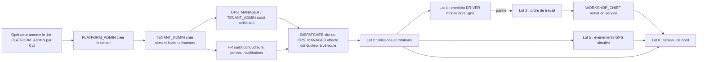

# PRD — MVP MINEFLEET 360

> Statut : **brouillon de cadrage (phase 0), révisé après la revue croisée** (QA-01..32, DB-01..42). Aucun code n'existe encore ; rien dans ce document n'a été testé ni validé auprès d'un client.
> Préséance : `docs/DECISIONS_A_ARBITRER.md` (décisions tranchées D-01..D-24 ; défauts provisoires C-01..C-17 en attente du client/juriste) > `MODELE_PHYSIQUE_LOT1.md` > `MATRICE_RBAC.md` > `REGLES_METIER.md` > `DICTIONNAIRE_DONNEES.md` > `USER_STORIES.md` > ce document. Les valeurs d'énumération sont en anglais `UPPER_SNAKE_CASE` (D-01), libellés français dans l'UI.
> Conventions : codes de rôles, noms d'entités et hypothèses H1–H10 de `docs/00_SOCLE_CADRAGE.md`. Les écarts au socle sont listés explicitement en section 13 (« Propositions d'écart »).
> Distinction appliquée partout : **Fait** (vérifié dans le dépôt), **Hypothèse** (retenue pour avancer, réversible), **À valider** (client, juridique Guinée, fournisseur).

## 1. Problème

**Faits (dépôt)** : `docs/PRODUCT_VISION.md` positionne MINEFLEET 360 comme un ERP métier pour exploitants miniers et transporteurs (parc, personnel, dispatch, maintenance, stocks, carburant, HSE, coûts). Le contexte initial est la Guinée ; le français est la langue par défaut.

**Hypothèses de problème (à confirmer par entretiens terrain, aucun n'a eu lieu)** :
- P1. Les données de parc et de personnel sont éparpillées (tableurs, papier, messageries) : pas de source unique « quel engin, quel conducteur, quel site, quelle habilitation valide ».
- P2. Il est difficile de savoir, à un instant donné ou a posteriori, **qui conduisait quoi** : conséquence sur la responsabilité HSE, le suivi des coûts et la maintenance.
- P3. L'expiration des permis et habilitations est suivie manuellement, avec un risque d'affecter un conducteur non habilité.
- P4. Les opérations se déroulent en connectivité dégradée ; un outil purement en ligne n'est pas utilisable sur le terrain.
- P5. Les fournisseurs de données (GPS, pont-bascule) sont hétérogènes ; le produit ne doit pas en dépendre pour être utile dès le premier jour.

**Énoncé** : fournir à une organisation minière ou de transport, multi-site, un référentiel fiable et traçable du parc et du personnel roulant, avec des règles d'affectation qui empêchent les erreurs évidentes, puis bâtir au-dessus les missions, la maintenance et le pilotage — sans jamais confondre une donnée estimée (GPS) avec une donnée mesurée (pont-bascule, H10).

## 2. Objectifs et non-objectifs

### Objectifs du MVP
- O1. Démontrer une **plateforme multi-tenant, multi-site, sûre** (isolation, RBAC avec portée TENANT/SITE, audit) — c'est la condition de confiance de tout le reste.
- O2. Disposer d'un **référentiel véhicules / conducteurs / habilitations** exploitable et tracé.
- O3. Garantir des **affectations conducteur↔véhicule valides** (pas de chevauchement, même site, conducteur `ACTIVE` et habilité, véhicule `AVAILABLE`, pas d'antidatage — D-13).
- O4. Prouver, sur des lots ultérieurs, la boucle opérationnelle : mission/rotation → panne → ordre de travail → remise en service → tableau de bord.
- O5. Fonctionner en **réseau dégradé** pour les usages terrain (checklist), en PWA.
- O6. Démonstration réalisée **uniquement sur données fictives** (H9).

### Non-objectifs (explicites)
Voir section 5. En particulier : pas de comptabilité, pas de paie, pas de suivi GPS de salariés réels, pas de calcul de tonnage à partir du GPS.

## 3. Personas (codes du socle)

Les attentes ci-dessous sont des **hypothèses de travail** ; elles doivent être validées par entretiens.

| Code | Persona | Besoin principal (hypothèse) | Lot d'apparition |
|------|---------|------------------------------|------------------|
| `PLATFORM_ADMIN` | Administrateur plateforme (éditeur) | Créer/suspendre des tenants ; **aucun accès aux données métier** (D-10) ; accès support hors lot 1 (C-10, D-16) | 1a |
| `TENANT_ADMIN` | Administrateur de tenant | Configurer sites, utilisateurs, rôles, référentiels ; consulter l'audit ; **ne lit pas** les données personnelles des conducteurs (D-10) | 1a |
| `DIRECTION` | Direction générale | Vue d'ensemble parc/personnel, lecture seule (pas de lecture du journal d'audit, D-10) | 1 (lecture), 6 |
| `OPS_MANAGER` | Direction des opérations | Gérer le parc, créer/clôturer des affectations, piloter les sites (pas de dérogation d'éligibilité ni de site au lot 1, D-13) | 1, 2, 6 |
| `DISPATCHER` | Dispatcher / régulateur | Affecter conducteurs et véhicules (portée `SITE` uniquement, D-10), créer et suivre missions | 1c, 2, 6 |
| `HR` | Ressources humaines | Tenir les dossiers conducteurs, permis, habilitations (seul rôle voyant téléphone et n° de permis, D-15) | 1b |
| `DRIVER` | Conducteur / opérateur d'engin | Voir ses affectations/missions, remplir la checklist, signaler une panne ; connectivité intermittente | 2, 4 (**lot 1 : rôle attribuable mais aucune permission métier, aucun écran**, C-12, D-16, D-25) |
| `WORKSHOP_CHIEF` | Chef d'atelier | Créer/valider les ordres de travail, remettre en service | 3 |
| `MECHANIC` | Mécanicien | Exécuter les interventions, saisir temps et constats | 3 |
| `HSE` | Responsable HSE | Contrôler habilitations et checklists (lecture seule au lot 1, écriture des habilitations reportée — D-10) | 1 (lecture), 4 |
| `FINANCE` | Finance / contrôle de gestion | Consulter indicateurs de coûts (aucune lecture des affectations au lot 1, D-25) | 6 (lecture) |
| `STOREKEEPER` | Magasinier | Hors MVP (voir section 5) | Post-MVP |
| `FUEL_MANAGER` | Responsable carburant | Hors MVP | Post-MVP |
| `AUDITOR` | Auditeur (rôle optionnel, **retenu** par D-10) | Lecture seule du journal et des référentiels | 1a |

Remarque : les codes `STOREKEEPER` et `FUEL_MANAGER` existent dans le référentiel de rôles du socle mais **aucune fonctionnalité du MVP ne leur est destinée** ; ils restent sans droits (ou lecture minimale) tant que les modules `inventory` et `fuel` ne sont pas lancés.

## 4. Parcours cibles (vue produit)

Le processus transversal de la vision (panne → suspension/réaffectation → OT → pièces → remise en service → coûts) est **couvert partiellement** : la partie pièces (magasinier) et la consolidation des coûts sont hors MVP.

## 5. Périmètre

### 5.1 Dans le MVP
| Domaine | Contenu | Lot |
|---------|---------|-----|
| Organisation | Tenants, sites (module `organization`) ; amorçage du 1er `PLATFORM_ADMIN` par CLI | 1a |
| Identité & accès | Comptes, invitation, connexion (code d'espace + e-mail + mot de passe, D-06), déconnexion, réinitialisation, rôles avec portée TENANT/SITE, protection du dernier `TENANT_ADMIN` (`identity`) | 1a |
| Audit | Journal append-only partitionné, consultation par `TENANT_ADMIN`/`AUDITOR` (`audit`) | 1a |
| Parc | Véhicules/engins, catégories (copie par tenant, lecture seule), statuts `AVAILABLE`/`IN_MAINTENANCE`/`IMMOBILIZED`/`OUT_OF_SERVICE`/`RETIRED` (`fleet`) | 1b |
| Personnel roulant | Conducteurs (`ACTIVE`/`UNAVAILABLE`/`SUSPENDED`/`INACTIVE`), permis, habilitations engins avec expiration (`workforce`) | 1b |
| Affectation | Affectation conducteur↔véhicule sur `[début, fin)`, règles bloquantes, conformité dérivée à la lecture (`assignment`) | 1c |
| UI minimale | Web responsive, français, navigation par rôle ; E2E et accessibilité clôturés en 1c | 1a à 1c |
| Missions/rotations | Plan de mission, statuts, rotations, saisie manuelle de pesée (source déclarée) (`dispatch`) | 2 |
| Maintenance | Ordres de travail, état véhicule, mécaniciens (`maintenance`) | 3 |
| Checklist | Checklist pré-départ en PWA hors ligne, signalement de panne (`dispatch`/`maintenance`) | 4 |
| GPS | Ingestion d'événements via **adaptateur simulé** (`telematics`) | 5 |
| Pilotage | Dashboard opérationnel direction/exploitation et dispatcher (`reporting`) | 6 |

### 5.2 Hors MVP (explicite)
- Carburant (émission, cuves), stock de pièces, pneus, achats, magasin (`fuel`, `inventory`) — phase 2 de la roadmap.
- HSE complet (incidents, enquêtes, plans d'action) ; seule la lecture des habilitations et la checklist sont couvertes.
- Contrats, sous-traitants, facturation, rentabilité, portail client, reporting institutionnel (phase 3).
- Intégration comptable/ERP, intégration réelle d'un fournisseur GPS, intégration pont-bascule automatique : **à valider** (fournisseurs non identifiés). Seuls un adaptateur simulé (lot 5) et une saisie manuelle de pesée avec source déclarée (lot 2) sont prévus.
- RH au-delà du dossier roulant : paie, congés, planning de quarts, fatigue (le skill `hr-workforce` les mentionne comme domaine, pas comme MVP).
- Maintenance préventive périodique planifiée automatique (phase 2) ; le lot 3 est limité aux OT à la demande.
- Application mobile native ; la cible est une PWA (H8 et CLAUDE.md).
- Analytique avancée / prédictif.
- SSO d'entreprise, intégration annuaire.
- Suivi GPS de personnes ; tout suivi se limite à des **véhicules** et suppose une base légale validée avant production.
- Facturation et abonnement de la plateforme (aucun service payant provisionné).
- Redis, stockage objet : non introduits au lot 1 (H8).
- **Hors lot 1 (D-14, D-16)** : exports (véhicules, conducteurs, affectations, audit) ; accès support plateforme ; liaison compte utilisateur↔conducteur et écran conducteur ; relevés de compteurs ; documents réglementaires de véhicule ; chaînage de hash de l'audit ; `person` générique ; dérogation d'éligibilité et de site ; antidatage au-delà de la tolérance ; job de conformité et suspension automatique des affectations ; idempotence des écritures (`Idempotency-Key`, reportée au lot 4) ; import CSV (C-16) ; gestion des catégories par le tenant ; MFA (C-03, après lot 1).

### 5.3 Garde-fous anti-dérive de périmètre
1. Toute demande hors section 5.1 passe par un arbitrage écrit (impact lot, dépendances, valeur).
2. Un lot n'est « terminé » que selon la Definition of Done de la roadmap (API+UI testées, autorisations tenant/site vérifiées, migration réversible ou stratégie sûre, audit, accessibilité, docs).
3. Pas de nouvelle dépendance ou de nouveau module sans justification (CLAUDE.md).

## 6. Découpage en lots verticaux

Ordre : 1 → 2 → 3 → 4 → 5 → 6. Chaque lot est livrable et démontrable seul sur données fictives ; une revue sécurité et une revue QA ont lieu après chaque lot métier (CLAUDE.md).

### Lot 1 — Fondations métier : tenant, site, utilisateurs/rôles, véhicule, conducteur, affectation, audit, UI minimale
- **Valeur** : référentiel sûr et affectations valides ; socle d'isolation réutilisé par tous les lots.
- **Découpage en trois tranches verticales (D-21)**, chacune livrable et revue (sécurité + QA) avant la suivante :
  - **1a — socle** (US-1.01 à 1.10, 1.26, 1.27, 1.28, 1.31, 1.32) : dépôt, compose, CI locale, tenant et sites, amorçage du premier `PLATFORM_ADMIN` (CLI), comptes, invitation, rôles/portées, protection du dernier `TENANT_ADMIN`, connexion par code d'espace + e-mail, audit, RLS et harnais de tests d'isolation généré depuis `authz_matrix.yaml`.
  - **1b — référentiels** (US-1.11 à 1.21) : catégories (lecture), véhicules et statuts, conducteurs, permis, habilitations, expirations, masquage des données personnelles.
  - **1c — affectations et UI** (US-1.22 à 1.25, 1.29, 1.30) : affectations et clôture, éligibilité, conformité dérivée, UI minimale complète, accessibilité, E2E, jeu de démonstration fictif.
- **Contenu retiré du lot 1** : voir la liste « Hors lot 1 » en 5.2 (idempotence, exports, support, liaison compte/conducteur, compteurs, documents véhicule, job de conformité).
- **Dépendances** : ADR architecture, modèle physique, `MATRICE_RBAC.md` + `authz_matrix.yaml` (créé en 1a), outillage monorepo/CI locale (D-22).
- **Sortie** : démonstration de bout en bout sur 2 tenants fictifs prouvant l'isolation.
- **Détail** : `docs/USER_STORIES.md` (US-1.xx, chaque story indique sa tranche).

### Lot 2 — Missions et rotations
- Missions de transport (planifiée → affectée → en route → chargement → déchargement → terminée / annulée), rotations, rattachement à une affectation valide.
- Tonnage : **mesuré** uniquement via saisie de pesée avec source déclarée (pont-bascule ou source approuvée) ; sinon « non mesuré ». Jamais dérivé du GPS (H10).
- Mesures immuables ; corrections par événement correctif tracé.

### Lot 3 — Ordres de travail et état véhicule
- Cycle de vie : demandé → approuvé → assigné → en cours → contrôle qualité → clôturé ; mécaniciens, constats, durées d'immobilisation, statut véhicule dérivé.
- Impact : un véhicule hors service ne peut plus être affecté ni planifié.
- Pièces et coûts de pièces : hors lot (module `inventory` post-MVP) ; seule une main-d'œuvre/temps déclaré est saisissable.

### Lot 4 — Checklist mobile hors ligne (PWA)
- Checklist pré-départ pour `DRIVER`, saisie hors ligne, synchronisation différée avec gestion des doublons, des écarts d'horloge et des mises à jour tardives, signalement de panne créant une demande d'OT.
- Risque technique le plus élevé du MVP (sync, conflits, stockage local de données personnelles).

### Lot 5 — GPS via adaptateur simulé
- Port d'ingestion d'événements de position (module `telematics`) alimenté par un **simulateur** ; stockage PostGIS ; validation de coordonnées ; tolérance au décalage d'horloge et aux événements tardifs/dupliqués ; géofences simples.
- Aucune donnée réelle de salarié (H9). Intégration fournisseur réelle : à valider, hors MVP.

### Lot 6 — Dashboard opérationnel
- Vues direction/exploitation et dispatcher : disponibilité du parc, affectations, missions du jour, OT ouverts, expirations à venir, dernière position simulée.
- Chaque indicateur affiche sa **source et son statut** (mesuré / estimé / saisi manuellement) ; aucun indicateur sans définition écrite.

## 7. Matrice d'autorisation (principe)
**Source de vérité unique : `docs/MATRICE_RBAC.md`** (puis `authz_matrix.yaml` au lot 1a, D-09) avec les arbitrages D-10. Aucune matrice n'est dupliquée dans le PRD ni dans les stories. Principes non négociables :
- Toute lecture/écriture de ressource tenant est **filtrée par `tenant_id` déduit de la session**, jamais d'un paramètre client (H1, H3).
- Un utilisateur à portée `SITE` ne voit et ne modifie que les ressources de ses sites.
- **Table unique des codes de refus (D-05)** : `401` non authentifié ; `404` ressource inexistante, hors tenant **ou** hors portée de site (non-divulgation, H2) ; `403` permission absente sur un endpoint de collection ou une ressource visible ; `422` format invalide ou règle métier violée (code d'erreur stable) ; `409` conflit d'état (chevauchement, unicité, version obsolète, blocage par ressources ouvertes). Les `403` sont audités ; les `404` inter-tenant sont journalisés comme événements de sécurité.
- Les données personnelles sont minimisées (D-15) : téléphone et numéro de permis visibles par `HR` seul, absents des réponses pour les autres rôles (masquage serveur total).
- `TENANT_ADMIN` configure mais ne lit ni les conducteurs, ni leurs permis/habilitations, ni les affectations ; la première réponse de refus (403) est évaluée avant toute recherche de ressource (D-05a) ; `PLATFORM_ADMIN` n'a aucun accès aux données métier ; `DISPATCHER` n'agit sur les affectations qu'avec une portée `SITE` (D-10).

## 8. Exigences non fonctionnelles

| Domaine | Exigence | Vérification prévue |
|---------|----------|---------------------|
| Sécurité / isolation | Tests IDOR et inter-tenant sur chaque endpoint tenant ; RLS en défense en profondeur ; clés étrangères composites (H1, H3) | Suite de tests d'isolation en CI |
| Traçabilité | Chaque écriture métier génère un `audit_event` append-only ; logs structurés ; identifiant de corrélation | Tests + revue |
| Temps | Stockage UTC `timestamptz`, affichage `Africa/Conakry` par défaut, configurable par site (H4) ; les dates d'affectation sont des instants, pas des jours calendaires ; horloge injectable dans le code dès le lot 1 (D-12) ; fixtures multi-fuseaux obligatoires, Conakry étant UTC+0 (D-23) | Tests de bornes et de fuseau avec au moins un site à décalage non nul |
| Monnaie | GNF, entier, format local (H5) — aucun montant au lot 1 | Tests de formatage dès qu'un montant apparaît |
| Langue | UI et messages d'erreur en français ; identifiants techniques en anglais ; textes externalisés pour permettre une autre langue plus tard (à valider) | Revue UX |
| Réseau dégradé | Lots 1–3 et 6 : tolérance (timeouts, reprise, messages clairs, pas de perte silencieuse de saisie). Au lot 1, les doublons de soumission sont empêchés par les contraintes d'unicité et d'exclusion (pas d'idempotence applicative, D-14). Lot 4 : fonctionnement hors ligne réel (PWA), file d'envoi, `Idempotency-Key` | Tests Playwright réseau coupé/lent ; tests de synchronisation |
| Accessibilité | Cible WCAG 2.1 AA (hypothèse), contrastes forts pour usage en extérieur, cibles tactiles larges, navigation clavier | Revue accessibilité avant livraison de chaque lot |
| Confidentialité salariés | Minimisation (D-15) : **pas** de date de naissance, d'aptitude médicale, de motif maladie, d'adresse, de pièce d'identité ni de photo au lot 1 ; téléphone et numéro de permis lisibles par `HR` seul, **masquage total** côté serveur pour tous les autres rôles (y compris `TENANT_ADMIN`) ; journalisation des lectures sensibles : Q19 ouverte ; rétention à fixer (C-09) ; conformité Guinée à valider par conseil juridique local (C-08) | Revue sécurité/privacy ; valeurs sentinelles dans réponses, logs et audit |
| Données de démo | Exclusivement fictives, générées, signalées comme telles (H9) | Contrôle du jeu de données |
| API | Contrat OpenAPI versionné ; erreurs normalisées `{code, message_fr, details, request_id}` ; concurrence optimiste par `row_version` / `If-Match` (409 `VERSION_CONFLICT`, D-19) ; pagination et tri stables | Vérification de contrat en CI locale (CI distante dépendant de C-17) |
| Migrations | Alembic, réversibles ou stratégie sûre ; aucune opération destructive sans approbation | Vérification de migration en CI |
| Capacité | À définir après mesure (nombre de véhicules/utilisateurs par tenant inconnu) — pas de chiffre inventé | Question ouverte Q9 |

## 9. Indicateurs de succès (cibles à mesurer, aucun chiffre inventé)

Aucune valeur cible chiffrée n'est fixée ici : elles seront définies après une mesure de référence (baseline) auprès d'un client pilote. Chaque indicateur indique **ce qu'on mesure, comment, et quand la cible sera fixée**.

### 9.1 Qualité de livraison (mesurables dès le lot 1, sans client)
| Indicateur | Cible | Mesure |
|-----------|-------|--------|
| Couverture d'isolation | Chaque endpoint tenant-owned a au moins un test inter-tenant et un test hors portée de site | Rapport de couverture des endpoints vs tests (cible : 100 % — exigence de conception, pas un résultat) |
| Événements d'audit | Chaque écriture métier produit un `audit_event` | Test automatisé par route d'écriture |
| Règles d'affectation | Chaque règle refusée a un test avec son code unique (`VEHICLE_ASSIGNMENT_OVERLAP`, `DRIVER_ASSIGNMENT_OVERLAP`, `DRIVER_NOT_ACTIVE`, `DRIVER_NOT_QUALIFIED`, `VEHICLE_NOT_AVAILABLE`, `ASSIGNMENT_SITE_MISMATCH`, `ASSIGNMENT_BACKDATED`) et les bornes `[début, fin)` | Matrice règle → test (`USER_STORIES.md` US-1.22, ordre d'évaluation en §0.4) |
| Migrations | Montée et descente vérifiées en CI | Pipeline |

### 9.2 Adoption et valeur (à fixer avec un pilote)
| Indicateur | Définition | Baseline à mesurer | Cible |
|-----------|-----------|--------------------|-------|
| Complétude du référentiel | Part des véhicules et conducteurs du pilote saisis dans l'outil | Inventaire client | À fixer |
| Fraîcheur des habilitations | Part des conducteurs actifs ayant un permis et les habilitations requises valides et renseignées | État initial du pilote | À fixer |
| Affectations non conformes | Nombre d'affectations `ACTIVE` dont la conformité dérivée (calculée à la lecture, D-12) est `NON_COMPLIANT` (permis/habilitation expiré, etc.) | Constat initial (papier/tableur) | À fixer |
| Temps pour créer une affectation | Durée de saisie par un `DISPATCHER` | Mesure en atelier utilisateur | À fixer |
| Utilisation terrain (lot 4) | Part des checklists transmises hors ligne puis synchronisées sans perte | Test terrain | À fixer |
| Perte de données de synchronisation | Nombre d'écarts constatés entre saisie locale et serveur | Test terrain | Cible visée : zéro, à confirmer |
| Satisfaction des personas | Entretiens et questionnaire de démonstration | Néant | À fixer |

## 10. Risques produit

| ID | Risque | Niveau | Mitigation |
|----|--------|--------|-----------|
| R1 | Fuite inter-tenant (IDOR, requête non filtrée) | Élevé | Filtrage serveur obligatoire, FK composites, RLS, tests inter-tenant bloquants en CI, revue sécurité par lot |
| R2 | Collecte de données de salariés (permis, GPS) sans base légale locale | Élevé | Minimisation, masquage, validation juridique Guinée avant production, démo fictive uniquement |
| R3 | Confusion GPS/tonnage | Élevé | H10 ; libellés « estimé » / « mesuré » ; source obligatoire sur toute mesure |
| R4 | Règle d'habilitation mal modélisée (mapping catégorie véhicule ↔ permis/habilitation) | Élevé | Question ouverte Q3 ; validation avec un expert métier avant implémentation |
| R5 | Sync hors ligne complexe (conflits, horloge) sous-estimée | Élevé | Lot 4 isolé, stratégie d'idempotence et de réconciliation définie avant dev |
| R6 | Dérive de périmètre (carburant, stock, finance) | Moyen | Section 5.2 et garde-fous 5.3 |
| R7 | Adoption faible : saisie perçue comme une contrainte, faible alphabétisation numérique, smartphones partagés | Moyen | Ateliers utilisateurs, UI simple, mode dégradé, formation (à valider) |
| R8 | Dépendance à un fournisseur GPS/pont-bascule non identifié | Moyen | Adaptateur (port) + simulateur ; fournisseur à valider hors MVP |
| R9 | Qualité des données initiales (doublons de plaques, numéros de parc) | Moyen | Unicité par tenant, normalisation, import contrôlé (hors lot 1, C-16) |
| R10 | Comptes partagés/mots de passe faibles sur le terrain | Moyen | Politique de mots de passe et limitation de tentatives (paramètres nommés, valeurs par `security-engineer`) ; MFA TOTP pour `PLATFORM_ADMIN`, `TENANT_ADMIN`, `HR`, `FINANCE` livrée après le lot 1 (C-03) |
| R11 | Verrouillage d'un tenant (dernier `TENANT_ADMIN` désactivé) ou auto-escalade | Moyen | US-1.31 : auto-modification de rôle refusée (422 `SELF_ROLE_CHANGE_FORBIDDEN`), retrait du dernier `TENANT_ADMIN` refusé (409 `LAST_TENANT_ADMIN`) ; procédure de reprise d'exploitation à spécifier avant pilote |
| R13 | Amorçage de la plateforme sans compte (premier `PLATFORM_ADMIN`) et seed de démonstration | Moyen | US-1.32 (CLI, secret par variable d'environnement, rôle `mf_app`) ; US-1.30 (seed CLI, refus si `ENV=production`) |
| R12 | Absence de client pilote identifié : aucune validation de valeur | Moyen | Entretiens avant lot 2 ; les hypothèses restent des hypothèses |

## 11. Hypothèses vs points à valider

### Hypothèses retenues (réversibles)
| ID | Hypothèse | Impact si fausse |
|----|-----------|------------------|
| A1 | H1–H10 du socle s'appliquent | Voir socle |
| A2 | Une affectation relie un conducteur à un véhicule sur un intervalle `[début, fin)` ; fin facultative (ouverte) ; statuts `PLANNED`, `ACTIVE`, `SUSPENDED`, `COMPLETED`, `CANCELLED` (D-04) | Modèle `vehicle_assignment` à revoir |
| A3 | Un véhicule a au plus un conducteur affecté à un instant donné ; un conducteur au plus un véhicule (exclusion en base, hors `CANCELLED`) | Si co-conduite/équipes de quart : ajouter un rôle d'équipage (C-11) |
| A4 | Conducteur, véhicule et affectation sont sur le **même site**, **sans dérogation** au lot 1 (D-13 ; C-04 en attente du client) | Règle d'éligibilité à assouplir |
| A5 | Un conducteur peut exister sans compte utilisateur (H6) ; aucune liaison compte↔conducteur au lot 1 (D-16) | Aucun |
| A6 | Pas de suppression physique de véhicule/conducteur/affectation : archivage/désactivation par statut (D-19) | Politique de conservation à définir (C-09) |
| A7 | Les catégories de véhicule et de permis sont un catalogue de référence **copié par tenant** à sa création, avec table de jonction catégorie↔permis requis (D-18) | Mapping réglementaire : C-07 |
| A8 | Réponse 404 pour toute ressource hors tenant ou hors portée (D-05) | Révision de la table des codes |
| A9 | PWA suffisante pour le terrain (pas d'app native) | Revoir le lot 4 |
| A10 | Les `DRIVER` n'ont pas de compte obligatoire ; lot 1 sans écran conducteur ni accès (D-16, C-12) | Lot 4 |
| A11 | La conformité d'une affectation active est **dérivée à la lecture** (« non conforme » + motif), sans job ; la suspension automatique arrive avec le planificateur (D-12) | Lot 2+ |
| A12 | Passer un véhicule ou un conducteur à un statut non opérationnel est refusé (409) tant qu'une affectation `PLANNED`/`ACTIVE` existe (D-11) | — |
| A13 | Pas d'antidatage : `valid_from ≥ maintenant − tolérance configurable` (D-13) | Q10 résolue |

### Points à valider (hors équipe produit)
- V1. Exigences légales Guinée : protection des données personnelles, durées de conservation, surveillance des salariés, consentement/base légale pour le GPS véhicule — **conseil juridique local**.
- V2. Réglementation locale des permis et habilitations d'engins miniers (catégories, durées, organismes délivrant) — **expert métier / client**.
- V3. Fournisseurs GPS et ponts-bascule utilisés par les clients cibles — **client**.
- V4. Hébergement (région, souveraineté des données), sauvegardes et RPO/RTO — **décision d'architecture/client**.
- V5. Processus réel de dispatch et vocabulaire local (rotation, poste, chantier) — **ateliers terrain**.
- V6. Modèle commercial (tenant par société, sous-traitants comme tenants distincts ou comme entités) — **direction produit**.

## 12. Dépendances de livraison
- Phase 0 : ADR-001..005, modèle conceptuel et physique, matrice RBAC, règles métier et `DECISIONS_A_ARBITRER.md` existent désormais dans `docs/` ; restent à créer : `authz_matrix.yaml` (lot 1a), catalogue d'erreurs, ADR « Planification et horloge » (statut `PLANNED` → `ACTIVE` sans job), `PLAN_LOT1.md` (cité par D-21, absent à la date de cette révision).
- Outillage (D-22) : Python 3.12 en conteneur (Python 3.10.11 local non utilisé), base de test = service PostgreSQL/PostGIS Docker, npm, scripts PowerShell/npm au lieu de `make`, `.gitattributes` `eol=lf` ; dépendances de test limitées à celles listées par D-22.
- Branche (D-24) : `master` renommée `main` au premier commit ; la CI GitHub Actions est écrite mais non exécutée tant qu'aucun dépôt distant n'est choisi (C-17).

## 13. Écarts au socle (état après les décisions D-xx)
| # | Écart | Statut |
|---|-------|--------|
| E1 | **Statut de véhicule** stocké : `AVAILABLE`, `IN_MAINTENANCE`, `IMMOBILIZED`, `OUT_OF_SERVICE`, `RETIRED` (terminal) ; « en exploitation » dérivé de l'affectation active ; historique dans `vehicle_status_history` (trigger). | **Tranché** (D-02) — remplace l'ancienne proposition `ACTIVE`/… |
| E2 | `vehicle_category` ↔ permis requis par **table de jonction** (`vehicle_category_license_category`), catalogue copié par tenant. | **Tranché** (D-18) ; valeurs « à valider localement » (C-07) |
| E3 | `site.timezone` (fuseau d'affichage, défaut `Africa/Conakry`). | Appliqué (H4) |
| E4 | Entité `invitation` **remplacée** par `account_token` (invitation, réinitialisation) dans le modèle physique. | Appliqué (`MODELE_PHYSIQUE_LOT1.md`) |
| E5 | `driver.site_id` et `vehicle.site_id` ; règle « même site » sans dérogation. | **Tranché** (D-13) ; C-04 en attente |
| E6 | `auth_session` (jetons de rafraîchissement, révocation). `idempotency_record` **retirée du lot 1** (reportée au lot 4, D-14). | Appliqué / reporté |
| E7 | `AUDITOR` retenu (rôle optionnel, lecture seule). | **Tranché** (D-10) |
| E8 | Tenant plateforme réservé (`kind = 'PLATFORM'`), `tenant_id NOT NULL` partout, `PLATFORM_ADMIN` dans ce tenant uniquement. | **Tranché** (D-07) |
| E9 | Statut conducteur : `ACTIVE`, `UNAVAILABLE`, `SUSPENDED`, `INACTIVE` ; validité permis/habilitation dérivée des dates. | **Tranché** (D-03) |

## 14. Questions ouvertes

Statut : **Résolue** = décision technique tranchée (D-xx) ; **Résolue (défaut provisoire)** = valeur provisoire du registre C-xx, à confirmer par le client ou le juriste ; **Ouverte** = non tranchée. Les questions Q16–Q26 sont dans `docs/USER_STORIES.md` §4.

| ID | Question | À arbitrer par | Statut / renvoi |
|----|----------|----------------|-----------------|
| Q1 | Règle « même site » : stricte, ou dérogation `OPS_MANAGER` ? | Produit + client | **Résolue (défaut provisoire)** : stricte, sans dérogation (D-13, C-04) |
| Q2 | Catégories de véhicule : global, par tenant, mixte ? | Architecte + produit | **Résolue** : catalogue copié par tenant à la création (D-18) |
| Q3 | Mapping catégorie → permis/habilitation requis : qui, quelle granularité, quelles sources ? | Expert métier / client / juridique | **Ouverte** (C-07) : valeurs fictives « à valider localement » |
| Q4 | Le `DRIVER` a-t-il un écran/compte dès le lot 1 ? | Produit | **Résolue (défaut provisoire)** : non (C-12, D-16) |
| Q5 | Accès support du `PLATFORM_ADMIN` aux données d'un tenant | Sécurité + produit | **Résolue (défaut provisoire)** : aucun accès support au lot 1 (C-10, D-16) |
| Q6 | MFA, politique de mots de passe, durée de session | Sécurité | **Partiellement résolue** : MFA TOTP après lot 1 (C-03) ; paramètres nommés, valeurs **ouvertes** (`security-engineer`) |
| Q7 | Adoption d'`AUDITOR`, lecteurs du journal | Produit + client | **Résolue** : `AUDITOR` retenu ; journal lisible par `TENANT_ADMIN` et `AUDITOR` (D-10) |
| Q8 | Import initial CSV | Produit | **Résolue (défaut provisoire)** : hors lot 1 (C-16) |
| Q9 | Volumétrie cible par tenant | Client / architecte | **Ouverte** (C-15) : hypothèse de dev 3 tenants fictifs × 3 sites × 200 véhicules |
| Q10 | Rétroactivité des affectations | Produit + client | **Résolue** : pas d'antidatage, tolérance configurable (D-13) |
| Q11 | Conservation et droits d'accès/effacement des salariés en Guinée | Juridique local | **Ouverte** (C-08, C-09) |
| Q12 | Unicité de l'immatriculation / du numéro de parc, engins sans plaque | Produit + client | **Résolue (défaut provisoire)** : numéro de parc unique à vie par tenant, immatriculation facultative (C-13) |
| Q13 | Langue : français seul ou préparation d'autres langues | Produit | **Ouverte** : français seul, textes externalisés (hypothèse) |
| Q14 | Client pilote et site de démonstration | Direction produit | **Ouverte** (C-15) |
| Q15 | Séparation `DISPATCHER` / `OPS_MANAGER` | Produit + client | **Résolue** : tous deux créent/clôturent les affectations, `DISPATCHER` en portée `SITE` uniquement, aucune approbation/dérogation au lot 1 (D-10, D-13) |

Questions techniques liées, ouvertes : hébergement (C-01) ; SSO/OIDC (C-02) ; rythmes de poste (C-11) ; documents véhicule bloquants (C-06) ; fournisseurs GPS et pont-bascule (C-14) ; hébergement du dépôt Git (C-17).
