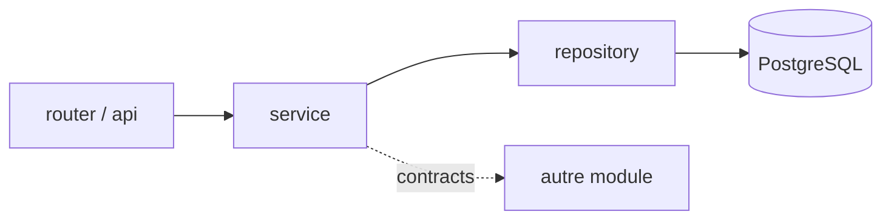
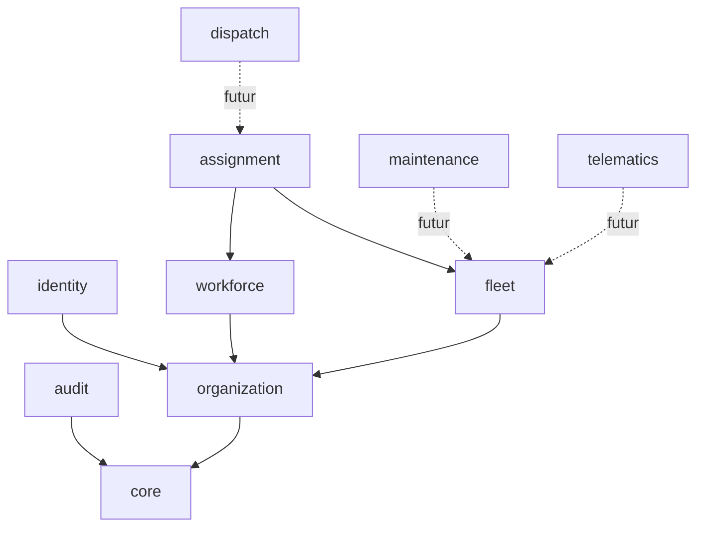

# ADR-001 — Monolithe modulaire et structure du monorepo

- **Statut** : Proposé
- **Date** : 2026-10-25
- **Références** : `CLAUDE.md`, `docs/00_SOCLE_CADRAGE.md` (H8, §4), `docs/ROADMAP.md`

## 1. Contexte
Aucun code n'existe encore. L'équipe est réduite, le périmètre fonctionnel est large (14 modules cibles) et la plateforme doit garantir l'isolation des données entre tenants. CLAUDE.md impose « monolithe modulaire d'abord » et « pas de module ni de dépendance spéculatifs ». Il faut donc une structure qui reste simple à exploiter (un seul déploiement, une seule base) tout en gardant des frontières strictes pour pouvoir extraire un module plus tard si un besoin réel apparaît (ex. ingestion GPS à fort volume).

**Faits vérifiés** : dépôt vide ; Python 3.10 / Node 20 / Docker sur le poste. **Hypothèses** : H8 (pas de Redis ni stockage objet au lot 1).

## 2. Options

| Option | Avantages | Inconvénients | Verdict |
|---|---|---|---|
| A. Monolithe modulaire (un processus, modules à frontières imposées) | Un déploiement, transactions locales (audit atomique), refactor peu coûteux, cohérent avec l'équipe | Discipline requise sur les frontières ; scalabilité par module impossible au départ | **Retenue** |
| B. Monolithe « classique » en couches techniques (routers/, models/, services/) | Démarrage très rapide | Couplage transversal, modèle unique partagé, difficile à découper, fuites d'isolation tenant | Rejetée |
| C. Microservices dès le départ | Scalabilité indépendante | Coût opérationnel, transactions distribuées, sécurité multi-tenant multipliée, équipe trop petite | Rejetée (prématuré) |

## 3. Décision

### 3.1 Structure du monorepo
```
minefleet360/
  backend/
    pyproject.toml
    alembic/                 # migrations uniques (une seule base)
    app/
      main.py                # assemblage FastAPI, montage des routers
      core/                  # config, logging JSON, erreurs, sécurité, contexte tenant, DB (session, base)
      shared/                # types partagés minimaux (pagination, Money GNF, UTC, identifiants)
      modules/
        identity/  organization/  fleet/  workforce/  assignment/  audit/
        (plus tard) dispatch/ maintenance/ inventory/ fuel/ telematics/ hse/ contracts/ finance/ reporting/
    tests/                   # unit/, integration/, tenant_isolation/, architecture/
  frontend/                  # React + TS + Vite (PWA ultérieurement)
  infra/                     # docker-compose, Dockerfiles, scripts de bootstrap DB (rôles, extensions)
  docs/                      # ADR, ARCHITECTURE, ERD, RBAC, etc.
```

### 3.2 Structure interne d'un module
```
modules/<nom>/
  api/            # router FastAPI + schémas Pydantic d'entrée/sortie (DTO)
  service.py      # logique métier, autorisations, transactions, émission d'audit
  repository.py   # accès SQLAlchemy, SEUL endroit où les requêtes sont écrites
  models.py       # modèles SQLAlchemy du module
  contracts.py    # interface publique du module (fonctions + DTO) consommable par les autres modules
  events.py       # événements de domaine émis (noms + payloads), si applicable
```

### 3.3 Couches

- **router** : validation Pydantic, dépendance d'authentification et de contexte tenant, appel d'un service. Aucune requête SQL, aucune logique métier.
- **service** : règles métier, vérification d'autorisation (rôle + portée tenant/site), orchestration, écriture de l'audit dans la même transaction (ADR-005).
- **repository** : requêtes SQLAlchemy. Toute requête sur une table métier **filtre explicitement `tenant_id`** (la RLS n'est qu'une seconde barrière, ADR-002).

### 3.4 Règles de dépendance entre modules
1. Un module n'importe **jamais** les `models`, `repository` ou `service` d'un autre module ; uniquement son `contracts.py`.
2. Pas de clé étrangère SQLAlchemy `relationship()` entre modules ; les FK de base (composites `(tenant_id, id)`, H3) restent autorisées pour l'intégrité, sans import de modèle (références par nom de table/colonne).
3. Graphe orienté acyclique, autorisé uniquement vers le bas :


`audit` est appelé par tous les services via une interface d'`core` (port `AuditRecorder`) ; il ne dépend d'aucun module métier (inversion de dépendance).
4. Les effets de bord inter-modules asynchrones passent par des événements de domaine internes (synchrones dans la transaction au lot 1 ; outbox plus tard, ADR-005).

### 3.5 Empêcher les imports croisés (contrôle automatisé)
- **import-linter** (contrats `layers` et `forbidden` dans `pyproject.toml`) exécuté en CI et en pré-commit : interdit `modules.A.*` → `modules.B.(models|repository|service)` et impose l'ordre router → service → repository.
- Un test `tests/architecture/` complémentaire (analyse AST) vérifie que seuls `repository.py` importent `sqlalchemy.orm.Session` et que les routers n'importent pas `repository`.
- Revue de PR : checklist « frontières respectées » (skill `delivery-review`).
- Frontend : structure `src/features/<module>/` avec règle ESLint `no-restricted-imports` équivalente.

## 4. Conséquences
- (+) Transaction unique mutation + audit ; un seul pipeline de migration (Alembic) ; coût d'exploitation minimal.
- (+) Les contrats de module deviennent les futures API d'extraction.
- (−) Discipline et outillage (import-linter) à maintenir ; ajout d'une dépendance de dev (justifiée, non applicative).
- (−) Un module défaillant (ex. ingestion GPS lourde) peut impacter le processus entier : à surveiller ; extraction du `telematics` en worker séparé envisageable (même code, autre point d'entrée) sans microservice.

## 5. Points à valider
- Acceptation d'import-linter comme dépendance de dev.
- Moment d'introduction du worker séparé (seuil de volume GPS à mesurer avec un fournisseur réel ; aucune valeur supposée ici).
- Nom définitif du dossier de modules (`modules/`) et gestion des événements internes (bus en mémoire vs outbox).
- Non vérifié : aucun outillage n'a été installé ni exécuté à ce stade.
