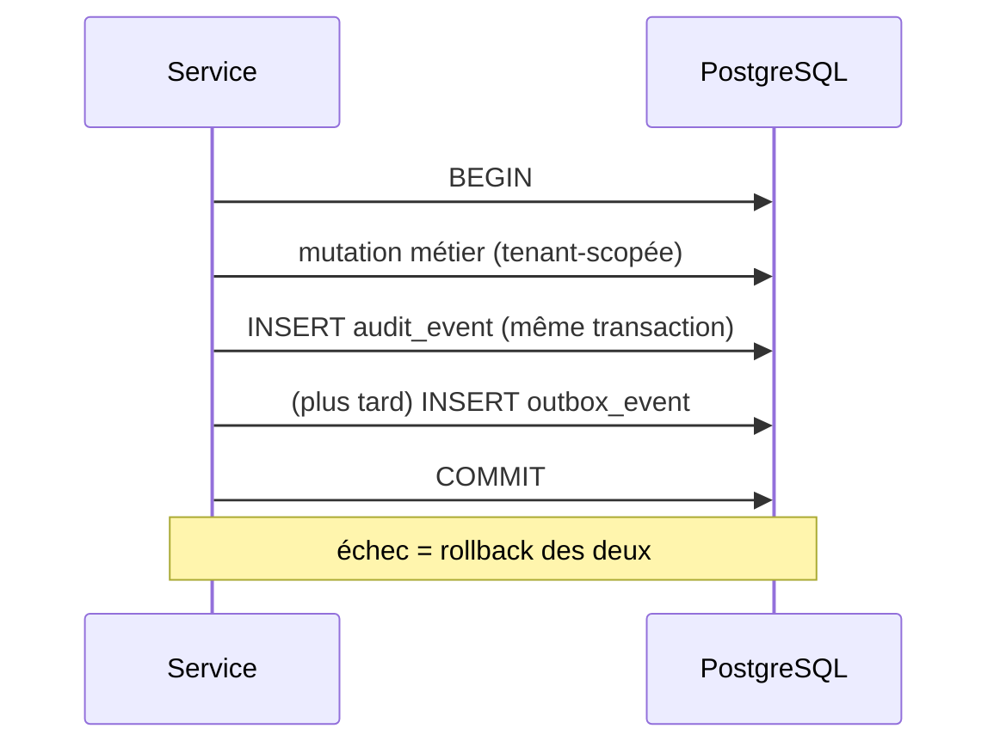

# ADR-005 — Journal d'audit et événements

- **Statut** : Proposé (mis à jour après la revue croisée ; aligné sur `docs/DECISIONS_A_ARBITRER.md` D-14, D-16, D-17, qui prime)
- **Date** : 2026-10-25
- **Références** : `docs/00_SOCLE_CADRAGE.md` (entité `audit_event`, H3, H4), ADR-002, ADR-003

## 1. Contexte
Traçabilité exigée (CLAUDE.md) : qui a fait quoi, quand, dans quel tenant/site, avec valeurs avant/après. Le journal doit résister à l'altération, y compris par un compte applicatif compromis, sans introduire de dépendance lourde au lot 1.

## 2. Options

| Option | Avantages | Inconvénients | Verdict |
|---|---|---|---|
| A. Table `audit_event` append-only, écrite dans la même transaction que la mutation | Atomicité (pas de mutation sans trace, ni l'inverse), simple | Charge sur la base principale | **Retenue (lot 1)** |
| B. Audit asynchrone via file/bus | Découplage | Perte possible, complexité, dépendance | Rejetée au lot 1 |
| C. Triggers SQL générant l'audit | Couvre aussi le SQL hors application | Pas de contexte applicatif (acteur, request_id) sauf via variables de session ; logique cachée | Option complémentaire possible |
| D. Event sourcing complet | Historique total | Disproportionné | Rejetée |

## 3. Décision
Table `audit_event` **append-only** (schéma §3.1), alimentée par le service via le port `AuditRecorder` **dans la même transaction** que la mutation métier. Les échecs d'autorisation et les événements d'authentification sont aussi tracés (transaction propre).

### 3.1 Schéma (unique, aligné sur le modèle physique — D-17)
Un seul schéma, identique à `docs/MODELE_PHYSIQUE_LOT1.md` §5.4 et à `docs/DICTIONNAIRE_DONNEES.md` §16 (les anciennes variantes `id`, `actor_type`, `before`/`after`, `agent` sont abandonnées).

| Colonne | Type | Remarque |
|---|---|---|
| `audit_event_id` | uuid | v4, `DEFAULT gen_random_uuid()` (D-20) ; PK composite `(audit_event_id, occurred_at)` car la clé d'une table partitionnée inclut la colonne de partition |
| `audit_seq` | bigint | séquence ; ordre d'insertion, base du scellement ultérieur |
| `tenant_id` | uuid **NOT NULL** | les événements de plateforme appartiennent au tenant plateforme réservé (D-07) |
| `site_id` | uuid null | Portée site de l'objet |
| `occurred_at` | timestamptz | UTC, horloge serveur (`clock_timestamp()`) ; clé de partition |
| `actor_user_id` | uuid null | FK simple vers `user_account` ; null pour système ou anonyme |
| `actor_kind` | text + CHECK | `USER`, `SYSTEM`, `PLATFORM_SUPPORT`, `DEVICE_SYNC`, `ANONYMOUS` |
| `support_session_id` | uuid null | requis ssi `PLATFORM_SUPPORT` (hors lot 1) |
| `action` | text | `<entité>.<verbe>` en snake_case avec point : `vehicle.create`, `driver_license.update`, `auth.login_failed` ; liste fermée côté application |
| `entity_type` / `entity_id` | text / uuid | Objet concerné |
| `outcome` | text + CHECK | `SUCCESS`, `DENIED`, `FAILURE` |
| `reason` | text null | Motif saisi |
| `changed_fields` | text[] | **Noms** des champs modifiés, sensibles inclus, jamais leurs valeurs |
| `before_data` / `after_data` | jsonb | Champs modifiés uniquement ; **aucun champ sensible, secret, n° de permis, téléphone ni GPS brut** |
| `request_id` | uuid | Corrélation avec les logs |
| `ip_address` / `user_agent` | inet / text null | Origine ; donnée personnelle, rétention C-09 |
| `prev_hash` / `row_hash` | bytea null | **Non renseignées au lot 1** (3.2 point 4) |

Il n'y a **pas** de `client_event_id` dans `audit_event` : l'idempotence relève de `idempotency_record`, reportée au lot 4 (D-14).

**Partitionnement (D-17, DB-08)** : table partitionnée **par mois** sur `occurred_at` dès sa création (convertir une table existante n'est pas une opération en place) ; partition `DEFAULT` maintenue vide (alerte si non vide) ; partitions futures créées par une fonction d'exploitation unique qui active et force la RLS et révoque tout droit à `PUBLIC` et `mf_app` (DB-25). Index : `(tenant_id, occurred_at desc)`, `(tenant_id, entity_type, entity_id, occurred_at desc)`, `(tenant_id, actor_user_id, occurred_at desc)`, `(tenant_id, site_id, occurred_at desc)`.

### 3.2 Protection contre l'altération (couches)
1. **Droits DB** : `mf_app` a seulement `INSERT` et `SELECT` sur `audit_event` (`REVOKE UPDATE, DELETE, TRUNCATE`) et aucun droit sur les partitions. Le propriétaire `mf_owner` n'est pas utilisé par l'app.
2. **Trigger de garde** `BEFORE UPDATE OR DELETE` (et `TRUNCATE`) levant une exception (`MF001`), même si un droit est accordé par erreur.
3. **RLS** forcée : lecture limitée au tenant courant ; l'insertion exige `tenant_id = app.current_tenant_id()` ; aucune politique `UPDATE`/`DELETE`.
4. **Chaînage de hash : reporté** (D-16, D-17). Pas de chaînage en ligne au lot 1 : une chaîne par tenant calculée dans la transaction métier exige un verrou consultatif tenu jusqu'au `COMMIT`, qui sérialise toutes les écritures d'un tenant derrière l'audit. Les colonnes `prev_hash`/`row_hash` restent NULL. L'intégrité cryptographique viendra d'un **scellement asynchrone** (table `audit_seal`, tâche hors chemin d'écriture hachant par lots ordonnés par `audit_seq`, ancrage externe périodique) après le lot 1. `audit.integrity.verify` et ST-72 sont requalifiés « après lot 1 ».
5. **Sauvegardes** immuables hors production (à définir à l'hébergement, C-01).

### 3.3 Règles de contenu
- Jamais de secret, mot de passe, jeton, ni donnée GPS brute dans `before/after`.
- Données personnelles minimisées : référence à l'identifiant plutôt que copie du dossier ; masquage de champs sensibles (n° de permis partiel).
- L'audit est lisible par `TENANT_ADMIN` et `AUDITOR` (rôle retenu, optionnel, lecture seule : D-10) ; l'accès à l'audit est lui-même audité.
- Journalisation des refus (D-05) : les `403` sont des `audit_event` (`outcome=DENIED`) ; les `404` sur identifiant d'un autre tenant sont des événements de sécurité en log structuré, pas des lignes d'audit du tenant. Une connexion sur un code d'espace inconnu n'a pas de tenant : log structuré seulement.
- Rétention : durée à définir avec conseil juridique local ; purge uniquement par procédure approuvée (jamais `DELETE` applicatif) : partition mensuelle détachée par `mf_owner`, puis archivée ou supprimée. Aucune purge en développement (C-09).

### 3.4 Événements de domaine et outbox
- Lot 1 : événements de domaine **internes** émis par les services, traités de façon synchrone dans la transaction (pas de bus).
- Plus tard, si intégrations externes ou notifications : **table outbox** (`outbox_event`) écrite dans la même transaction, publiée par un worker avec livraison au moins une fois ; consommateurs **idempotents** (clé = `event_id`). Aucun broker avant besoin démontré (H8).

## 4. Conséquences
- (+) Pas de mutation sans trace ; corrélation avec les logs par `request_id`.
- (−) Croissance de table à surveiller (partitions mensuelles) ; le scellement asynchrone sera à concevoir et mesurer.
- (−) Un superutilisateur de base peut toujours altérer : limite assumée, atténuée par ancrage externe et séparation des rôles.
- Les lectures sensibles (consultation d'un dossier conducteur, trajectoires GPS) peuvent aussi être auditées : périmètre à arbitrer pour éviter le bruit.

## 5. Points à valider
- Durée de rétention de l'audit et des adresses IP (conseil juridique local).
- Conception du scellement asynchrone et de l'ancrage externe (après le lot 1).
- Périmètre d'audit des lectures sensibles.
- Rôle `AUDITOR` : retenu (D-10), optionnel.
- Rien n'a été implémenté ni testé.
